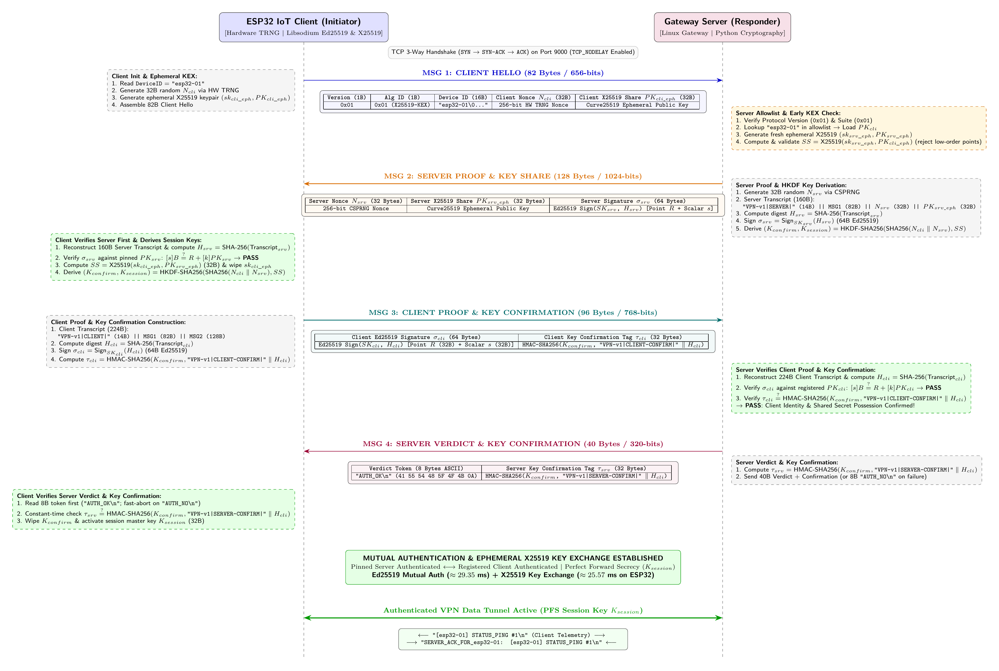

# Classical IoT VPN (ESP32 to Gateway)

A lightweight mutual authentication and secure key exchange tunnel between an ESP32 microcontroller and a Python gateway server using **Ed25519 digital signatures**, **Ephemeral X25519 Diffie-Hellman key exchange (Curve25519)**, **HKDF-SHA256 key derivation**, and **bidirectional HMAC-SHA256 key confirmation**.

---

## Directory Overview

* **`esp32_client/`**: ESP32 C++ firmware for Arduino IDE (`esp32_client.ino`, `AuthManager`, `DeviceIdentity`, `config.h`).
* **`laptop_server/`**: Python gateway server (`server.py`, `tunnel_session.py`, `crypto_engine.py`, `authorized_devices.json`).
* **`sequence_diagram.png`**: Protocol flow diagram showing the mutual authentication and key exchange protocol.
* **`benchmarking/`**: Standalone microcontroller benchmarks and analysis reports for classical cryptography (Digital Signatures and Key Exchange).

---

## Protocol Handshake Flow (Mutual Authentication + Ephemeral X25519 KEX)



1. **TCP Connection**: The ESP32 connects to the gateway over Wi-Fi on TCP port 9000.
2. **Message 1 (Client Hello, 82 B)**:
   * The ESP32 transmits `[1B Version] [1B AlgID] [16B DeviceID] [32B ClientNonce] [32B ClientKeyShare]`.
   * Generates a fresh ephemeral X25519 keypair `(sk_cli_eph, PK_cli_eph)` providing **Perfect Forward Secrecy (PFS)**.
   * Version (`0x01`) and AlgID (`0x01`) enforce protocol standards and downgrade protection.
   * The gateway validates `DeviceID` against `authorized_devices.json` and drops unauthorized devices.
3. **Message 2 (Server Proof, 128 B — Server Authenticates First)**:
   * The gateway generates a 32-byte random challenge nonce (`ServerNonce`) and a fresh ephemeral X25519 keypair `(sk_srv_eph, PK_srv_eph)`.
   * The gateway constructs the Server Transcript binding both nonces and key shares:  
     `SHA-256("VPN-v1|SERVER|" (14 B) || MSG1 (82 B) || ServerNonce (32 B) || PK_srv_eph (32 B))` -> 160 B input
   * The gateway signs this digest with its Ed25519 private key and returns `[32B ServerNonce] [32B PK_srv_eph] [64B ServerSignature]`.
   * The ESP32 verifies the signature against its pinned public key (`TRUSTED_GATEWAY_PUBLIC_KEY`). If verification fails, the ESP32 stops immediately.
   * Both sides compute the X25519 shared secret:  
     `SS = X25519(sk_eph, PK_peer_eph)` (32 bytes).
   * Both sides derive `K_confirm` and `K_session` via HKDF-SHA256 (RFC 5869).
4. **Message 3 (Client Proof, 96 B — Client Binds Full Handshake History & Proves Shared Secret)**:
   * The ESP32 constructs the Client Transcript binding the complete wire exchange (MSG 1 + MSG 2):  
     `SHA-256("VPN-v1|CLIENT|" (14 B) || MSG1 (82 B) || MSG2 (128 B))` -> 224 B input
   * The ESP32 signs this digest with its device private key (64-byte Ed25519 signature).
   * The ESP32 computes a 32-byte Client Key Confirmation tag:  
     `HMAC-SHA256(K_confirm, "VPN-v1|CLIENT-CONFIRM|" || ClientTranscriptDigest)`.
   * Transmits `[64B ClientSignature] [32B ClientKeyConfirmationTag]` (96 bytes).
   * The gateway verifies the signature and validates the confirmation tag.
5. **Message 4 (Server Verdict & Confirmation, 40 B)**:
   * The gateway computes the 32-byte Server Key Confirmation tag:  
     `HMAC-SHA256(K_confirm, "VPN-v1|SERVER-CONFIRM|" || ClientTranscriptDigest)`.
   * Transmits `[8B "AUTH_OK\n"] [32B ServerKeyConfirmationTag]` (40 bytes).
   * The ESP32 verifies the verdict token and validates the server key confirmation tag.
6. **Active Data Tunnel**: The client and server transition to the active session with verified session master keys (`K_session`).

---

## Quickstart Guide

### 1. Start the Server (Laptop)

```bash
cd laptop_server
python3 server.py
```
The server will print its local IP address, public key, and listen for incoming connections on port 9000.

### 2. Configure and Flash the Client (ESP32)

1. Open `esp32_client/config.h` and verify your network settings:
   ```cpp
   const char* const WIFI_SSID     = "Your_WiFi_SSID";
   const char* const WIFI_PASSWORD = "Your_WiFi_Password";
   const char* const GATEWAY_IP    = "10.202.171.216"; // IP address printed by server.py
   const uint16_t    GATEWAY_PORT  = 9000;
   ```
2. Open `esp32_client/esp32_client.ino` in Arduino IDE.
3. Select your ESP32 board and COM port, then click **Upload**.
4. Open the Serial Monitor at **115200 baud** to monitor the connection, mutual authentication, and key exchange.

---

## Performance Summary (ESP32 @ 240 MHz)

### Digital Signature Authentication (Phase A)
* **Chosen Algorithm:** Ed25519
* **Auth Latency (Sign + Verify):** 29.35 ms
* **Dynamic Heap Overhead:** 0 bytes
* **Signature Wire Size:** 64 bytes

### Key Exchange (Combined ESP32 <-> Laptop Benchmark)
* **Chosen Algorithm:** X25519 (Curve25519)
* **ESP32 KEX Crypto Cost:** 25.57 ms (`8.48 ms` KeyGen + `17.09 ms` Derive)
* **Laptop Gateway Crypto Cost:** 0.790 ms
* **Combined Crypto Cost (ESP32 + Laptop):** 26.36 ms
* **End-to-End Wi-Fi KEX Latency:** 39.01 ms
* **Public Key Share Size:** 32 bytes
* **Dynamic Heap Overhead:** 0 bytes
