# Key Exchange Algorithms: ESP32 and Laptop over Wi-Fi

In the handshake, the ESP32 and the gateway have to agree on a secret key without sending it. This is called a **key exchange**. This test compares three key exchange algorithms, running for real between the ESP32 and the laptop over Wi-Fi, to choose the best one for the classical VPN. All three give about the same security level (128-bit).

Only the key exchange is tested here (no signatures). For every run we record:
1. how long the ESP32 takes to make its key and to compute the secret (using the ESP32's cycle counter at 240 MHz),
2. how long the laptop takes for the same two steps (it sends its times back in message 2),
3. how long the whole exchange takes over Wi-Fi,
4. the key size sent over the network, and the heap and stack memory used on the ESP32,
5. whether both sides really got the same secret. They check with an HMAC tag; this check is not timed, and the secret itself is never sent.

---

## Algorithms tested

| Algorithm | ID | Based on | ESP32 library | Laptop library | Key size sent |
| :--- | :---: | :--- | :--- | :--- | :---: |
| **X25519** | `0x01` | Curve25519 (RFC 7748) | libsodium | Python `cryptography` | **32 bytes** |
| **ECDH P-256** | `0x02` | NIST curve P-256 | mbedTLS | Python `cryptography` | **65 bytes** |
| **DH-3072** | `0x03` | 3072-bit Diffie-Hellman (RFC 7919) | mbedTLS | Python `cryptography` | **384 bytes** |

---

## How one test run works

Two messages are exchanged:

```text
ESP32 (240 MHz)                                         Laptop (Python)
     |                                                            |
1. Make a key pair (timed)                                        |
     |                                                            |
     | ---- [Message 1: ESP32's public key] ---------------------> |
     |      [algorithm ID (1B) | public key (32B / 65B / 384B)]    |
     |                                                            | 2. Make a key pair (timed)
     |                                                            | 3. Compute the secret (timed)
     |                                                            | 4. Make a check tag from the secret (not timed)
     | <--- [Message 2: laptop's public key + its times + tag] --- |
     |                                                            |
5. Compute the secret (timed)                                     |
6. Check the tag: both sides must have the same secret (not timed)|
```

---

## Results

| What | ID | X25519 (chosen) | ECDH P-256 | DH-3072 | Best |
| :--- | :---: | :---: | :---: | :---: | :---: |
| ESP32: make key pair (mean) | KEX-1 | **8.48 ms** | 151.46 ms | 319.79 ms | **X25519** |
| ESP32: make key pair (median) | | **8.45 ms** | 151.47 ms | 320.36 ms | **X25519** |
| ESP32: make key pair (spread) | | **0.06 ms** | 0.16 ms | 2.25 ms | **X25519** |
| Public key size | KEX-2 | **32 B** | 65 B | 384 B | **X25519** |
| ESP32: compute secret (mean) | KEX-3 | **17.09 ms** | 152.06 ms | 319.52 ms | **X25519** |
| ESP32: compute secret (median) | | **17.10 ms** | 152.10 ms | 320.08 ms | **X25519** |
| ESP32: compute secret (spread) | | **0.03 ms** | 0.21 ms | 2.25 ms | **X25519** |
| ESP32 total | KEX-4 | **25.57 ms** | 303.52 ms | 639.32 ms | **X25519** |
| Laptop: make key pair | | **0.504 ms** | 0.778 ms | 3.610 ms | **X25519** |
| Laptop: compute secret | | **0.286 ms** | 0.764 ms | 16.566 ms | **X25519** |
| Laptop total | KEX-5 | **0.790 ms** | 1.541 ms | 20.176 ms | **X25519** |
| ESP32 + laptop | KEX-6 | **26.36 ms** | 305.07 ms | 659.49 ms | **X25519** |
| Whole exchange over Wi-Fi | KEX-7 | **39.01 ms** | 341.10 ms | 696.95 ms | **X25519** |
| ESP32 heap memory | KEX-8 | **0 B** (stack only) | 2,780 B | 5,804 B | **X25519** |
| ESP32 stack memory | KEX-9 | **1,712 B** | 2,776 B | 2,324 B | **X25519** |
| Both sides got the same secret (every run) | KEX-10 | **PASS** | **PASS** | **PASS** | **All** |

### Screenshots

#### ESP32 Serial Monitor
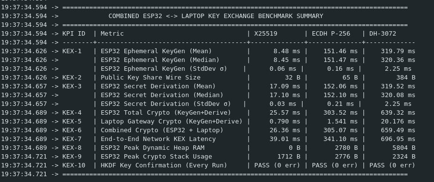

#### Laptop terminal
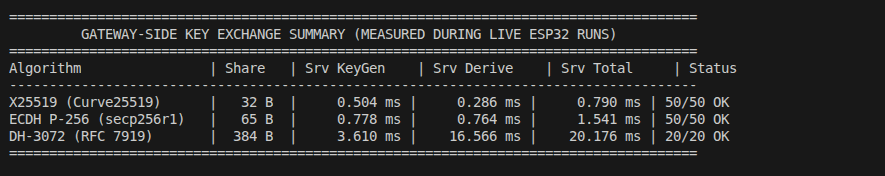

---

## Why we chose X25519

1. **It is the fastest.** The ESP32 and the laptop together need **26.36 ms** (25.57 ms on the ESP32 + 0.79 ms on the laptop). That is **11.6 times faster** than ECDH P-256 (305.07 ms) and **25 times faster** than DH-3072 (659.49 ms).
2. **The whole exchange over Wi-Fi is fast too:** **39.01 ms**, which is 8.7 times faster than ECDH P-256 and 17.9 times faster than DH-3072.
3. **The ESP32 is the slow side.** The laptop is about 32 times faster than the ESP32 for X25519 (0.79 ms vs. 25.57 ms). So the ESP32 does 97% of the crypto work in the exchange.
4. **It is small.** The X25519 key is only **32 bytes**: about half the size of P-256 and 12 times smaller than DH-3072 (384 bytes).
5. **It needs no heap memory** on the ESP32 (P-256 needs 2,780 bytes and DH-3072 5,804 bytes). It only uses 1,712 bytes of stack, so the memory never gets fragmented.

---

## Graphs

### ESP32: make key pair (KEX-1)
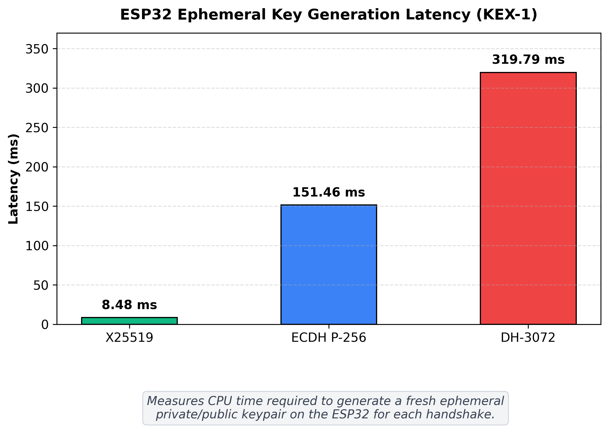

### Public key size (KEX-2)
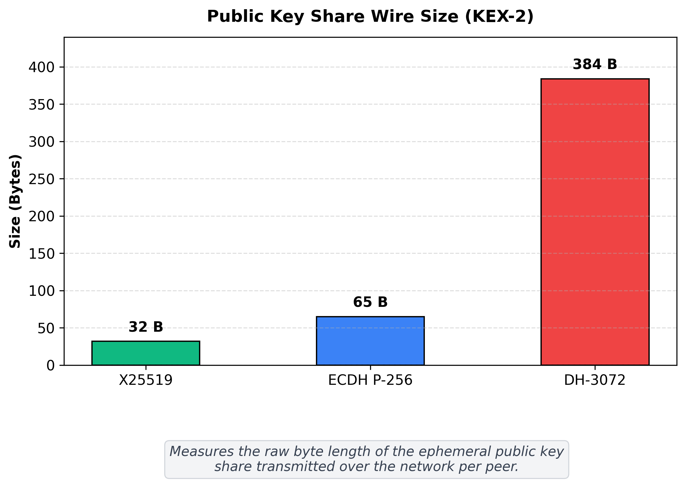

### ESP32: compute secret (KEX-3)
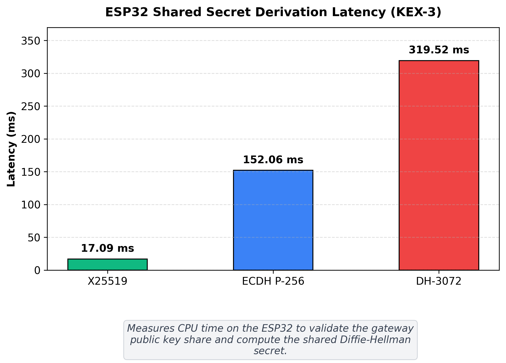

### ESP32 total (KEX-4)
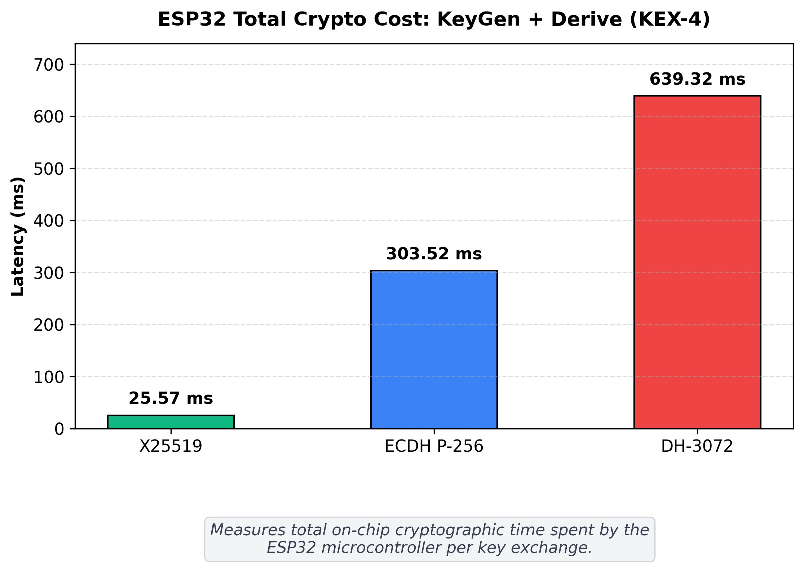

### Laptop: make key pair
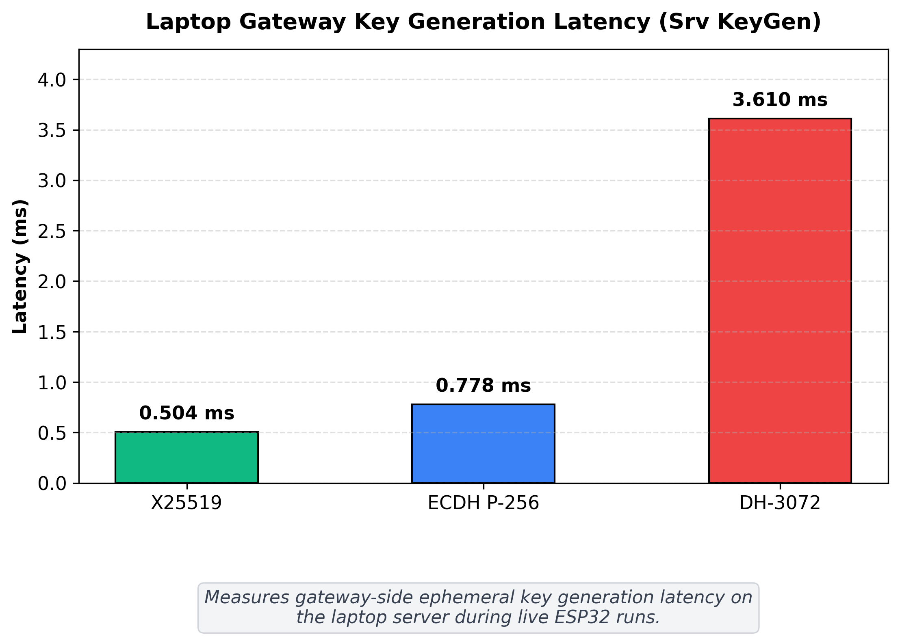

### Laptop: compute secret
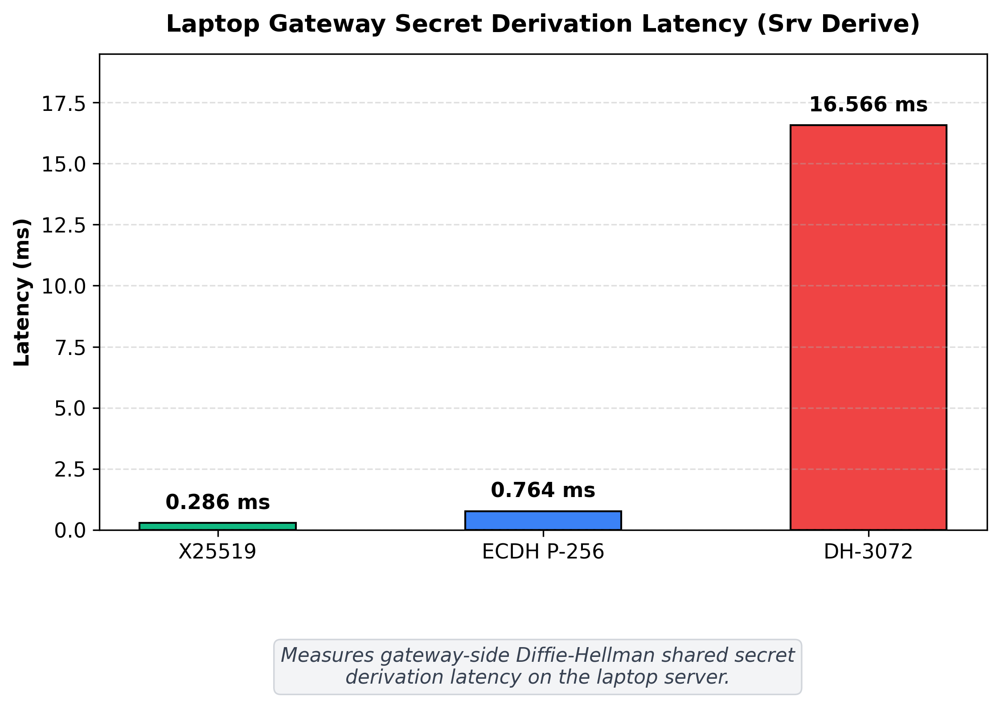

### Laptop total (KEX-5)
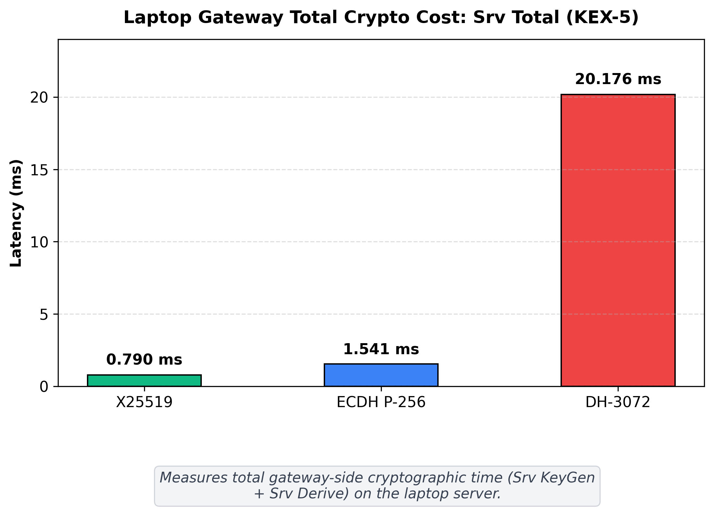

### ESP32 + laptop (KEX-6)
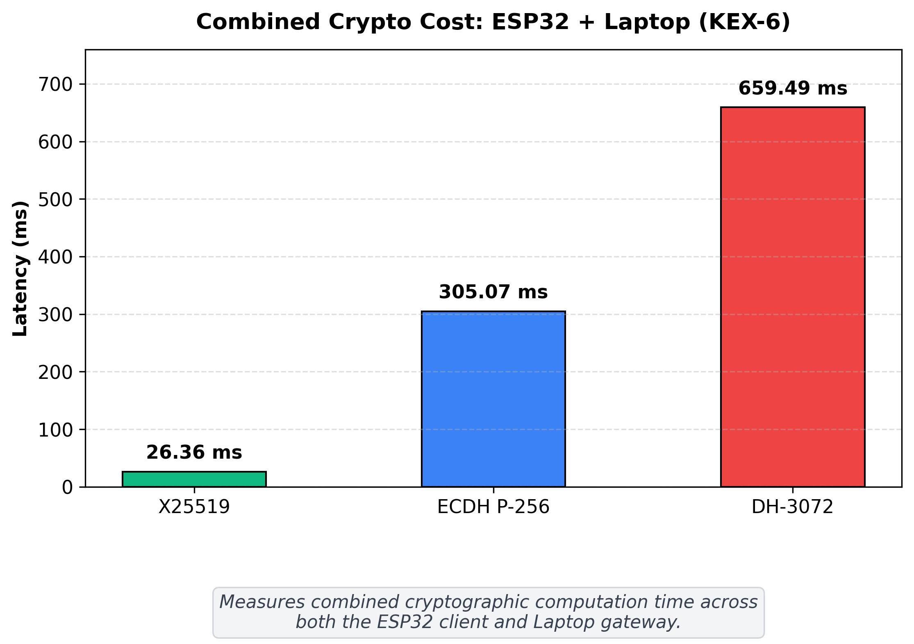

### Whole exchange over Wi-Fi (KEX-7)
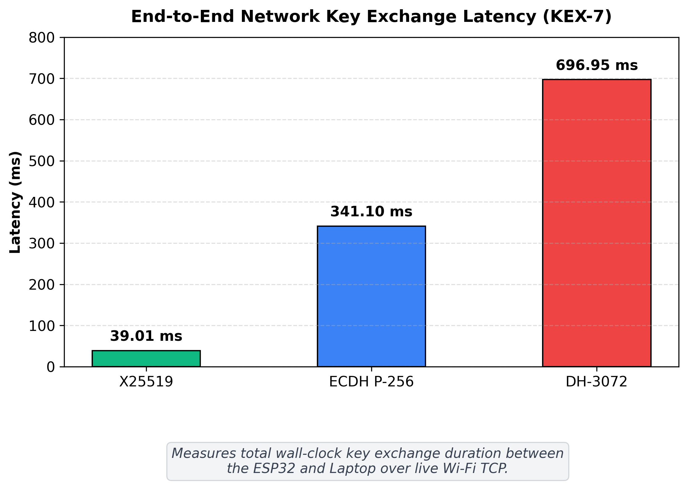

### ESP32 heap memory (KEX-8)
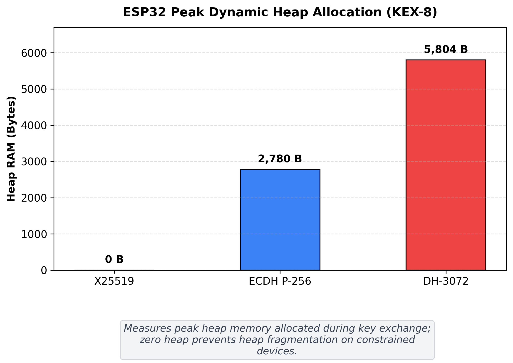

### ESP32 stack memory (KEX-9)
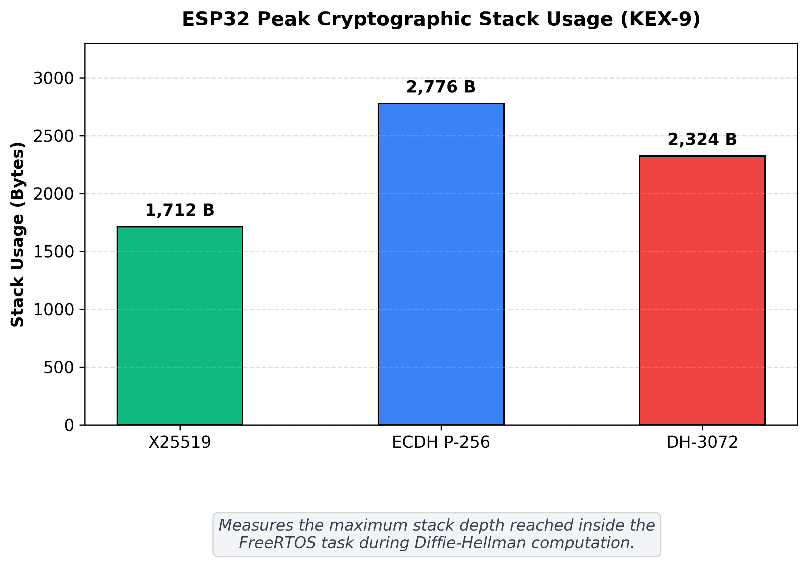

---

## How to run it

### Step 1: start the laptop side
```bash
python3 benchmark_gateway_kex.py
```
It does a quick self-test, then waits on TCP port `9000` and prints the laptop's IP address.

### Step 2: flash the ESP32
1. Open `key_exchange_benchmark.ino` in the Arduino IDE.
2. Check `WIFI_SSID` and `WIFI_PASSWORD`, and set `LAPTOP_IP` to the IP printed in step 1.
3. Choose **Tools > Board > ESP32 Arduino > ESP32 Dev Module** (240 MHz) and upload.
4. Open the **Serial Monitor** at **115200 baud** to watch the runs and the final table.

## Extra: a simple X25519 demo (`phase_a_isolated/`)

A smaller demo that only does a plain X25519 exchange. It does not check who is on the other side, so it is not a VPN.
* `x25519_wifi/x25519_wifi.ino`: the ESP32 creates the Wi-Fi network `ESP32-X25519-Demo` (password `X25519demo`) and waits on `192.168.4.1:5000`.
* `x25519_server.py`: run it on the laptop after joining that network (`python3 x25519_server.py`). It needs PyNaCl (`pip install pynacl`). Both sides print the same secret.
