# Combined Key Exchange Benchmark (ESP32 $\leftrightarrow$ Laptop Gateway)

Unified single-phase benchmark suite evaluating classical Diffie-Hellman key exchange schemes (**X25519**, **ECDH P-256**, and **DH-3072**) between the physical **ESP32 microcontroller** and the **Python Laptop Gateway** at an equivalent 128-bit classical security baseline.

This benchmark executes live Diffie-Hellman key exchanges between the ESP32 and Laptop over Wi-Fi TCP (focusing strictly on key exchange without signature or transcript-signing overhead) while simultaneously recording:
1. **Isolated on-chip ESP32 CPU cycles & milliseconds** (`KeyGen` and `Derive` via the 240 MHz `ccount` register),
2. **Gateway (Laptop) computation milliseconds** (`KeyGen` and `Derive`, returned in `MSG 2`),
3. **End-to-end network key exchange latency** over Wi-Fi TCP,
4. **Public key share wire size**, **ESP32 dynamic heap RAM**, and **ESP32 cryptographic stack usage**,
5. **Cryptographically separated Key Confirmation** (`HMAC-SHA256` with HKDF-derived $K_{\text{confirm}}$, computed outside the timed region so the raw shared secret $SS$ or its direct hash is never exposed on the wire).

---

## Algorithms Tested (at ~128-bit Security Level)

| Algorithm | Suite ID | Group / Curve Standard | ESP32 Library | Gateway Library | Wire Share Size |
| :--- | :---: | :--- | :--- | :--- | :---: |
| **X25519** | `0x01` | Montgomery Curve25519 (RFC 7748) | Libsodium | Python `cryptography` | **32 bytes** |
| **ECDH P-256** | `0x02` | NIST Weierstrass Curve (`secp256r1`) | ESP32 Mbed TLS (ECP) | Python `cryptography` | **65 bytes** |
| **DH-3072** | `0x03` | Finite Field FFDHE-3072 (RFC 7919) | ESP32 Mbed TLS (MPI) | Python `cryptography` | **384 bytes** |

---

## Combined Benchmark Protocol Flow (Pure Key Exchange Only)

Each benchmark iteration executes a 2-message ephemeral Diffie-Hellman exchange:

```text
ESP32 Client (240 MHz)                                 Laptop Gateway (Python)
     |                                                            |
1. Time ESP32 KeyGen (sk_C, pk_C)                                 |
     |                                                            |
     | ---- [MSG 1: Client Key Share] --------------------------> |
     |      [AlgID (1B) | pk_C (32B / 65B / 384B)]                |
     |                                                            | 2. Time Laptop KeyGen (sk_S, pk_S)
     |                                                            | 3. Time Laptop Derive (SS = DH(sk_S, pk_C))
     |                                                            | 4. Untimed: K_conf = HMAC("VPN-v1-KEX-SALT", SS)
     |                                                            |    ConfirmTag = HMAC(K_conf, Label || pk_C || pk_S)[0:16]
     | <--- [MSG 2: Server Key Share + Timings + ConfirmTag] ---- |
     |      [pk_S (32B/65B/384B) | SrvKG_us(4B) | SrvDer_us(4B) | ConfirmTag(16B)]
     |                                                            |
5. Time ESP32 Derive (SS = DH(sk_C, pk_S))                        |
6. Untimed: Verify ConfirmTag via K_conf (100% Key Agreement)     |
```

---

## Live Hardware Benchmark Results Summary

| Metric | KPI ID | X25519 (Selected) | ECDH P-256 | DH-3072 | Winner |
| :--- | :---: | :---: | :---: | :---: | :---: |
| **ESP32 Ephemeral KeyGen (Mean)** | `KEX-1` | **8.48 ms** | 151.46 ms | 319.79 ms | **X25519** |
| **ESP32 Ephemeral KeyGen (Median)** | — | **8.45 ms** | 151.47 ms | 320.36 ms | **X25519** |
| **ESP32 Ephemeral KeyGen (StdDev $\sigma$)** | — | **0.06 ms** | 0.16 ms | 2.25 ms | **X25519** |
| **Public Key Share Wire Size** | `KEX-2` | **32 B** | 65 B | 384 B | **X25519** |
| **ESP32 Secret Derivation (Mean)** | `KEX-3` | **17.09 ms** | 152.06 ms | 319.52 ms | **X25519** |
| **ESP32 Secret Derivation (Median)** | — | **17.10 ms** | 152.10 ms | 320.08 ms | **X25519** |
| **ESP32 Secret Derivation (StdDev $\sigma$)** | — | **0.03 ms** | 0.21 ms | 2.25 ms | **X25519** |
| **ESP32 Total Crypto (`KeyGen+Derive`)** | `KEX-4` | **25.57 ms** | 303.52 ms | 639.32 ms | **X25519** |
| **Laptop Gateway KeyGen (`Srv KeyGen`)** | — | **0.504 ms** | 0.778 ms | 3.610 ms | **X25519** |
| **Laptop Gateway Derive (`Srv Derive`)** | — | **0.286 ms** | 0.764 ms | 16.566 ms | **X25519** |
| **Laptop Gateway Total (`Srv Total`)** | `KEX-5` | **0.790 ms** | 1.541 ms | 20.176 ms | **X25519** |
| **Combined Crypto (`ESP32 + Laptop`)** | `KEX-6` | **26.36 ms** | 305.07 ms | 659.49 ms | **X25519** |
| **End-to-End Network KEX Latency** | `KEX-7` | **39.01 ms** | 341.10 ms | 696.95 ms | **X25519** |
| **ESP32 Peak Dynamic Heap RAM** | `KEX-8` | **0 B** (Stack only) | 2,780 B | 5,804 B | **X25519** |
| **ESP32 Peak Crypto Stack Usage** | `KEX-9` | **1,712 B** | 2,776 B | 2,324 B | **X25519** |
| **HKDF Key Confirmation (Every Run)** | `KEX-10` | **PASS (0 err)** | **PASS (0 err)** | **PASS (0 err)** | **ALL** |

### Hardware Terminal Summary Screenshots

#### ESP32 Serial Monitor Summary
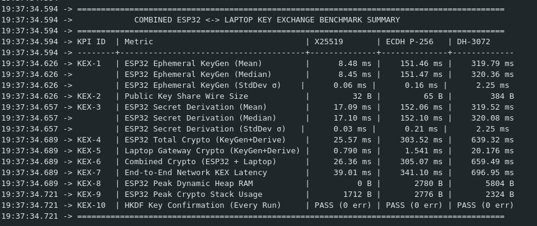

#### Laptop Gateway Terminal Summary
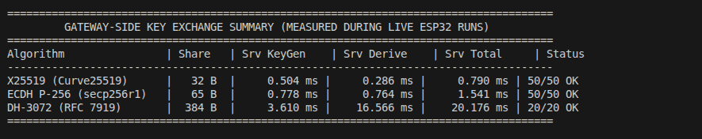

---

## Key Technical Findings (Why X25519 Wins)

1. **Computational Speed:** Total combined cryptographic computation (`ESP32 + Laptop`) completes in **26.36 ms** (**25.57 ms** on ESP32 + **0.790 ms** on Laptop), which is **11.57× faster** than ECDH P-256 (`305.07 ms`) and **25.02× faster** than DH-3072 (`659.49 ms`).
2. **End-to-End Wi-Fi Handshake Speed:** Over live Wi-Fi TCP, X25519 completes the entire bidirectional key exchange in **39.01 ms** (**8.74× faster** than ECDH P-256 and **17.87× faster** than DH-3072).
3. **ESP32 is 97% of the Cryptographic Bottleneck:** Because the Laptop gateway is **32.4× faster** than the 240 MHz ESP32 for X25519 (`0.790 ms` vs `25.57 ms`), the embedded microcontroller dominates handshake computation.
4. **Compact Wire Payload:** The X25519 public key share is only **32 bytes** ($2.03\times$ smaller than P-256 and $12\times$ smaller than DH-3072's 384-byte payload).
5. **Zero Dynamic Heap Overhead:** X25519 consumes **0 bytes** of dynamic heap RAM on the ESP32 (vs. `2,780 B` for P-256 and `5,804 B` for DH-3072), operating entirely in stack buffers (`1,712 B`) without `malloc`/`free` fragmentation.

---

## Benchmark Visualizations

### 1. ESP32 Ephemeral Key Generation Latency (KEX-1)
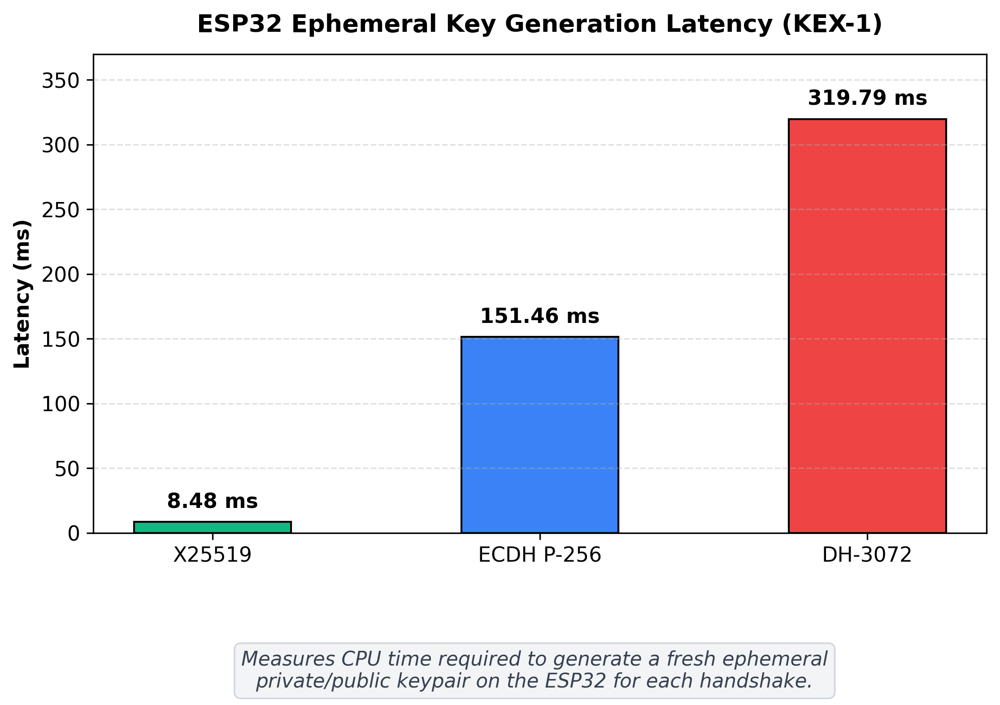

### 2. Public Key Share Wire Size (KEX-2)
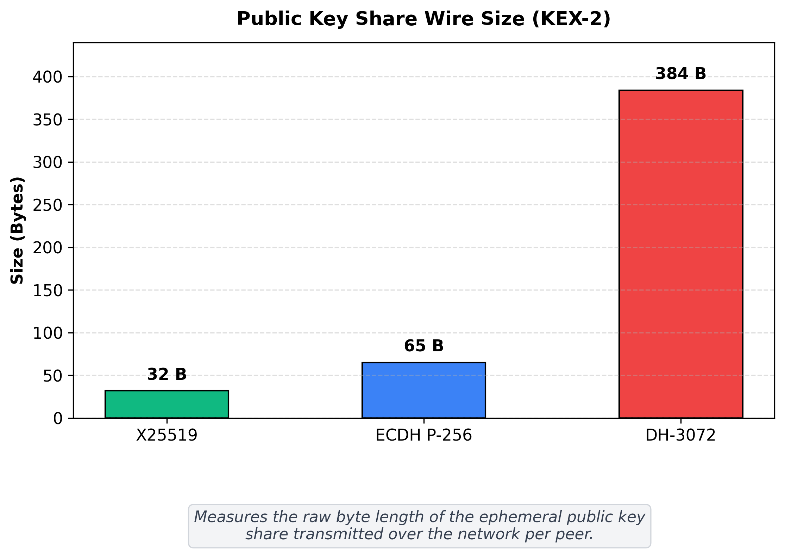

### 3. ESP32 Secret Derivation Latency (KEX-3)
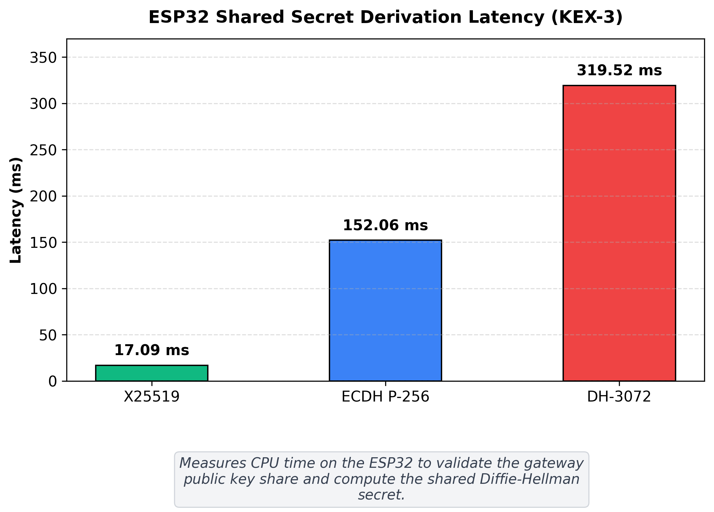

### 4. ESP32 Total Crypto Cost: KeyGen + Derive (KEX-4)
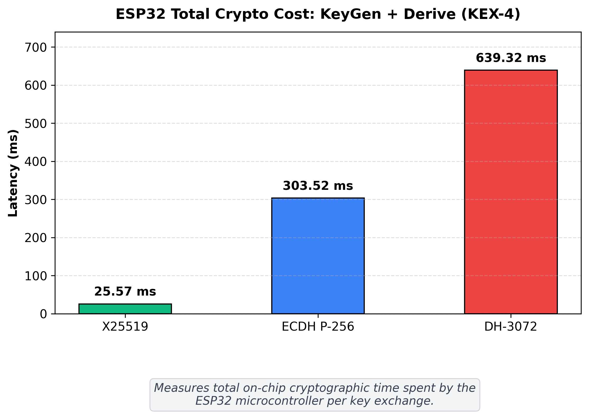

### 5. Laptop Gateway Key Generation Latency (Srv KeyGen)
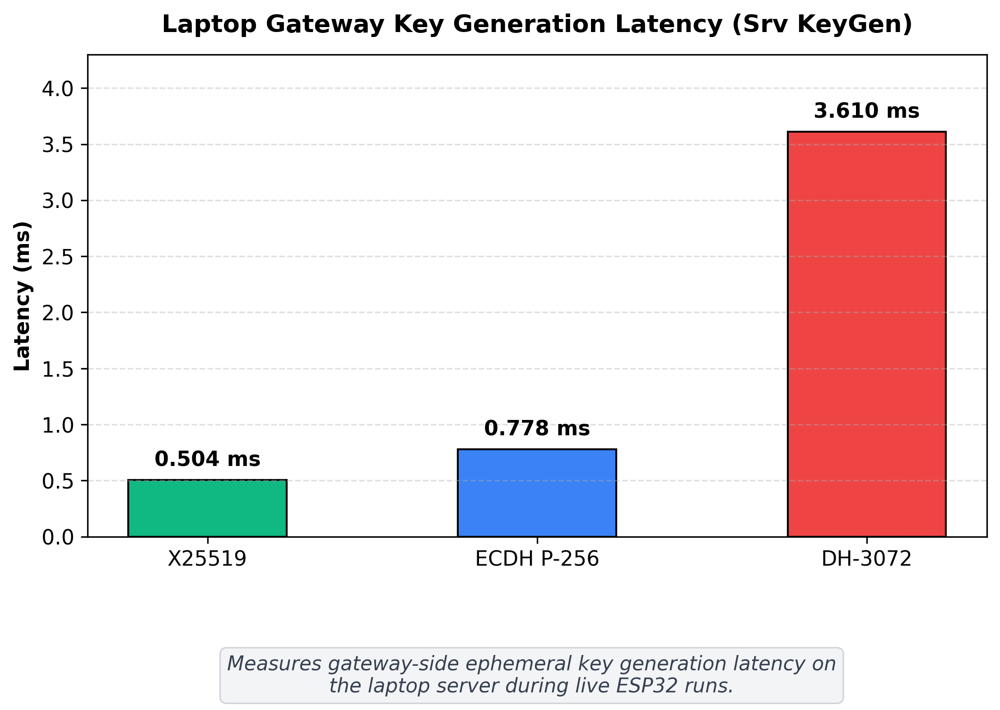

### 6. Laptop Gateway Secret Derivation Latency (Srv Derive)
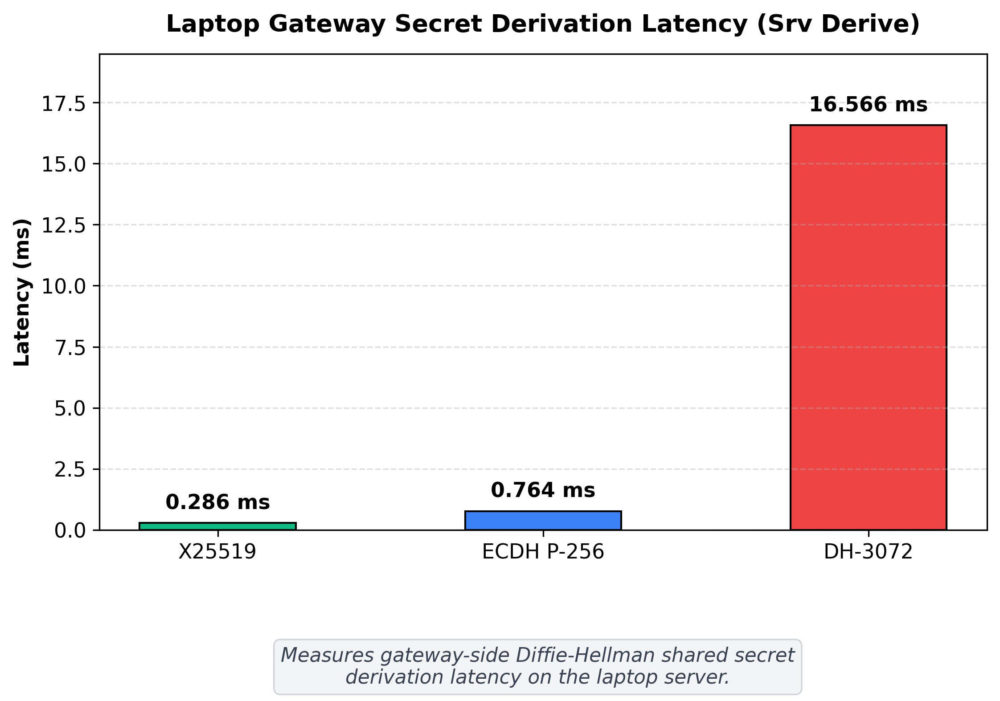

### 7. Laptop Gateway Total Crypto Cost: Srv Total (KEX-5)
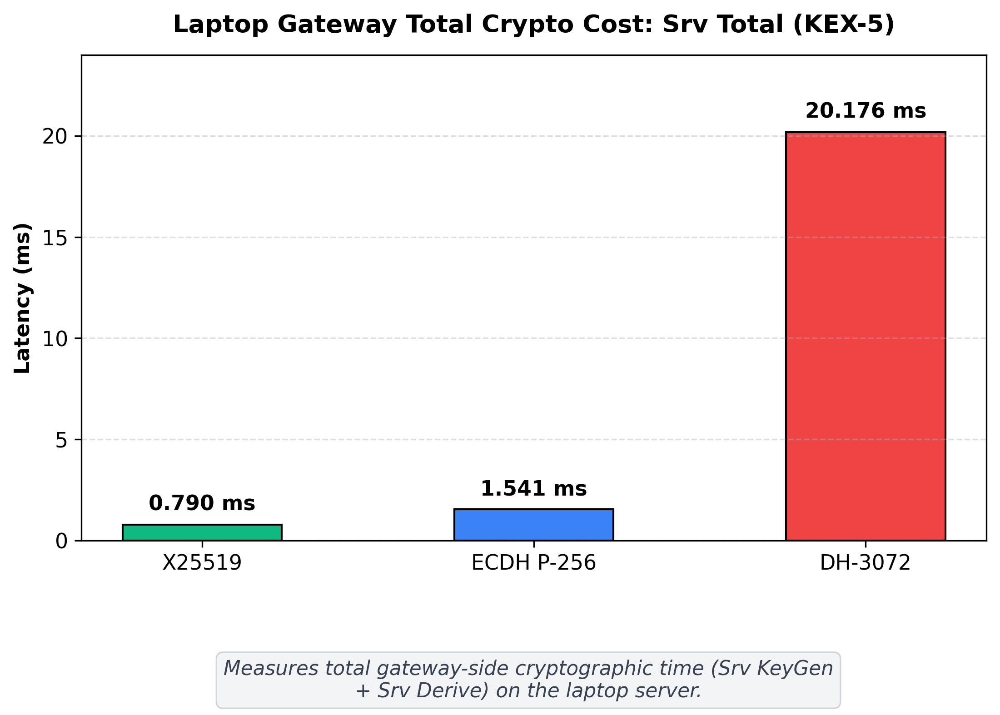

### 8. Combined Crypto Cost: ESP32 + Laptop (KEX-6)
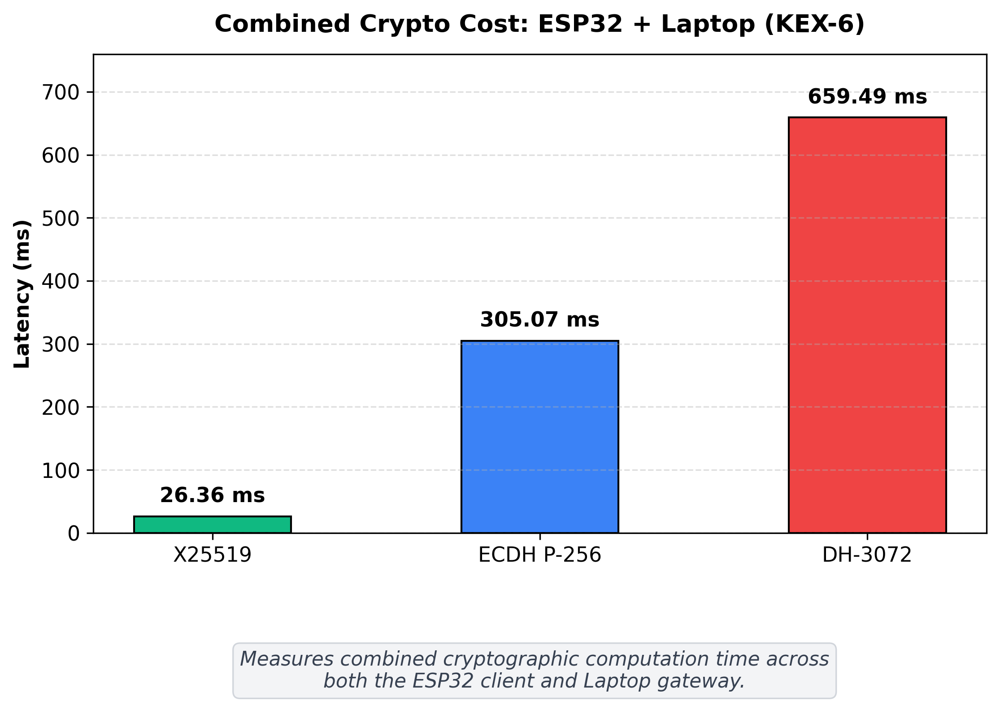

### 9. End-to-End Network Key Exchange Latency (KEX-7)
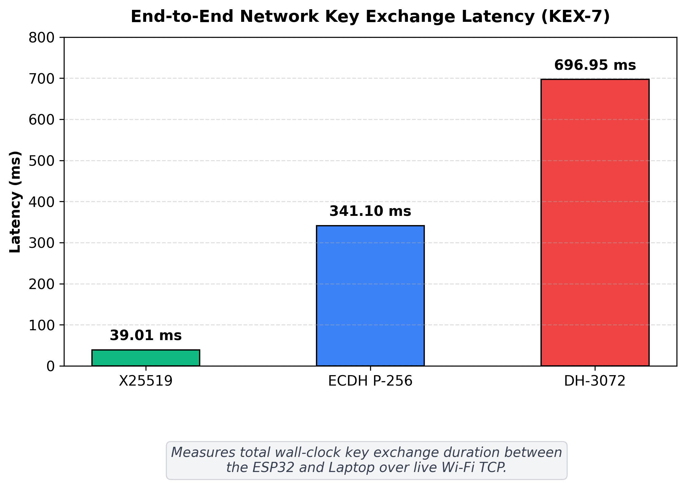

### 10. ESP32 Peak Dynamic Heap Memory Allocation (KEX-8)
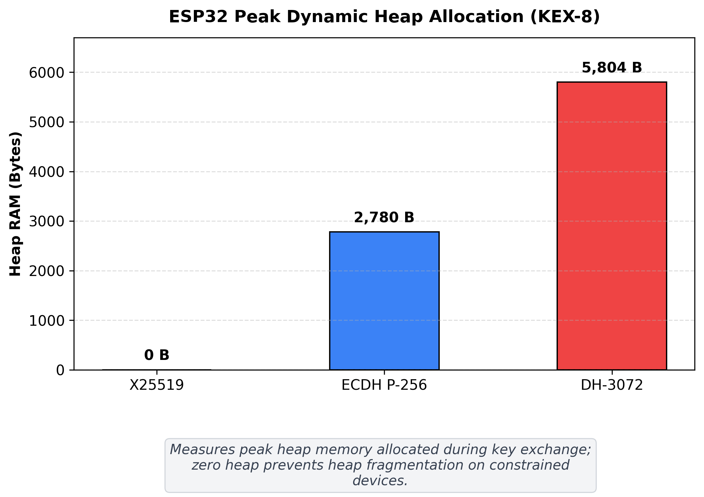

### 11. ESP32 Peak Cryptographic Stack Usage (KEX-9)
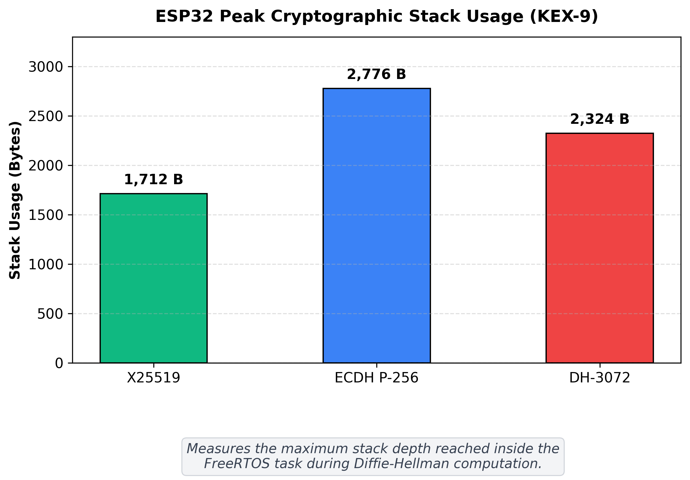

---

## How to Run the Combined Benchmark

### Step 1: Start the Gateway Benchmark Server on Your Laptop
```bash
python3 benchmark_gateway_kex.py
```
* The script runs a quick local self-test and then listens on TCP port `9000`, printing your Laptop's Wi-Fi IP address.

### Step 2: Flash the ESP32 Benchmark Sketch
1. Open `key_exchange_benchmark.ino` in the **Arduino IDE**.
2. Verify `WIFI_SSID`, `WIFI_PASSWORD`, and set `LAPTOP_IP` to the IP printed by `benchmark_gateway_kex.py`.
3. Select **Tools > Board > ESP32 Arduino > ESP32 Dev Module** (`240 MHz`) and upload.
4. Open the **Serial Monitor** at **115200 baud** to view the live runs and summary table.
