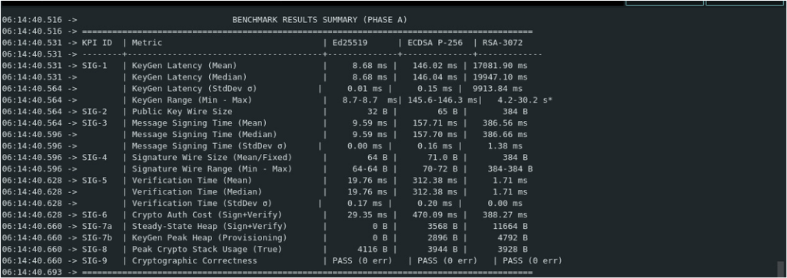
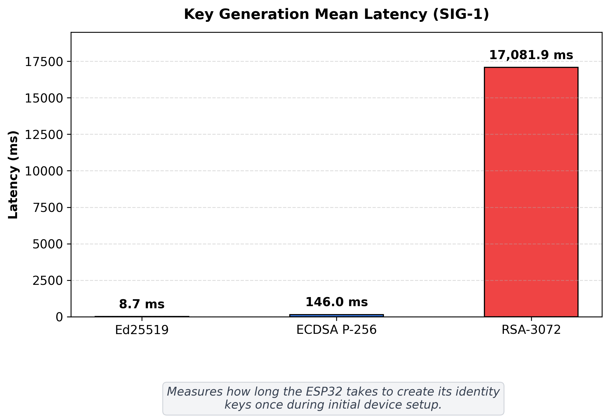
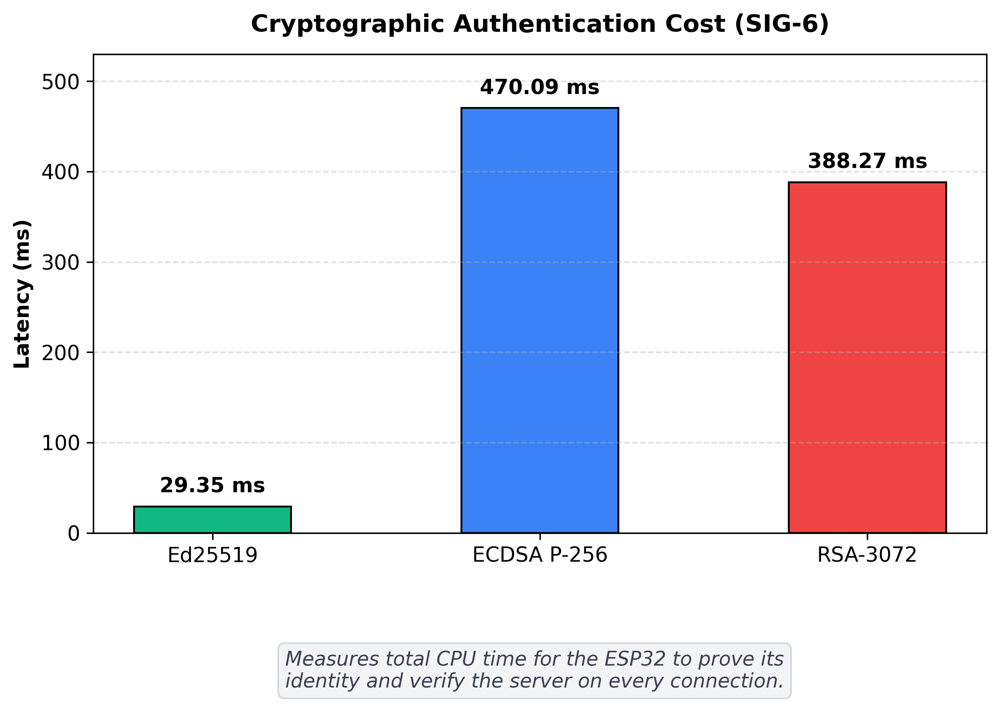
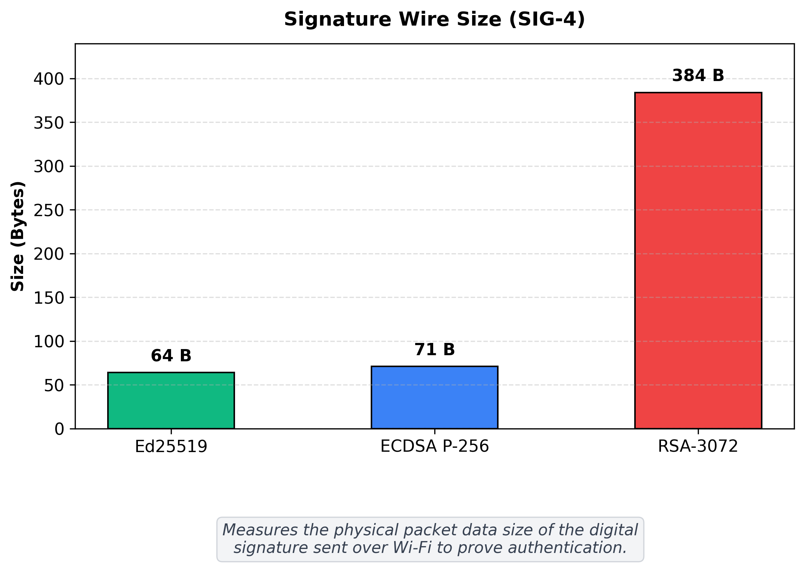
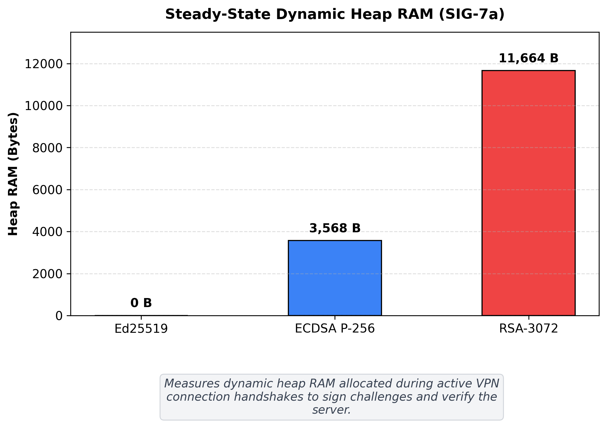
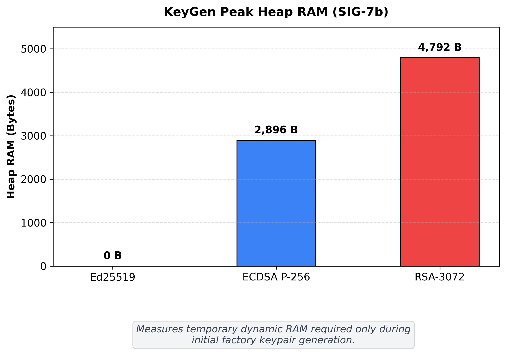
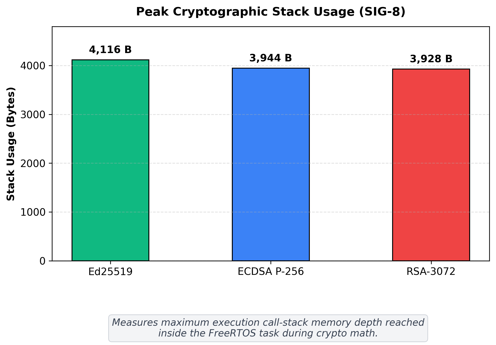

# Phase A: Isolated Micro-Benchmarks (Digital Signatures on ESP32)

Standalone benchmark implementation and results report evaluating digital signature algorithms on the ESP32 microcontroller at an equivalent 128-bit classical security baseline.

The evaluation profiles each algorithm in memory without Wi-Fi or network transport delays to select the optimal digital signature scheme for the embedded VPN client.

## Algorithms Tested

| Algorithm | Curve / Standard | Implementation Library |
| :--- | :--- | :--- |
| **Ed25519** | Twisted Edwards Curve25519 | libsodium |
| **ECDSA P-256** | NIST prime curve secp256r1 | ESP32 mbedTLS |
| **Classical RSA-3072** | PKCS#1 v1.5 with 3072-bit modulus | ESP32 mbedTLS |

## Test Environment

* **Microcontroller:** ESP32-D0WDQ6 (Revision v1.0), Dual Core Xtensa LX6
* **Clock Frequency:** 240 MHz (240,000,000 cycles/second)
* **Free SRAM at Startup:** ~329 KB
* **Measurement Mechanism:** Direct hardware cycle counter register (`ccount`)
  $$\text{Time (ms)} = \frac{\text{CPU Cycles}}{240,000}$$
* **Iteration Count:** 100 runs for fast tests (Ed25519 and ECDSA P-256); 10 runs for slow RSA key generation to prevent watchdog resets.

## Benchmark Methodology & KPIs

To provide academic rigor suitable for defense and publication, the micro-benchmark suite instruments 9 Key Performance Indicators (KPIs):

| KPI ID | Metric | Measurement Technique |
| :--- | :--- | :--- |
| **SIG-1** | **Keypair Generation Latency** | Hardware cycle counter (`ccount`) / `esp_timer` (Mean, Median, Min, Max, $\sigma$) |
| **SIG-2** | **Public Key Wire Size** | Serialized octet length transmitted over the wire |
| **SIG-3** | **Message Signing Latency** | Hardware cycle counter (includes SHA-256 / SHA-512 hashing inside timed window) |
| **SIG-4** | **Signature Wire Size** | Actual serialized signature wire size (DER variable 70–72 B for ECDSA; fixed 64 B for Ed25519) |
| **SIG-5** | **Signature Verification Latency** | Hardware cycle counter (includes message hashing verification inside timed window) |
| **SIG-6** | **Per-Handshake Client Crypto** | Total cryptographic processing time per connection ($\text{SIG-3} + \text{SIG-5}$) |
| **SIG-7a** | **Steady-State Dynamic Heap** | Peak dynamic heap allocation during runtime Sign + Verify (key pre-loaded in memory) |
| **SIG-7b** | **KeyGen Peak Heap** | Peak dynamic heap allocation during keypair generation (prime search / field math) |
| **SIG-8** | **Peak Crypto Stack Watermark** | FreeRTOS task high water mark with benchmark harness arrays placed in BSS (`static`) |
| **SIG-9** | **Cryptographic Correctness** | Formal standards compliance (RFC 8032 §7.1 Test Vector 1 KAT + active `CHECK` macro) |

## Benchmark Summary Table (Measured on ESP32 @ 240 MHz)

| KPI ID | Metric | Ed25519 (libsodium) | ECDSA P-256 (mbedTLS) | RSA-3072 (mbedTLS) | Winner |
| :--- | :--- | :---: | :---: | :---: | :---: |
| **SIG-1** | **KeyGen Latency (Median)** | **8.68 ms** | 146.04 ms | 19,947.10 ms *(4.2–30.2 s)* | **Ed25519** |
| **SIG-2** | **Public Key Wire Size** | **32 bytes** | 65 bytes | 384 bytes | **Ed25519** |
| **SIG-3** | **Message Signing Latency (Median)** | **9.59 ms** | 157.70 ms | 386.66 ms | **Ed25519** |
| **SIG-4** | **Signature Wire Size** | **64 bytes (Fixed)** | 70–72 bytes (Mean: 71.0 B) | 384 bytes (Fixed) | **Ed25519** |
| **SIG-5** | **Verification Latency (Median)** | 19.76 ms | 312.38 ms | **1.71 ms** | **RSA-3072** |
| **SIG-6** | **Per-Handshake Cost (SIG-3 + SIG-5)** | **29.35 ms** | 470.09 ms | 388.27 ms | **Ed25519** |
| **SIG-7a**| **Steady-State Heap (Sign + Verify)** | **0 bytes** | 3,568 bytes | 11,664 bytes | **Ed25519** |
| **SIG-7b**| **KeyGen Peak Heap (Provisioning)** | **0 bytes** | 2,896 bytes | 4,792 bytes | **Ed25519** |
| **SIG-8** | **Peak Crypto Stack Watermark** | 4,116 bytes | 3,944 bytes | **3,928 bytes** | **RSA-3072** |
| **SIG-9** | **Cryptographic Correctness** | **PASS (0 err, KAT)** | **PASS (0 err)** | **PASS (0 err)** | **All** |

*Note on Stack Watermark (SIG-8):* Timing harness arrays are marked `static`, moving them to the `.bss` segment so `uxTaskGetStackHighWaterMark` reflects pure cryptographic library stack usage without test scaffolding pollution.

## Why Ed25519 Was Selected

Ed25519 is the selected digital signature algorithm for the embedded VPN client based on four critical technical findings:

1. **Superior Per-Handshake Execution Speed ($16.0\times$ faster than ECDSA, $13.2\times$ faster than RSA):** In mutual authentication, the client must sign its proof and verify the gateway's proof. Ed25519 completes both operations in **29.35 ms** (9.59 ms sign + 19.76 ms verify), compared to **470.09 ms** for ECDSA P-256 and **388.27 ms** for RSA-3072.
2. **Compact Network Payload ($8.0\times$ smaller than RSA):** Total handshake wire overhead (Public Key + Signature) is **96 bytes**, compared to 136 bytes for ECDSA and **768 bytes** for RSA. Smaller frames eliminate TCP packet fragmentation and minimize radio on-time.
3. **Zero Dynamic Heap Footprint:** libsodium's Ed25519 implementation utilizes pure stack buffers, allocating **0 bytes of dynamic heap**, eliminating memory fragmentation risks in long-running IoT deployments.
4. **Constant-Time Execution & Side-Channel Resistance:** Ed25519 operations over Twisted Edwards Curve25519 execute in constant time, preventing timing side-channel attacks, and derive nonces deterministically (RFC 8032) to eliminate the catastrophic random-nonce collision vulnerability inherent to ECDSA.

*Note on RSA-3072 vs. ECDSA P-256:* While RSA key generation is impractical on an embedded microcontroller (~20 seconds median), key generation is a one-time factory provisioning cost that can be performed offline. On a pure per-handshake basis (Sign + Verify), RSA-3072 (388.27 ms) actually outperforms software ECDSA P-256 (470.09 ms) due to the ESP32's hardware-accelerated Modular Exponentiation (MPI) engine and fast public verification ($e=65537$). However, Ed25519 dramatically outperforms both with no hardware accelerator required.

## Hardware Serial Output Verification

### ESP32 Serial Monitor Summary Table Output

## Benchmark Visualizations

### 1. Key Generation Mean Latency (SIG-1)

### 2. Cryptographic Authentication Cost (SIG-6: Sign + Verify)

### 3. Signature Wire Size (SIG-4)

### 4. Steady-State Dynamic Heap RAM (SIG-7a)

### 5. KeyGen Peak Heap RAM (SIG-7b)

### 6. Peak Cryptographic Stack Usage (SIG-8)

## How to Run the Benchmark

1. Open `Phase_A_Isolated_Benchmark.ino` in the Arduino IDE.
2. Select your board: **Tools > Board > ESP32 Arduino > ESP32 Dev Module**.
3. Set CPU Frequency to **240 MHz**.
4. Connect your ESP32 via USB and select the corresponding Serial port (`/dev/ttyUSB0` on Linux).
5. Upload the sketch and open the **Serial Monitor** at **115200 baud**.
6. The ESP32 will automatically run the benchmarks and print the cycle counts, converted timings, wire sizes, and peak dynamic heap RAM to the terminal.

## Files in this Directory

* **`Phase_A_Isolated_Benchmark.ino`**: Standalone Arduino sketch containing the benchmark implementation for Ed25519, ECDSA P-256, and RSA-3072.
* **`benchmark_report.tex`**: LaTeX source code for the comprehensive micro-benchmark report.
* **`benchmark_report.pdf`**: Compiled PDF reference documentation containing KPI definitions, comparison tables, serial output terminal captures, and pseudocode.
* **`generate_graphs.py`**: Python matplotlib script used to generate publication-grade comparison plots.
* **`graphs/`**: Directory containing the generated benchmark visualization plots.
* **`screenshots/`**: Directory containing the ESP32 hardware serial monitor captures.
