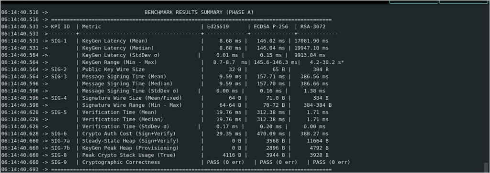
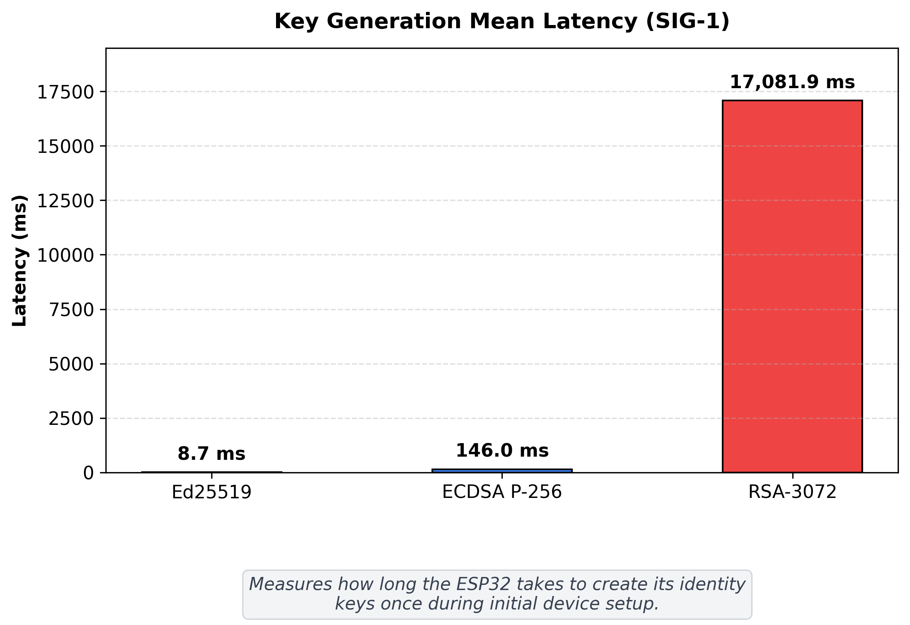
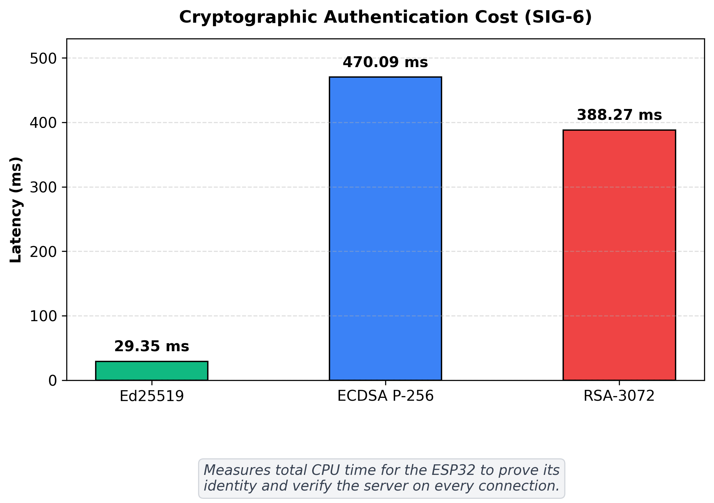
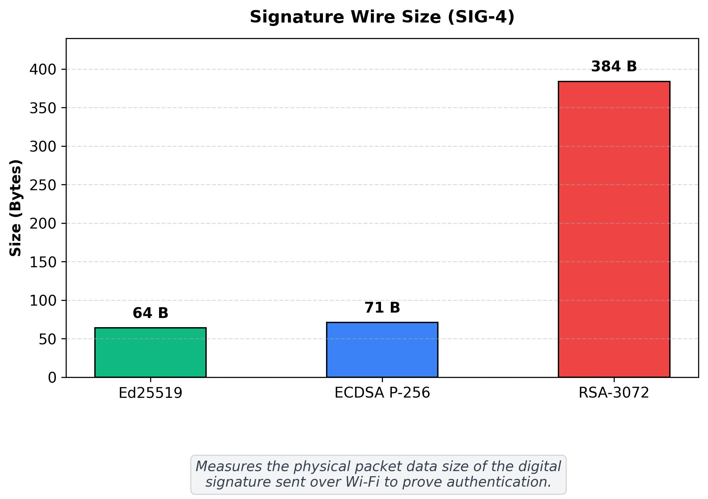
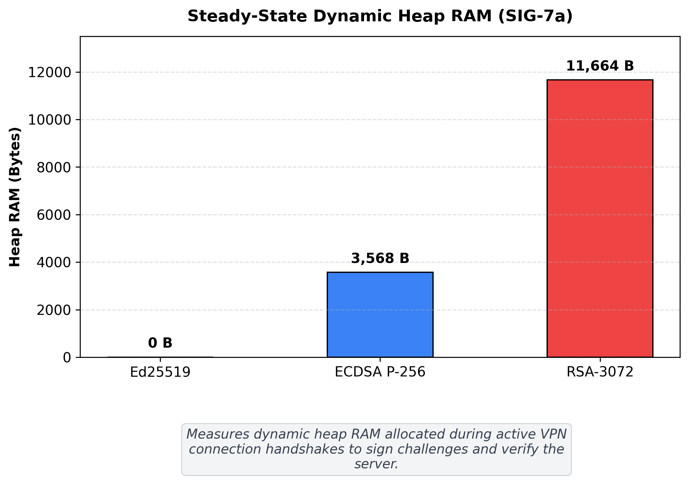
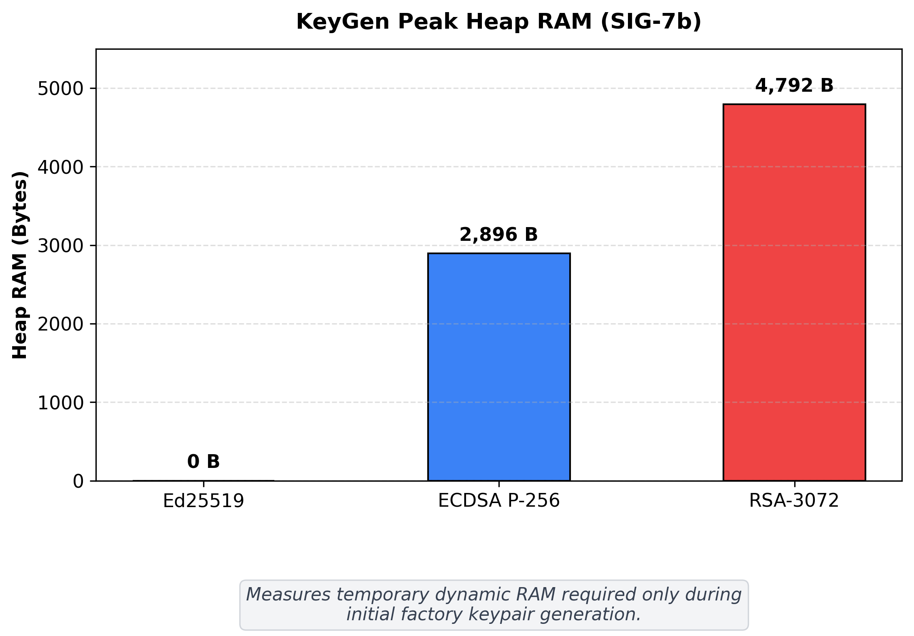
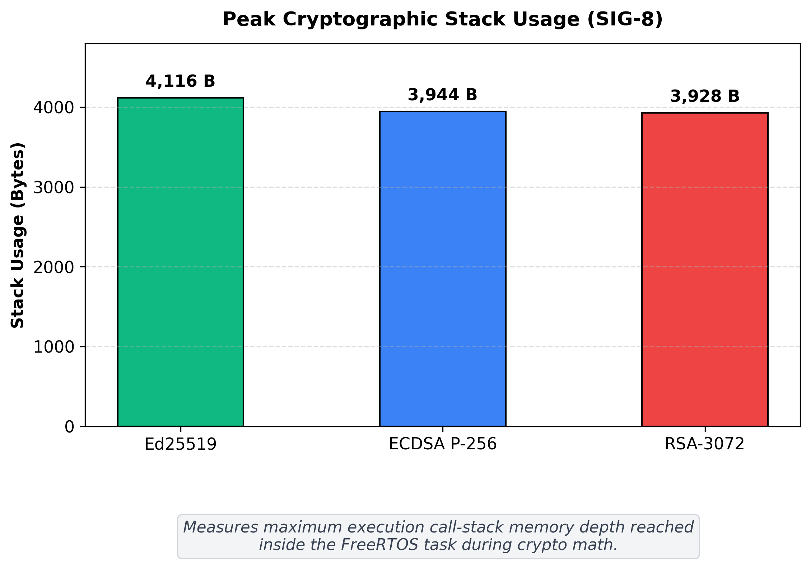

# Signature Algorithms on the ESP32: Which One Should the VPN Use?

In the handshake, the ESP32 has to **sign** once (to prove who it is) and **verify** once (to check the gateway). This test compares three signature algorithms on the ESP32 to choose the best one for the classical VPN. All three give about the same security level (128-bit).

The tests run on the ESP32 alone, without Wi-Fi, so only the algorithm itself is measured.

## Algorithms tested

| Algorithm | What it is based on | Library |
| :--- | :--- | :--- |
| **Ed25519** | Curve25519 (Edwards form) | libsodium |
| **ECDSA P-256** | NIST curve P-256 | mbedTLS (comes with the ESP32) |
| **RSA-3072** | 3072-bit RSA, PKCS#1 v1.5 | mbedTLS (comes with the ESP32) |

## Test setup

* **Board:** ESP32-D0WDQ6 (revision 1.0), two cores, **240 MHz**
* **Free memory at start:** about 329 KB
* **How time is measured:** the ESP32's cycle counter. Time in ms = cycles / 240,000.
* **Number of runs:** 100 for Ed25519 and ECDSA. 10 for RSA key generation, because it is very slow and would trigger the watchdog otherwise.

## What we measured

| ID | What | How |
| :--- | :--- | :--- |
| SIG-1 | Time to make a key pair | Cycle counter (mean, median, min, max, spread) |
| SIG-2 | Public key size | Bytes sent over the network |
| SIG-3 | Time to sign | Cycle counter (includes hashing the message) |
| SIG-4 | Signature size | Bytes sent over the network (ECDSA: 70-72 bytes, Ed25519: always 64) |
| SIG-5 | Time to verify | Cycle counter (includes hashing the message) |
| SIG-6 | Cost per handshake | Sign + verify (SIG-3 + SIG-5) |
| SIG-7a | Heap memory while signing and verifying | Highest heap use during sign + verify |
| SIG-7b | Heap memory while making keys | Highest heap use during key generation |
| SIG-8 | Stack memory | Highest stack use (the test's own arrays are kept off the stack so they do not count) |
| SIG-9 | Correct results | Ed25519 checked against the official RFC 8032 test vector; all three sign and verify without errors |

## Results (ESP32 at 240 MHz)

| ID | What | Ed25519 | ECDSA P-256 | RSA-3072 | Best |
| :--- | :--- | :---: | :---: | :---: | :---: |
| SIG-1 | Make key pair (median) | **8.68 ms** | 146.04 ms | 19,947.10 ms *(4.2-30.2 s)* | **Ed25519** |
| SIG-2 | Public key size | **32 bytes** | 65 bytes | 384 bytes | **Ed25519** |
| SIG-3 | Sign (median) | **9.59 ms** | 157.70 ms | 386.66 ms | **Ed25519** |
| SIG-4 | Signature size | **64 bytes** | 70-72 bytes (average 71.0) | 384 bytes | **Ed25519** |
| SIG-5 | Verify (median) | 19.76 ms | 312.38 ms | **1.71 ms** | **RSA-3072** |
| SIG-6 | Sign + verify per handshake | **29.35 ms** | 470.09 ms | 388.27 ms | **Ed25519** |
| SIG-7a | Heap while signing and verifying | **0 bytes** | 3,568 bytes | 11,664 bytes | **Ed25519** |
| SIG-7b | Heap while making keys | **0 bytes** | 2,896 bytes | 4,792 bytes | **Ed25519** |
| SIG-8 | Stack used | 4,116 bytes | 3,944 bytes | **3,928 bytes** | **RSA-3072** |
| SIG-9 | Correct results | **PASS** (incl. official test vector) | **PASS** | **PASS** | **All** |

## Why we chose Ed25519

1. **It is the fastest per handshake.** Signing and verifying together take **29.35 ms**. ECDSA takes 470.09 ms (16 times slower) and RSA takes 388.27 ms (13 times slower).
2. **It is the smallest.** The public key and signature together are **96 bytes**. ECDSA needs 136 bytes and RSA needs **768 bytes** (8 times more). Smaller messages mean less radio time and no splitting into many packets.
3. **It needs no heap memory.** Ed25519 uses only the stack, so it never fragments the memory, which matters for a device that runs for a long time.
4. **It is safer to implement.** Ed25519 takes the same time no matter what the secret key is, so timing attacks don't work. It also does not need a random number when signing. ECDSA does, and a bad random number in ECDSA can leak the secret key.

**About RSA:** making an RSA key on the ESP32 takes about 20 seconds, but that only happens once, when the device is set up. For sign + verify alone, RSA (388 ms) is actually faster than ECDSA (470 ms). This is because the ESP32 has hardware to speed up RSA math, and RSA verification is very cheap. Ed25519 is still much faster than both, without any special hardware.

## Output from the ESP32

## Graphs

### Time to make a key pair (SIG-1)

### Sign + verify per handshake (SIG-6)

### Signature size (SIG-4)

### Heap memory while signing and verifying (SIG-7a)

### Heap memory while making keys (SIG-7b)

### Stack memory (SIG-8)

## How to run it

1. Open `mutual_auth_benchmark.ino` in the Arduino IDE.
2. Choose **Tools > Board > ESP32 Arduino > ESP32 Dev Module**.
3. Set the CPU frequency to **240 MHz**.
4. Plug in the ESP32 and choose its port (for example `/dev/ttyUSB0` on Linux).
5. Upload, then open the **Serial Monitor** at **115200 baud**.
6. The ESP32 runs all the tests by itself and prints the times, sizes and memory use.

## Files

* `mutual_auth_benchmark.ino`: the test for Ed25519, ECDSA P-256 and RSA-3072.
* `benchmark_report.pdf`: a longer report with all the definitions, tables, screenshots and pseudocode.
* `graphs/`: the graphs above.
* `screenshots/`: screenshots of the ESP32 output.
* `phase_a_isolated/ed25519_isolated/ed25519_isolated.ino`: a smaller test that only times Ed25519 (key generation, sign, verify; 100 runs). It is a separate sketch, so open it on its own.
