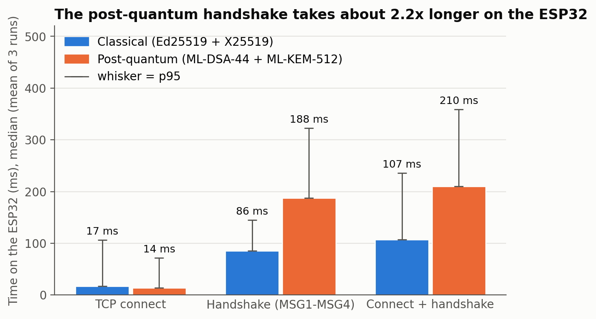
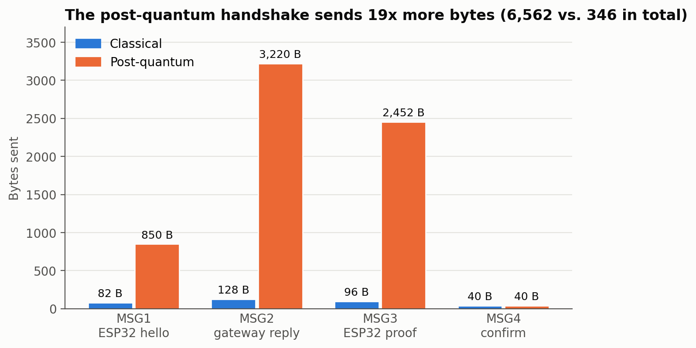
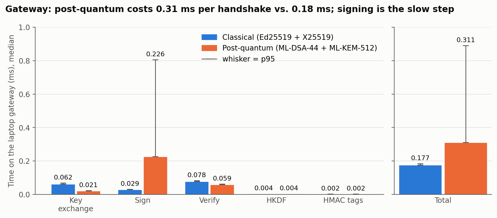
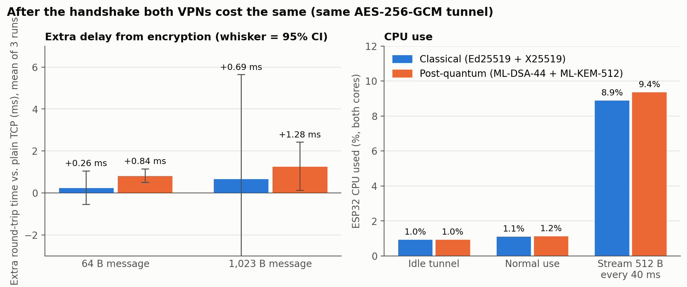
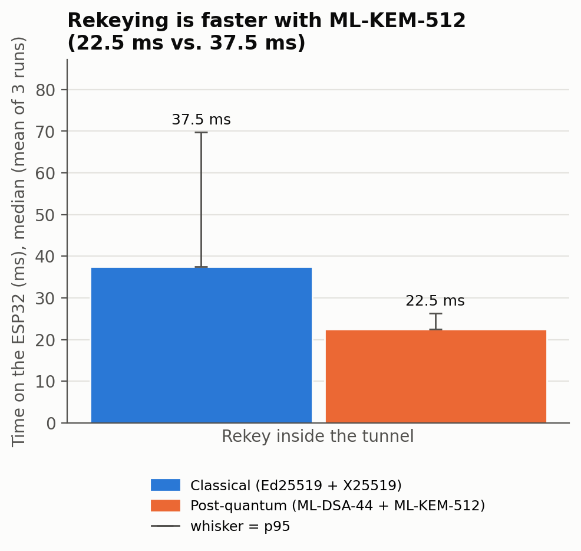
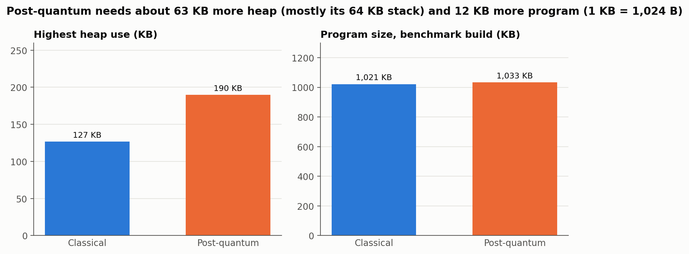
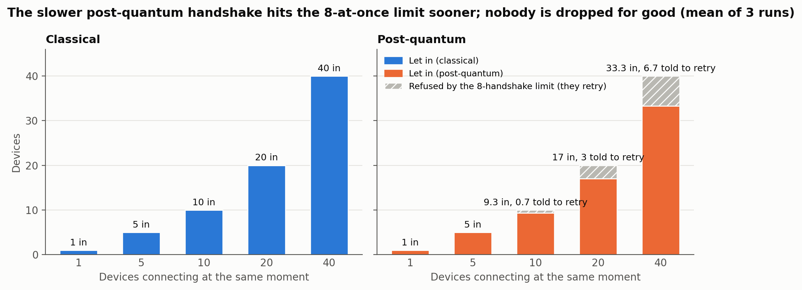
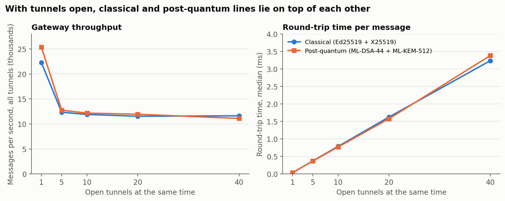

# Whole-VPN Benchmark: Classical vs. Post-Quantum

The other benchmarks in this repository time **one algorithm at a time** (sign, verify, key exchange). This one tests the **finished VPN**:
* does every algorithm give correct results,
* how long the handshake takes,
* how much the encryption slows messages down,
* how much data can be sent,
* how long rekeying takes,
* how much CPU and memory the ESP32 uses,
* how many devices the gateway can handle.

Both VPNs are tested with exactly the same code, so their results can be compared directly.

The same files are in [`Non_PQC_VPN/benchmarking/system_benchmark/`](../../../Non_PQC_VPN/benchmarking/system_benchmark/) and [`PQC_VPN/benchmarking/system_benchmark/`](../../../PQC_VPN/benchmarking/system_benchmark/). The scripts find out by themselves which VPN they belong to. `compare_gateway_crypto.py` and `reference_cross_check.py` are only in `PQC_VPN/`.

The benchmark has four parts:

| Part | What it does | Where it runs | Status |
|---|---|---|---|
| **A** | Tests the VPN on a real ESP32 over real Wi-Fi (tests B0-B7) | ESP32 + laptop | Done: 3 runs per VPN |
| **B** | Tests the gateway with many simulated ESP32s (tests L0-L6) | Laptop | Done: 3 runs per VPN |
| **C** | Compares the gateway's crypto cost fairly, classical vs. post-quantum | Laptop | Done |
| **D** | Checks our post-quantum libraries against two independent implementations, with 1,000 random inputs | Laptop | Done twice: 2 x 9,000 / 9,000 identical |

---

## Part A: on the ESP32 (tests B0-B7)

| Test | What it measures | How |
|---|---|---|
| B0 | Does every algorithm give correct results? | Known-answer tests (see below) |
| B1 | How long AES-256-GCM takes per message (64, 256 and 1,023 bytes) | 200 runs each, no network. Also given in ms per KB |
| B2 | How long the handshake takes, and how many bytes it sends | 100 handshakes over Wi-Fi: first the TCP connection, then messages 1-4 |
| B3 | How much delay the VPN adds | 200 pairs per size: a plain message (no VPN) and a VPN message, **one after the other**, so changes in the Wi-Fi affect both the same way |
| B4a | The most data the VPN can send | 30 s of 1,023-byte messages, with up to 8 on the way at once. Only data the gateway confirmed is counted |
| B4b | Whether the VPN keeps up with a steady stream | 30 s of 512 bytes every 40 ms (102.4 kbps), sent on time no matter what. We check how much arrives and how long the replies take |
| B5 | How long a rekey takes | 20 rekeys, from the request until the new keys are in use |
| B6 | How busy the ESP32's CPU is | How much of the time **both cores** are idle (this counts our code *and* the Wi-Fi work). Three cases: connected but quiet (20 s), normal use with one ping every 1.5 s (20 s), and the steady stream from B4b |
| B7 | Memory and flash | Most heap memory used, free heap, unused stack, program size |

**For every time we give the number of samples, mean, median, 95th percentile (p95), spread, minimum and maximum.** The p95 is the time that 95% of the cases are faster than. On a network, the slow cases matter as much as the normal ones.

While measuring, the ESP32 does not print its normal handshake tables. Printing several KB at 115,200 baud takes hundreds of milliseconds and would make every handshake look slower. In the CPU test, the benchmark sleeps while waiting instead of looping, so waiting does not count as CPU work.

### How to run it (about 10 minutes per VPN)
1. On the laptop, start the gateway in benchmark mode. This also starts a plain (no VPN) echo server, used to compare against:
   ```bash
   cd PQC_VPN          # or Non_PQC_VPN
   python3 benchmarking/system_benchmark/gateway_benchmark.py --serve
   ```
   For `PQC_VPN`, build the libraries first with `laptop_server/build_native_libs.sh`.
2. In `esp32_client/config.h`, set `#define BENCHMARK_MODE 1`. Also check `WIFI_SSID`, `WIFI_PASSWORD` and `GATEWAY_IP`. The board must be in `authorized_devices.json`.
3. Upload, open the Serial Monitor at 115200 baud, and wait for **BENCHMARK COMPLETE**. Keep the board in the same place for both VPNs, because the Wi-Fi affects B2-B4.
4. Close the Serial Monitor and save each run with the capture script (it resets the board, so every run starts from the beginning). Do 3 runs:
   ```bash
   python3 benchmarking/capture_esp32_bench.py --port /dev/ttyUSB0 --out benchmarking/system_benchmark/results --name esp32_results_run1
   ```
   (then `run2` and `run3`). It saves the full output (`.log`) and the `BENCH,` lines (`.csv`).
5. Combine the runs: `python3 benchmarking/system_benchmark/aggregate_runs.py esp32 --classical ... --pqc ...` (see the top of that file).
6. Set `BENCHMARK_MODE` back to `0`, put the placeholders back in place of your Wi-Fi password and IP, and upload again for normal use.

**Before measuring, set up the laptop the same way every time:** charger plugged in, **Performance** power mode, and Wi-Fi power saving off (`sudo iwconfig wlo1 power off`; check with `iwconfig wlo1`). The laptop runs the gateway, so a slowed-down CPU or a sleeping Wi-Fi card shows up in the ESP32's times.

### Results (3 runs per VPN, 27 Nov 2026)

**Setup:** ESP32-D0WD at 240 MHz (Arduino core 3.3.12, ESP-IDF 5.5.5, mbedTLS 3.6.6, libsodium 1.0.21). The ESP32 and the laptop gateway (HP Victus 15, charger in, Performance mode, Wi-Fi power saving off) both on the same phone hotspot, the ESP32 about 1 m away (signal about -6 dBm). The code measured is the current one: the 4-message handshake **with SA binding**. Each VPN was measured 3 times; each cell is **the mean over the 3 runs ± the 95% confidence interval** (Student t, as in our test plan). For times, each run contributes its median (or p95). 1 KB = 1,024 bytes.

| Test | What | Classical | Post-quantum | Post-quantum vs. classical |
|---|---|---|---|---|
| B0 | Known-answer tests passed (every run) | **9 / 9** | **13 / 13** | both correct |
| B1 | AES-256-GCM encrypt + decrypt, 1,023 bytes | 1.21 ms per KB | 1.23 ms per KB | same AES code |
| B1 | AES-256-GCM encrypt + decrypt, 64 bytes | 2.37 ms per KB | 2.71 ms per KB | +0.02 ms per message (program build, see below) |
| B2 | Handshake, messages 1-4: median | 85.7 ± 4.2 ms | **187.6 ± 9.6 ms** | **2.2 times longer** |
| B2 | Handshake, messages 1-4: p95 | 144.9 ± 35.0 ms | 322.5 ± 41.3 ms | |
| B2 | Failed handshakes | 0 / 300 | 0 / 300 | same |
| B2 | Bytes sent for one handshake | 346 bytes | **6,562 bytes** | **19 times more** |
| B3 | Extra delay from the VPN (median VPN - median plain), 64 B | +0.26 ± 0.80 ms | +0.84 ± 0.32 ms | below 1 ms: within Wi-Fi noise |
| B3 | Extra delay from the VPN, 1,023 B | +0.69 ± 4.95 ms | +1.28 ± 1.15 ms | about 1-2 ms |
| B4a | Most data the VPN can send | 1,575 ± 615 kbps | 1,630 ± 411 kbps | **the same** |
| B4b | Delivered when 102.4 kbps is sent | 102.4 kbps, 750 / 750 (every run) | 102.4 kbps, 750 / 750 (every run) | same |
| B4b | Reply time during the stream: median / p95 | 10.1 / 34.7 ms | 9.3 / 16.8 ms | same median |
| B5 | Rekey time: median | 37.5 ± 4.2 ms | **22.5 ± 1.1 ms** | **post-quantum is faster** |
| B5 | Rekey time: p95 | 69.8 ± 95.1 ms | 26.3 ± 4.4 ms | |
| B6 | CPU use: quiet / normal use / 102.4 kbps stream | 1.0% / 1.1% / 8.9% | 1.0% / 1.1% / 9.4% | same |
| B7 | Most heap used | 126.7 ± 9.0 KB | **189.7 ± 2.0 KB** | +63 KB (mostly the 64 KB task stack) |
| B7 | Heap still free after the run | 178.6 KB | 86.9 KB | |
| B7 | Task stack never used | 3.3 KB of 8 KB | 48.2 KB of 64 KB | the PQC task uses about 15.8 KB |
| B7 | Program size (benchmark build) | 1,021 KB | 1,033 KB | +12 KB |

Every run's numbers are in `results/esp32_results_run{1,2,3}.csv` (classical: `Non_PQC_VPN/benchmarking/system_benchmark/results/`), the combined table in `results/esp32_summary.md` (made by `aggregate_runs.py`), and the full ESP32 output in the `.log` files. The earlier single runs (10 Nov 2026, before SA binding) are kept in `results/archive_before_SA_binding/`.

**What the results show:**
* **Post-quantum makes the handshake 2.2 times longer: about 188 ms instead of 86 ms.** Two reasons: the ESP32 signs with ML-DSA-44, which is slower than Ed25519 and sometimes has to try again, and the handshake sends 6,562 bytes instead of 346. A connection is made once and then kept, so about a fifth of a second is fine for an IoT device. No handshake failed in 600 attempts.
* **After the handshake there is no real difference.** Both VPNs use the same AES-256-GCM code: the extra delay per message is about 1 ms (less than the normal ups and downs of the Wi-Fi), both reach about 1,600 kbps, both carry a steady 102.4 kbps stream without losing a message, and both use about 1% CPU in normal use and about 9% for the stream.
* **Rekeying is faster with post-quantum: 22.5 ms instead of 37.5 ms**, because ML-KEM-512 is faster than X25519 on the ESP32 (Part C finds the same on the laptop).
* **Post-quantum needs more memory:** about 63 KB more heap. Most of it is the 64 KB stack of the task that runs the post-quantum code; that task really uses only about 15.8 KB of it (the ML-DSA-44 signing needs about 15 KB, see `../mutual_auth_benchmark/`). About 87 KB of heap is still free. The program is only 12 KB bigger.

**How to read these numbers:**
* **Use medians for anything that goes over Wi-Fi.** A few messages sometimes wait much longer (the p95 shows this), and those would pull a mean up.
* **The extra delay (B3) can even come out slightly negative in one run** (classical run 2: -0.10 ms and -1.60 ms). The VPN does not make messages faster: its real cost (under 0.2 ms of AES on the ESP32, B1) is smaller than the Wi-Fi's normal variation, so the plain and the VPN messages sometimes swap places. The 95% confidence interval shows this honestly.
* **B1, 64-byte messages, post-quantum 2.71 vs. classical 2.37 ms per KB:** both firmwares call exactly the same AES-GCM function; the difference (about 0.02 ms per small message) comes from the different program build (code layout and flash cache), not from the VPN protocol. For 1 KB messages they are almost equal.
* **The earlier, single-run measurement (10 Nov) gave a lower top speed for post-quantum (788 vs. 1,119 kbps).** With 3 runs and the laptop set up as above, both reach about 1,600 kbps, which confirms that the old gap came from the Wi-Fi, not from the VPN.
* **Reply times during the stream include rekeys.** While a rekey runs, the messages due in that time wait and then go out together; the p95 shows these moments.

---

## Known-answer tests (B0 on the ESP32, L0 on the laptop)

A known-answer test runs an algorithm on **fixed inputs** and compares the result with a value that someone else published or calculated. If even one byte is different, something is wrong. This catches mistakes that a test like "sign something, then verify my own signature" would miss, because a broken implementation always agrees with itself.

| Algorithm | Used for | Checked against | Classical | Post-quantum |
|---|---|---|:-:|:-:|
| SHA-256 | Hashing the handshake | FIPS 180-4 example ("abc") | ✓ | ✓ |
| HMAC-SHA256 | Confirming the keys, making keys | RFC 4231 test case 2 | ✓ | ✓ |
| AES-256-GCM | Encrypting messages | NIST GCM test case 16, plus one changed bit must be caught | ✓ | ✓ |
| Ed25519 | Proving who you are | RFC 8032 section 7.1, test 1 (make key, sign, verify, changed signature caught) | ✓ | |
| X25519 | Key exchange and rekeying | RFC 7748 section 5.2, vector 1 | ✓ | |
| ML-KEM-512 | Key exchange and rekeying | kyber-py 1.2.0 (FIPS 203): make key, encapsulate, decapsulate, broken ciphertext | | ✓ |
| ML-DSA-44 | Proving who you are | dilithium-py 1.5.1 (FIPS 204): make key, fixed signature, verify, changed signature caught | | ✓ |

ML-KEM-512 and ML-DSA-44 are the algorithms this project is about. Their expected values come from **kyber-py** and **dilithium-py**, which are separate implementations of the NIST standards, written in Python by other people. We ran them with fixed inputs (ML-KEM: d = 0x00-0x1F, z = 0x20-0x3F, m = 0x40-0x5F; ML-DSA: seed = 0x00-0x1F, message = 0x60-0x7F, no context, fixed signing).

On the ESP32, encapsulation and signing use random numbers, so they can't be compared byte for byte. The ESP32 therefore checks:
* making keys from a fixed seed,
* opening the reference ciphertext,
* verifying the reference signature,
* a round trip with its own random encapsulation and signing.

The laptop also compares the fixed (non-random) encapsulation and signing byte for byte.

### Part D: testing with many random inputs
One fixed input can miss a mistake that only shows up for some inputs. So `reference_cross_check.py` runs **1,000 tests with random inputs** (random seeds, messages from 0 to 256 bytes, contexts from 0 to 32 bytes). In each test, our libraries and the reference programs must give exactly the same:
* keys,
* ciphertext,
* shared secret,
* answer for a broken ciphertext,
* fixed signature.

Each side must also accept the other side's signatures (including the random signatures the VPN really uses), and both must reject a changed signature.

**Result: 9,000 / 9,000 checks identical, twice** (10 Nov 2026, random seed 2030312455; and 27 Nov 2026 with the current code, random seed 323908427). Both runs are saved in `results/reference_cross_check.txt`.
```bash
pip install kyber-py dilithium-py        # only the first time
python3 benchmarking/system_benchmark/reference_cross_check.py --trials 1000
```

---

## Part B: the gateway on the laptop (tests L0-L6)

```bash
bash benchmarking/system_benchmark/run_laptop_3x.sh     # 3 runs, about 2 minutes each; saved in results/laptop_gateway_results_run{1,2,3}.csv
```

| Test | What it measures |
|---|---|
| L0 | The known-answer tests above, on the laptop, plus one encrypted message and one changed message |
| L1 | The gateway's crypto work per handshake, step by step (500 timed runs, after 50 warm-up runs) |
| L2 | Gateway encrypt and decrypt time per message (2,000 timed runs, after warm-up) |
| L3 | A full handshake between the real gateway and a simulated ESP32 on the same laptop (100 runs) |
| L4 | A rekey on the same laptop (20 rekeys) |
| L5 | 1, 5, 10, 20 or 40 devices connecting at exactly the same moment: how many get in, and how long it takes |
| L6 | 1 to 40 connected devices, all sending 64-byte messages as fast as the replies come back (5 s each). The simulated devices run as **separate programs**, so their own work does not slow down the gateway |

Each simulated device uses its own address (`127.0.0.x`, Linux only), like separate ESP32s on Wi-Fi.

### Results (3 runs per VPN, 27 Nov 2026; HP Victus 15, 12 CPU threads, Python 3.12, plugged in, Performance power mode)

Each cell is the mean over the 3 runs (± 95% confidence interval where it matters). Per run: `results/laptop_gateway_results_run{1,2,3}.csv`; combined: `results/laptop_summary.md`.

| Test | What | Classical (`Non_PQC_VPN`) | Post-quantum (`PQC_VPN`) |
|---|---|---|---|
| L0 | Known-answer tests (every run) | 8 / 8 PASS | 12 / 12 PASS |
| L2 | AES-256-GCM encrypt / decrypt, 1,023-byte message (median) | 7.2 / 7.6 µs | 7.1 / 7.6 µs |
| L3 | Full handshake on the laptop: median / p95 | 1.20 ± 0.16 / 1.36 ms | 2.31 ± 0.12 / 3.55 ms |
| L3 | Bytes sent for one handshake | 346 bytes | 6,562 bytes |
| L4 | Rekey on the laptop: median | 0.29 ms | 0.21 ms |
| L5 | 10 devices connecting at the same moment: let in (limit: 8 handshakes at a time) | 10 of 10 | 9.3 of 10 (runs: 10, 8, 10) |
| L5 | 20 devices at the same moment: let in | 20 of 20 | 17 of 20 |
| L5 | 40 devices at the same moment: let in | 40 of 40 | 33.3 of 40 (runs: 33, 34, 33) |
| L6 | 1 connected device: messages per second in total | 22,268 ± 14,662 | 25,343 ± 3,888 |
| L6 | 10 connected devices: messages per second, reply time median | 11,898 msg/s, 0.79 ms | 12,172 msg/s, 0.77 ms |
| L6 | 40 connected devices: messages per second, reply time median | 11,628 msg/s, 3.23 ms | 11,098 msg/s, 3.38 ms |
| L6 | Devices dropped or unable to connect (40 devices) | 0 | 0 |

**What this shows:**
* The AES-GCM encryption (L2) is the same code in both VPNs and measures the same (about 7 µs per 1 KB message on the laptop).
* A handshake on the laptop takes about 2 times longer with post-quantum (L3), and sends 19 times more bytes.
* With 10-40 devices connecting at exactly the same moment, the classical gateway lets them all in, while the post-quantum gateway tells a few to try again, because its handshakes take longer and the limit of 8 handshakes at a time is reached sooner (L5). Refused devices simply retry.
* After the handshake both VPNs are the same: about 12,000 messages per second in total and the same reply times (L6), and no device was ever dropped. (One classical run with one device was slower, 15,577 msg/s, which is why that cell has a wide interval.)

---

## Part C: a fair comparison of the gateway's crypto cost

```bash
python3 benchmarking/system_benchmark/compare_gateway_crypto.py --rounds 6     # PQC_VPN only; about 1 minute
```
This script measures the classical and the post-quantum gateway **taking turns** (classical, post-quantum, post-quantum, classical, and so on) for 6 rounds, then takes the median. Because they take turns, both see the same laptop conditions. In round 1, for example, the laptop was slow for both, and that does not affect the result.

| Operation | Classical (Ed25519 + X25519) | Post-quantum (ML-DSA-44 + ML-KEM-512) | PQC / classical |
|---|---|---|---|
| Key exchange | 0.062 ms (p95 0.069) | 0.021 ms (p95 0.023) | 0.34x |
| Sign gateway transcript | 0.029 ms (p95 0.031) | 0.226 ms (p95 0.806) | 7.75x |
| Verify device signature | 0.078 ms (p95 0.083) | 0.059 ms (p95 0.062) | 0.75x |
| HKDF session keys | 0.004 ms (p95 0.004) | 0.004 ms (p95 0.004) | 1.01x |
| Two HMAC confirmation tags | 0.002 ms (p95 0.003) | 0.002 ms (p95 0.003) | 1.00x |
| TOTAL gateway crypto | 0.177 ms (p95 0.185) | 0.311 ms (p95 0.891) | 1.76x |

Measured on 27 Nov 2026 with the current code (`results/gateway_crypto_comparison.md`). Between rounds, the total changed by only 1% (classical) and 5% (post-quantum). The earlier measurement (10 Nov 2026) gave 0.177 / 0.323 ms (1.82x), so the result is repeatable.

### What these numbers mean
* **Post-quantum costs the gateway about 1.8 times the crypto work per handshake**, about 0.13 ms more. Almost all of it is **ML-DSA-44 signing**: about 8 times Ed25519 normally, and about 26 times in the slowest 5% of cases. ML-DSA sometimes has to throw a signature away and try again, which makes some signatures much slower than others.
* **ML-KEM-512 is faster than X25519** (0.34 times the time), and **ML-DSA-44 checks signatures faster than Ed25519** (0.75 times). The post-quantum key exchange itself is not the expensive part.
* **The real cost of post-quantum is size, not computing time:** one handshake is 6,562 bytes instead of 346 (19 times more). On Wi-Fi this matters much more than a fraction of a millisecond on the gateway: on the ESP32 (B2) the handshake took about 188 ms instead of 86 ms.
* **After the handshake, both VPNs are the same.** Both encrypt with AES-256-GCM, so the cost per message, the number of messages per second and the delay do not depend on classical vs. post-quantum.
* **Many devices at the same moment:** with 10-40 devices connecting at exactly the same time, some are refused, because the gateway only allows 8 handshakes at the same time (to protect itself from floods). This happens more with post-quantum, because its handshakes take longer. A refused device tries again after 3 s, 6 s, 12 s, and so on. In L6, every device got connected this way.
* **One device on its own is also limited by the rekey rules:** at most 2,000 messages with one key and one rekey every 5 seconds, which is about 400 messages per second per device. This is on purpose, and far more than an ESP32 sends. L6 switches this limit off, because it is testing the gateway.

**For reliable laptop numbers:** plug the laptop in and set the power mode to **Performance** (and Wi-Fi power saving off for Part A), as was done for the results above.

---

## Graphs

All graphs are made by `make_graphs.py` (in `PQC_VPN/benchmarking/system_benchmark/`) from the 3 runs of each VPN. Bars are the mean over the 3 runs. Blue is always classical and orange is always post-quantum.

### Handshake time on the ESP32 (B2)


Bars are the median (mean of 3 runs), the line on top is the p95. The post-quantum handshake takes about 188 ms instead of 86 ms.

### Bytes sent in the handshake


Messages 2 and 3 carry the ML-DSA-44 public key and signature and the ML-KEM-512 key, which is why they are so much bigger.

### Gateway crypto per handshake, step by step (Part C)


ML-KEM-512 and ML-DSA-44 verify are faster than X25519 and Ed25519. Only ML-DSA-44 signing is slower, and it also changes the most from run to run.

### After the handshake: extra delay and CPU use (B3, B6)


Both VPNs use the same AES-256-GCM tunnel, so these bars are almost the same. The whiskers on the extra delay are the 95% confidence interval over the 3 runs: the delay is about 1 ms and partly hidden in the Wi-Fi's own variation.

### Rekey time on the ESP32 (B5)


A rekey only swaps a new key exchange (no signatures), and ML-KEM-512 is faster than X25519 on the ESP32.

### Memory on the ESP32 (B7)


Most of the extra heap is the 64 KB stack of the task that runs the post-quantum handshake (of which about 15.8 KB is really used). 1 KB = 1,024 bytes.

### Many devices connecting at the same moment (L5)


Grey devices were told "busy, try again" by the limit of 8 handshakes at once. They are not blocked; they connect on their next try.

### Many tunnels open at the same time (L6)


Once connected, the two VPNs behave the same. No session was dropped in any test.

---

## Files
* [`benchmark_report.pdf`](../../../PQC_VPN/benchmarking/system_benchmark/benchmark_report.pdf) (PQC_VPN only): the full report, with every result, all graphs, what each measurement means and where the code is.
* `gateway_benchmark.py`: the laptop tests (Part B), `--serve` mode for the ESP32 tests (Part A), and `--l1-json` for Part C.
* `compare_gateway_crypto.py` (PQC_VPN only): the fair classical vs. post-quantum comparison (Part C).
* `reference_cross_check.py` (PQC_VPN only): the 1,000 random tests against kyber-py and dilithium-py (Part D).
* `results/laptop_gateway_results_run{1,2,3}.csv`: Part B results, one file per run (id, metric, n, mean, median, p95, std, min, max, unit).
* `results/esp32_results_run{1,2,3}.csv` and `.log`: Part A results, one file per run, and the full ESP32 output.
* `results/esp32_summary.md`, `results/laptop_summary.md` (and `.csv`): the 3 runs combined (mean ± 95% CI), made by `aggregate_runs.py`.
* `run_laptop_3x.sh`: runs Part B three times. `../capture_esp32_bench.py`: saves an ESP32 run to files.
* `results/archive_before_SA_binding/`: the earlier single runs (10 Nov 2026), before SA binding.
* `make_graphs.py` (PQC_VPN only): makes the graphs in `results/graphs/` from the result files. Run `python3 make_graphs.py`.
* `results/gateway_crypto_comparison.md` and `results/reference_cross_check.txt` (PQC_VPN only): Parts C and D.
* `../../esp32_client/SystemBenchmark.*`, `KnownAnswerTests.*`, `VpnLog.*`: the ESP32 side of the benchmark (Part A).
