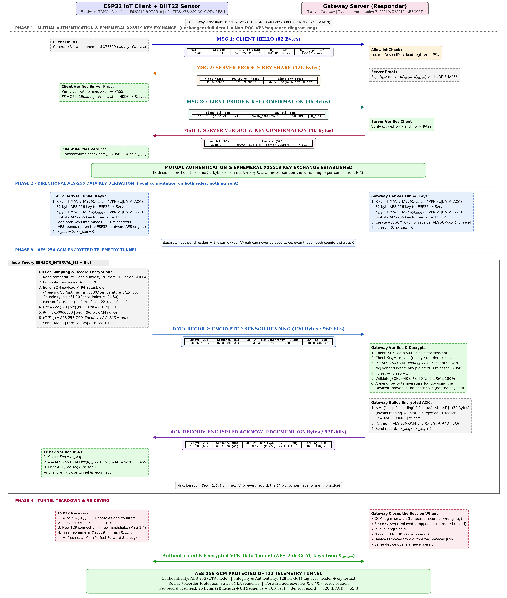

# Classical VPN: DHT22 Temperature Telemetry

Sends DHT22 temperature and humidity readings from ESP32 devices to the laptop gateway
through the classical VPN in [`../Non_PQC_VPN/`](../Non_PQC_VPN/README.md).

The handshake is **unchanged**. It is the same 4-message Ed25519 + X25519 + HKDF-SHA256 mutual
authentication. The only change is the data tunnel. The original sends plaintext ping lines.
This version sends every reading as an **encrypted, authenticated record keyed from `K_session`**.

---

## Directory Overview

* **`esp32_dht22_client/`**: Arduino sketch.
  * `esp32_dht22_client.ino`: reads the DHT22 and sends one encrypted record every `SENSOR_INTERVAL_MS`.
  * `SecureChannel.h/.cpp`: the AES-256-GCM record layer, using mbedTLS with the ESP32 hardware AES engine (new).
  * `TunnelLog.h/.cpp`: boxed Serial printouts of the data keys, the encrypted records, and the payloads (new).
  * `AuthManager`, `DeviceIdentity`, `config.h`: copied from `../Non_PQC_VPN/esp32_client/`. `config.h` adds the sensor settings.
* **`laptop_server/`**: Python gateway.
  * `secure_channel.py`: the record layer, matching the ESP32 side (new).
  * `telemetry_store.py`: validates readings and appends them to `temperature_log.csv` (new).
  * `tunnel_printer.py`: boxed printouts of the data keys, the encrypted records, and the payloads (new).
  * `tunnel_session.py`: handshake unchanged; `handle_tunnel()` now decrypts sensor records.
  * Everything else is copied from `../Non_PQC_VPN/laptop_server/`.
* **`sequence_diagram.png`**: the full protocol flow (handshake, data keys, encrypted telemetry, teardown).
* **`screenshots/`**: screenshots of the results from a test run (`dht1.png` to `dht5.png`).

---

## Hardware Wiring (DHT22 -> ESP32)

| DHT22 pin | ESP32 pin                                   |
|-----------|---------------------------------------------|
| VCC (+)   | 3.3V                                        |
| DATA      | GPIO 4 (`DHT_PIN` in `config.h`)            |
| GND (-)   | GND                                         |

A bare 4-pin DHT22 needs a **10 kΩ pull-up** between DATA and 3.3V. 3-pin breakout modules already have one.

---

## Protocol Flow



**Phase 1** (MSG 1-4) is the unchanged classical handshake; see [`../Non_PQC_VPN/README.md`](../Non_PQC_VPN/README.md) for its details.
It ends with both sides holding the same 32-byte session master key `K_session`. That key is never sent
on the wire, and it is new for every connection because it comes from ephemeral X25519 keys.
Everything below happens **after** that point.

### Phase 2: Directional AES-256 key derivation

Nothing is sent in this phase. Each side computes, on its own:

```
K_c2s = HMAC-SHA256(K_session, "VPN-v1|DATA|C2S")   32 bytes = AES-256 key, ESP32  -> Server
K_s2c = HMAC-SHA256(K_session, "VPN-v1|DATA|S2C")   32 bytes = AES-256 key, Server -> ESP32
```

* The ESP32 loads them into two mbedTLS GCM contexts, so the AES rounds run on the ESP32's hardware AES engine.
  The gateway creates `AESGCM(K_c2s)` for receiving and `AESGCM(K_s2c)` for sending.
* Both sides set their send and receive sequence counters to 0.
* **Why two keys:** AES-GCM is catastrophically broken if the same (key, IV) pair is ever used twice.
  Both directions start counting at 0. With one shared key, the ESP32's record #0 and the server's ACK #0
  would use the same IV. Separate keys make that collision impossible.
* **Why not use `K_session` directly:** the labels give each key a single purpose (domain separation).
  `K_session` itself is never used to encrypt anything.

### Phase 3: Encrypted telemetry (repeats every `SENSOR_INTERVAL_MS` = 5 s)

**1. ESP32 samples and encrypts.**

1. It reads temperature `T` and humidity `RH` from the DHT22 and computes the heat index.
2. It builds the JSON payload `P` (about 94 bytes):
   ```json
   {"reading":1,"uptime_ms":5000,"temperature_c":24.60,"humidity_pct":51.30,"heat_index_c":24.50}
   ```
   If the sensor read fails, it still sends `{"reading":2,"uptime_ms":10000,"error":"dht22_read_failed"}`.
   That way the server knows the device is alive, and the 30 s idle timeout does not close the tunnel.
3. It builds the 10-byte header `Hdr = Length (2B) || Sequence (8B)`, where `Length = 8 + |P| + 16`.
4. It builds the 96-bit GCM IV: `IV = 0x00000000 || Sequence`.
5. It encrypts: `(C, Tag) = AES-256-GCM-Encrypt(K_c2s, IV, P, AAD = Hdr)`.
   * **AES-256 in counter mode** encrypts `P` into `C`, which has the same length as `P`.
   * **GHASH** computes a 16-byte tag over the header (as AAD) and `C`.
     Changing any bit of the length, the sequence number, or the ciphertext invalidates the tag.

**2. The record goes over TCP** (120 bytes for the example above):

```
+-------------+---------------+------------------------------+---------------+
| Length (2B) | Sequence (8B) | AES-256-GCM ciphertext (94B) | GCM Tag (16B) |
+-------------+---------------+------------------------------+---------------+
 \__________ AAD __________/
```

The 26 bytes of overhead per record are the 2-byte length, the 8-byte sequence, and the 16-byte tag.
Anyone on the Wi-Fi sees only these bytes. They can tell a record was sent and how big it is, but not the reading.

**3. The gateway verifies and decrypts** (`secure_channel.py`, `tunnel_session.py`):

1. It reads the length field and checks `24 <= Length <= 504`. Anything else closes the session.
   This also bounds memory: the gateway never buffers more than one record.
2. It waits until the whole record has arrived. TCP may split or merge records, and the length field handles both cases.
3. It checks `Sequence == rx_seq`. A replayed, dropped, or reordered record closes the session.
4. It decrypts: `P = AES-256-GCM-Decrypt(K_c2s, IV, C, Tag, AAD = Hdr)`. The tag is verified **before** any
   plaintext is released. A mismatch (tampering, or the wrong key) closes the session.
5. It increments `rx_seq`.
6. It validates the JSON. Fields must be finite numbers, `-40 <= T <= 80 °C` (the DHT22 range), and `0 <= RH <= 100 %`.
7. It appends a row to `temperature_log.csv`. The device ID in that row is the one **proven in the handshake**,
   never one read from the payload, so one device cannot submit readings as another.

**4. The gateway sends an encrypted ACK.**

The ACK is `A = {"seq":0,"reading":1,"status":"stored"}` (39 bytes). An invalid reading instead gets
`"status":"rejected"` with the reason. It is encrypted the same way, but with `K_s2c` and the gateway's own
`tx_seq`, which makes a 65-byte record.

**5. The ESP32 verifies the ACK.** It checks the sequence number, decrypts with `K_s2c`, and prints the result.
Any failure closes the tunnel, and the ESP32 reconnects.

### Phase 4: Teardown and re-keying

The gateway closes a session when any of these happens:

* a GCM tag mismatch,
* a sequence number other than the one expected,
* an invalid length field,
* 30 s with no record,
* the device is removed from `authorized_devices.json`,
* the same device opens a newer session.

The ESP32 then wipes `K_c2s`, `K_s2c`, its GCM contexts, and its counters, and backs off (3 s, 6 s, … up to 30 s).
After that it runs a **new handshake**. Its fresh ephemeral X25519 keys produce a fresh `K_session`, and so fresh
`K_c2s` and `K_s2c`. Recording the traffic of one session never helps decrypt another one (Perfect Forward Secrecy).

### Security properties

| Property | Mechanism |
|---|---|
| Confidentiality | AES-256 (CTR mode inside GCM) with per-session, per-direction keys |
| Integrity and authenticity | 128-bit GCM tag over header + ciphertext; only the holder of `K_session` can produce it |
| Replay and reorder protection | Strict 64-bit sequence number, authenticated as AAD |
| No IV reuse | Separate key per direction + counter-based IV that never repeats within a session |
| Forward secrecy | `K_session` comes from ephemeral X25519; new keys on every reconnect |
| Device binding | The CSV device ID comes from the Ed25519-authenticated handshake, not the payload |

---

## Quickstart

### 1. Start the server (laptop)

```bash
cd laptop_server
python server.py
```

Readings are printed and appended to `laptop_server/temperature_log.csv`:

```
server_time,device_id,reading,uptime_ms,temperature_c,humidity_pct,heat_index_c,error
2026-11-07T18:27:40,esp32-01,1,5000,24.6,51.3,24.5,
```

### 2. Flash the ESP32

1. Arduino IDE -> Library Manager: install **"DHT sensor library" by Adafruit** (also accept **Adafruit Unified Sensor**).
2. Open `esp32_dht22_client/esp32_dht22_client.ino`.
3. In `config.h`, set `WIFI_SSID`, `WIFI_PASSWORD`, `GATEWAY_IP`, `DEVICE_ID`, and `DHT_PIN` if you wired another GPIO.
4. Upload, then open the Serial Monitor at **115200 baud**.

Device identity keys live in NVS flash (namespace `vpn_identity`). An ESP32 that is already in
`authorized_devices.json` keeps its key and works without re-registering.
For a new device, copy the public key it prints at boot into `laptop_server/authorized_devices.json`.

### Settings

| Setting                | File                  | Default | Notes                                        |
|------------------------|-----------------------|---------|----------------------------------------------|
| `DHT_PIN`              | `config.h`            | 4       | GPIO wired to DHT22 DATA                     |
| `SENSOR_INTERVAL_MS`   | `config.h`            | 5000    | ≥ 2000 (DHT22 limit), < 30000 (idle timeout) |
| `MAX_RECORD_PLAINTEXT` | both config files     | 480     | Must match on both sides                     |
| `TELEMETRY_CSV`        | `config.py`           | `temperature_log.csv` |                                |
