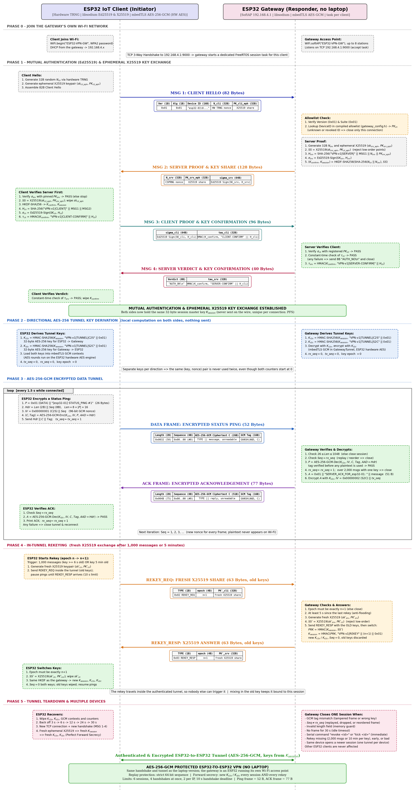

# Classical VPN with an ESP32 as the Gateway (no laptop)

This is the same VPN as [`Non_PQC_VPN/`](../Non_PQC_VPN/README.md), but here **one ESP32 does the laptop's job**. It is the gateway, and the other ESP32s connect to it.

```
   [ESP32 client: esp32-01] ─┐
   [ESP32 client: esp32-02] ─┼── Wi-Fi "ESP32-VPN-GW" ──>  [ESP32 GATEWAY]  192.168.4.1 : 9000
   [ESP32 client: esp32-03] ─┘
```

* The gateway ESP32 makes **its own Wi-Fi network**. You don't need a router, a phone hotspot or a laptop.
* The handshake and the encryption are exactly the same as in `Non_PQC_VPN/`. Only the Wi-Fi name and the gateway IP are different in the clients.
* The gateway uses the same identity key as the laptop gateway, so the clients already trust it. Its public key starts with `191A242D` and ends with `B17673BA`.

---

## What is in this folder

| File | What it does |
|---|---|
| `esp32_gateway/` | The code for the gateway ESP32 (it does what `Non_PQC_VPN/laptop_server/` does on the laptop) |
| `esp32_gateway/gateway_config.h` | Wi-Fi name and password, the list of allowed devices, the gateway key, limits |
| `esp32_gateway/VpnGateway.*` | Accepts connections, limits how many at once, reads commands typed in the Serial Monitor |
| `esp32_gateway/GatewaySession.*` | Handles one client: the handshake and its encrypted messages. Each client runs in its own task |
| `esp32_gateway/GatewayTunnel.*` | Encrypts and decrypts messages (AES-256-GCM) |
| `esp32_gateway/GatewayCrypto.*` | The handshake crypto (Ed25519, X25519, HKDF, HMAC) |
| `esp32_gateway/Allowlist.*` | The allowed devices, and blocking/unblocking them while running |
| `esp32_gateway/SessionRegistry.*` | Keeps one connection per device |
| `esp32_gateway/Log.*` | Keeps the printouts of different clients from mixing |
| `esp32_client/` | The client code, a copy of `Non_PQC_VPN/esp32_client/` set up for this gateway |
| `sequence_diagram.png` | A picture of every step: joining the Wi-Fi, handshake, encrypted messages, rekeying, disconnecting |



---

## How to set it up (Arduino IDE)

**You need:** Arduino IDE 2.x with the **esp32 by Espressif Systems** board package (from the Boards Manager). The crypto library (libsodium) comes with it, so nothing else needs to be installed. You need at least 2 ESP32 boards: 1 gateway and 1 or more clients.

### 1. Flash the gateway
1. Open `esp32_gateway/esp32_gateway.ino`.
2. If you want, change `AP_SSID` and `AP_PASSWORD` in `gateway_config.h`. The password must be at least 8 characters.
3. Choose **Tools → Board → esp32 → ESP32 Dev Module** and the board's port, then click **Upload**.
4. Open the Serial Monitor at **115200 baud**, with line ending set to **"Newline"**. You should see:
   ```
   Wi-Fi SSID        : ESP32-VPN-GW
   Gateway IP        : 192.168.4.1
   Gateway Public Key: 191A242DDD267E20588D076B12F44C834FDDC7C53D8678922EB17759B17673BA
   ```

### 2. Flash each client
1. Open `esp32_client/esp32_client.ino`.
2. In `config.h`, give **each board its own `DEVICE_ID`** (`esp32-01`, `esp32-02`, `esp32-03`). Leave the Wi-Fi settings and `GATEWAY_IP` (`192.168.4.1`) as they are, unless you changed them on the gateway.
3. Upload. When a client starts for the first time, it prints its **Device Public Key**.

### 3. Add a new client to the allowed list
Each board creates its own key the first time it starts and keeps it in flash. Boards that already worked with the laptop gateway keep their keys, and those keys are already in `gateway_config.h`. For a new board:
1. Copy the `Device Public Key` from the client's Serial Monitor.
2. Add `{ "esp32-04", { 0x.., ... } }` to `AUTHORIZED_DEVICES` in `gateway_config.h`.
3. Flash the gateway again.

---

## Commands you can type on the gateway

Type these in the gateway's Serial Monitor:

| Command | What it does |
|---|---|
| `help` | Shows the list of commands |
| `status` | Free memory, number of connected Wi-Fi clients, open connections |
| `list` | The allowed devices, and whether each one is blocked |
| `sessions` | Which devices are connected right now |
| `revoke esp32-02` | Blocks the device **and disconnects it immediately**. Stays blocked after a restart |
| `allow esp32-02` | Unblocks a blocked device |
| `kick esp32-02` | Disconnects the device once (it will connect again by itself) |

---

## What happens with many ESP32s

Each client runs in its **own task** on the gateway, so a problem with one client only affects that client:

| What happens | Result |
|---|---|
| The device is not in the allowed list, or is blocked | Only that connection is closed. The client notices right away and tries again after 3 s, 6 s, 12 s, 24 s, then every 30 s |
| Wrong key, bad signature or bad HMAC tag | That client gets `AUTH_NO`; the others keep working |
| Garbage data or the wrong protocol version | That connection is closed |
| The client stops answering during the handshake | It is dropped after 10 seconds |
| The same device connects again | The new connection replaces the old one |
| You type `revoke <id>` while it is connected | Only that device is disconnected |
| An encrypted message is changed, replayed, out of order or too big | Only that connection is closed |
| The client does not change its keys in time (more than 2,000 messages or 10 minutes with one key), asks too often, or sends a bad rekey | Only that connection is closed |
| No data for 30 seconds | That connection is closed (clients send a ping every 1.5 s) |
| Too many connections at once | The gateway allows 6 connections in total, 4 handshakes at the same time, and 2 per IP. Extra connections are refused |
| The gateway runs out of memory for a new client | Only the new client is refused |
| The gateway restarts | The clients wait for its Wi-Fi to come back, then connect again by themselves |

---

## Security notes
* `GATEWAY_PRIVATE_SEED` (the gateway's secret key) is written in the code, so that the clients can keep trusting the same key as with the laptop gateway. **Anyone who reads it can pretend to be the gateway.** For real use, make a new secret, keep it out of the repository, and update `TRUSTED_GATEWAY_PUBLIC_KEY` in the clients.
* All messages are **encrypted with AES-256-GCM**, the same way as in `Non_PQC_VPN/` and `PQC_VPN/`. There is one key for each direction, every message has a number that must go up by one, and the 16-byte tag is checked before anything is used. Both ESP32s use their built-in AES hardware.
* **The keys are changed while connected**, the same way as in [`Non_PQC_VPN/`](../Non_PQC_VPN/README.md): every 1,000 messages or 5 minutes, the client does a fresh X25519 exchange inside the encrypted connection, both sides switch to the new keys, and the old keys are deleted. The gateway's limits are `REKEY_MAX_MESSAGES`, `REKEY_MAX_MS` and `REKEY_MIN_INTERVAL_MS` in `gateway_config.h`.
