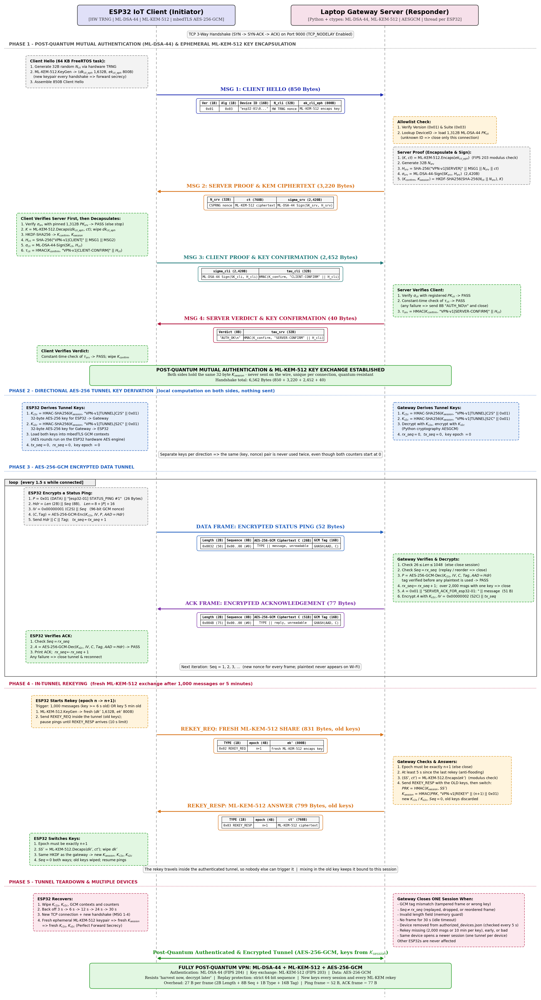

# Post-Quantum VPN (ESP32 to Laptop)

This is the post-quantum version of our VPN in [`../Non_PQC_VPN/`](../Non_PQC_VPN/README.md). Today's VPNs use algorithms that a large quantum computer could break in the future. Someone could record encrypted traffic today and decrypt it years later. This is often called *"harvest now, decrypt later"*. This version replaces those algorithms with new ones that are designed to resist quantum computers.

The handshake works exactly like the classical one: four messages, both sides prove who they are, they agree on a secret key, and then every message is encrypted. Only the algorithms and the message sizes change:

| | Classical (`Non_PQC_VPN`) | Post-quantum (this folder) |
|---|---|---|
| Proving who you are (signatures) | Ed25519 | **ML-DSA-44** (NIST FIPS 204) |
| Agreeing on a secret key | X25519 | **ML-KEM-512** (NIST FIPS 203) |
| Encrypting messages | AES-256-GCM | AES-256-GCM (the same) |
| Changing keys while connected | fresh X25519 every 1,000 messages / 5 min | fresh **ML-KEM-512** every 1,000 messages / 5 min |
| Algorithm ID in message 1 | `0x01` | `0x03` |
| Size of messages 1 / 2 / 3 / 4 | 82 / 128 / 96 / 40 bytes | 850 / 3,220 / 2,452 / 40 bytes |
| Whole handshake | 346 bytes | 6,562 bytes |

AES-256 is already considered safe against quantum computers, so the encryption of the messages stays the same.

> An older version in this folder used ML-DSA-44 together with the classical X25519 key exchange and sent messages without encryption. It was replaced by this version. It can still be found in the git history (commit `3952522`).



---

## What is in this folder

* `esp32_client/`: the code for the ESP32 (Arduino IDE).
  * `esp32_client.ino`: Wi-Fi, connecting (and trying again if it fails), sending pings. It runs in its own task with a **64 KB stack**, because ML-DSA-44 signing needs about 34 KB of stack.
  * `AuthManager`: the handshake (ML-DSA-44 + ML-KEM-512).
  * `DeviceIdentity`: the ESP32's own ML-DSA-44 key, saved in flash.
  * `SecureTunnel`: encryption of messages (AES-256-GCM, on the ESP32's built-in AES hardware).
  * `config.h`: Wi-Fi, gateway IP, device name, and the gateway's public key.
* `laptop_server/`: the gateway (Python).
  * `server.py`: starts the gateway and accepts connections. If one connection has a problem, the gateway keeps running.
  * `tunnel_session.py`: talks to one ESP32 (each ESP32 gets its own thread).
  * `crypto_engine.py`: the handshake crypto. ML-DSA-44 and ML-KEM-512 come from C libraries, loaded with `ctypes`.
  * `secure_tunnel.py`: encryption of messages, the same as on the ESP32.
  * `session_registry.py`: keeps one connection per device.
  * `console.py`: keeps the printouts of different ESP32s from mixing.
  * `authorized_devices.json`: the allowed ESP32s and their 1,312-byte public keys.
  * `build_native_libs.sh` and `host_shim/`: build the two C libraries for the laptop, **offline**, from `arduino_libraries/`.
  * `requirements.txt`: the Python package needed (`cryptography`).
* `arduino_libraries/`: the two post-quantum libraries, used by both the ESP32 and the laptop.
  * `MLKEM512/`: ML-KEM-512, made from [mlkem-native](https://github.com/pq-code-package/mlkem-native) v2.0.0.
  * `MLDSA44/`: ML-DSA-44, made from mldsa-native v1.0.0-beta2.
* `sequence_diagram.png`: a picture of every step.
* `benchmarking/mutual_auth_benchmark/`: compares Ed25519 and ML-DSA-44 on the ESP32 ([README](benchmarking/mutual_auth_benchmark/README.md)).
* `benchmarking/system_benchmark/`: tests the whole VPN and compares classical with post-quantum side by side ([README](benchmarking/system_benchmark/README.md)).

---

## How it works

The ESP32 connects to the gateway on TCP port 9000. Then four messages are exchanged.

**Message 1, Client Hello (850 bytes): ESP32 to gateway**
* The ESP32 makes a **fresh ML-KEM-512 key pair**: a public part (800 bytes) and a private part (1,632 bytes). It is new for every connection, so old sessions stay safe even if a key leaks later.
* It sends: version, algorithm ID, device name, a 32-byte random number, and the 800-byte public part.
* The gateway checks the version and algorithm, and checks the device name against `authorized_devices.json`. Unknown devices are dropped right away.

**Message 2, Server Proof (3,220 bytes): gateway to ESP32**
* The gateway uses the ESP32's ML-KEM public key to create a **shared secret `K`** and a 768-byte **ciphertext**. Only the ESP32, with its private key, can get `K` back out of the ciphertext. If the public key is malformed, the gateway stops.
* The gateway hashes message 1 plus its own random number and the ciphertext, and **signs** the hash with its ML-DSA-44 key (the signature is 2,420 bytes).
* The ESP32 checks the signature with the gateway's public key from `config.h` **before** doing anything else. This stops fake gateways, and because the keys are inside the signed data, nobody in the middle can swap them.
* The ESP32 opens the ciphertext with its private key, gets the same `K`, and then deletes the private key.
* Both sides turn `K` into two keys with HKDF: `K_confirm` (to check the handshake) and `K_session` (for the data).

**Message 3, Client Proof (2,452 bytes): ESP32 to gateway**
* The ESP32 hashes messages 1 and 2, signs the hash with its own ML-DSA-44 key, and adds an HMAC tag made with `K_confirm`.
* The gateway checks both. This proves the ESP32 is the device it says it is, and that it got the same secret.

**Message 4, Verdict (40 bytes): gateway to ESP32**
* `AUTH_OK` plus the gateway's own HMAC tag, or `AUTH_NO` (8 bytes) if the ESP32's proof was wrong.

**After the handshake: encrypted messages.** These work exactly as in the classical VPN:
* From `K_session`, each side makes one AES-256 key for each direction.
* Every message has the format `[2 bytes length][8 bytes number][encrypted data][16 bytes tag]`. The tag proves nothing was changed. The number must go up by exactly 1, so replays are caught.
* Inside, each message starts with one byte that says what it is: normal data, a rekey request, or a rekey answer. One message can carry up to 1,023 bytes.
* A changed, replayed, out-of-order or too-big message closes only that ESP32's connection.

**Changing the keys while connected (rekeying)**
* After **1,000 messages or 5 minutes**, the ESP32 asks for new keys. For a demo, set `REKEY_AFTER_MESSAGES` in `config.h` to 10.
* It sends a fresh ML-KEM-512 public key (an 831-byte encrypted message). The gateway answers with a ciphertext (799 bytes). Both get a new secret, mix it with the old key, and switch to new keys. The old keys are deleted and the numbering starts again from 0.
* This happens inside the encrypted connection, so nobody else can start a rekey. If a key ever leaks, it only exposes the messages from its own period.
* The gateway disconnects a device that does not rekey in time (more than 2,000 messages or 10 minutes with one key), asks for new keys within 5 seconds of the last time, or sends a bad rekey message. Only that device is disconnected.

### ML-KEM-512 sizes
| Part | Size |
|---|---|
| Public key (sent by the ESP32) | 800 bytes |
| Private key (stays on the ESP32) | 1,632 bytes |
| Ciphertext (sent by the gateway) | 768 bytes |
| Shared secret | 32 bytes |

---

## What happens with many ESP32s

Every ESP32 gets **its own thread** on the gateway, so a problem with one device only affects that device:

| What happens | Result |
|---|---|
| The device is not in the allowed list | Only that connection is closed. The ESP32 tries again after 3 s, 6 s, 12 s, 24 s, then every 30 s |
| Wrong key or bad HMAC tag | That device gets `AUTH_NO`; the others keep working |
| Garbage data, wrong version, or a broken ML-KEM key | That connection is closed |
| The device stops answering during the handshake | It is dropped after 15 seconds |
| The same device connects again | The new connection replaces the old one |
| The device is removed from `authorized_devices.json` while connected | Only that device is disconnected (checked every 5 seconds) |
| `authorized_devices.json` is saved half-way or has a typo | The last good list is kept; nobody is disconnected |
| An encrypted message is changed, replayed or too big | Only that connection is closed |
| The device does not change its keys in time, asks too often, or sends a bad rekey | Only that connection is closed |
| Too many connections at once | The gateway allows 8 handshakes at the same time, 2 per IP, and 5 new connections per IP every 10 seconds. Extra connections are refused |
| Something goes wrong while starting one connection | That connection is refused; the gateway and the other connections keep running |

---

## How to run it

### What you need
* **Laptop:** Python 3, a C compiler (`gcc` or `clang`), and the `cryptography` package.
* **ESP32:** Arduino IDE 2.x with the **esp32 by Espressif Systems** board package, plus the two libraries in `arduino_libraries/`.

### 1. Build the libraries and start the gateway (laptop)
```bash
cd PQC_VPN/laptop_server
./build_native_libs.sh      # builds libmlkem512.so and libmldsa44.so (no internet needed)
python3 -m venv .venv && .venv/bin/pip install -r requirements.txt   # only the first time
.venv/bin/python server.py
```
The `.so` files are not stored in git, so build them on each laptop. The gateway prints its IP and waits on port **9000**.

### 2. Install the libraries and flash the ESP32
1. Copy **both** libraries into your Arduino libraries folder (`~/Arduino/libraries` on Linux, `~/Documents/Arduino/libraries` on Windows and Mac):
   ```bash
   cp -R PQC_VPN/arduino_libraries/MLDSA44 PQC_VPN/arduino_libraries/MLKEM512 ~/Arduino/libraries/
   ```
   Then restart the Arduino IDE.
2. In `esp32_client/config.h`, set `WIFI_SSID`, `WIFI_PASSWORD`, `GATEWAY_IP` (printed by `server.py`), and a different `DEVICE_ID` for each board.
3. Open `esp32_client/esp32_client.ino`, choose **ESP32 Dev Module**, upload, and open the Serial Monitor at **115200 baud**.

You can also build from the command line without installing the libraries:
```bash
arduino-cli compile --fqbn esp32:esp32:esp32 --libraries PQC_VPN/arduino_libraries PQC_VPN/esp32_client
```

### 3. Add each ESP32 to the allowed list
The first time an ESP32 starts, it creates its ML-DSA-44 key, saves it in flash, and prints its 1,312-byte **Device Public Key** on the Serial Monitor. Copy it into `laptop_server/authorized_devices.json` under the board's device name. The gateway picks up the change without a restart.

> The `authorized_devices.json` in the repository contains the key of the board we tested with, under `esp32-01`. A different board using that name will be rejected until you put its own key there.

---

## Technical notes
* **Random numbers on the ESP32:** both libraries take their random numbers from the ESP32's hardware random number generator (`esp_fill_random()`). The library settings that were changed for this project are marked `[ESP32 VPN]` in the `*_native_config.h` files.
* **Random numbers on the laptop:** `build_native_libs.sh` builds the *same* C code with the *same* settings. The only difference is that `host_shim/` takes random numbers from the operating system instead of the ESP32 hardware.
* **Memory:** the ML-KEM data (about 6.5 KB) is kept in a global object, not on the stack. The libraries never use `malloc`. ML-DSA-44 signing is the step that needs the most stack.
* **Library source:** only the plain C files of mlkem-native v2.0.0 are included, with its original license (`LICENSE.mlkem-native`).

## How it was tested
* **Correct results:** our ML-KEM-512 and ML-DSA-44 libraries give exactly the same output as two independent reference programs (kyber-py and dilithium-py) in 1,000 random tests (9,000 / 9,000 checks). See the [system benchmark](benchmarking/system_benchmark/README.md).
* **Same gateway key as before:** the libraries built with `build_native_libs.sh` create the same gateway key as the earlier library, so the key in `config.h` did not have to change.
* **Rekeying, 12 / 12 tests passed** against the real gateway:
  * Two rekeys in a row work, and data keeps flowing after each one.
  * A message sent with the old key after a rekey is rejected.
  * A wrong rekey number, a rekey asked too soon, and a broken ML-KEM key each close only that connection.
  * A device that does not rekey in time is disconnected, while a device that rekeys in time stays connected.
* **Many devices, 20 / 20 tests passed** against the real gateway, using simulated ESP32s:
  * 3 devices connect at once and exchange encrypted messages.
  * Unknown devices, wrong keys, bad tags, garbage and broken ML-KEM keys are all rejected, and the other devices keep working.
  * Connections that just sit there do not block real devices.
  * Changed, replayed and too-big messages close only that connection.
  * A device connecting again replaces its old connection.
  * A broken allowed list keeps everyone connected, and a removed device is disconnected while the others stay.
  * The gateway survives an error while starting a connection.
  * The printouts of different devices never mix.
* **ESP32 code:** builds without any warnings, and uses 79% of the flash.
* **Real hardware:** an ESP32 and the laptop (over a phone hotspot) completed the full handshake, got the same `K_session` on both sides, and exchanged more than 50 encrypted messages.
