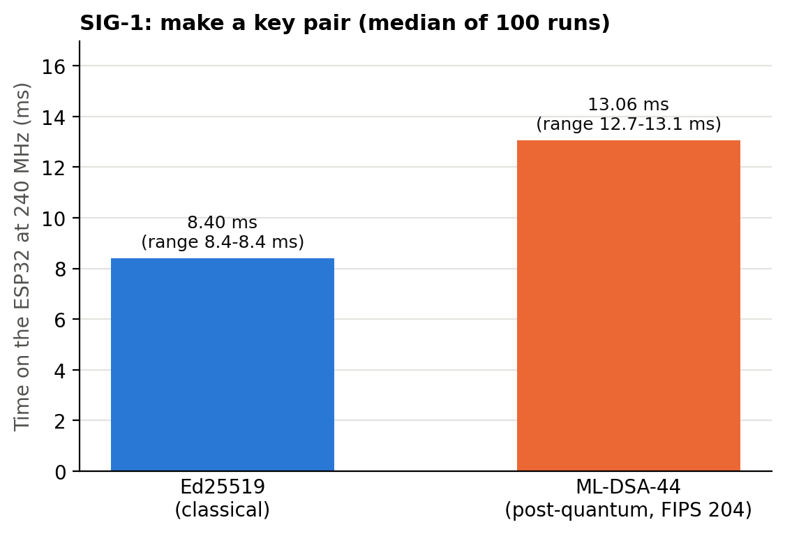
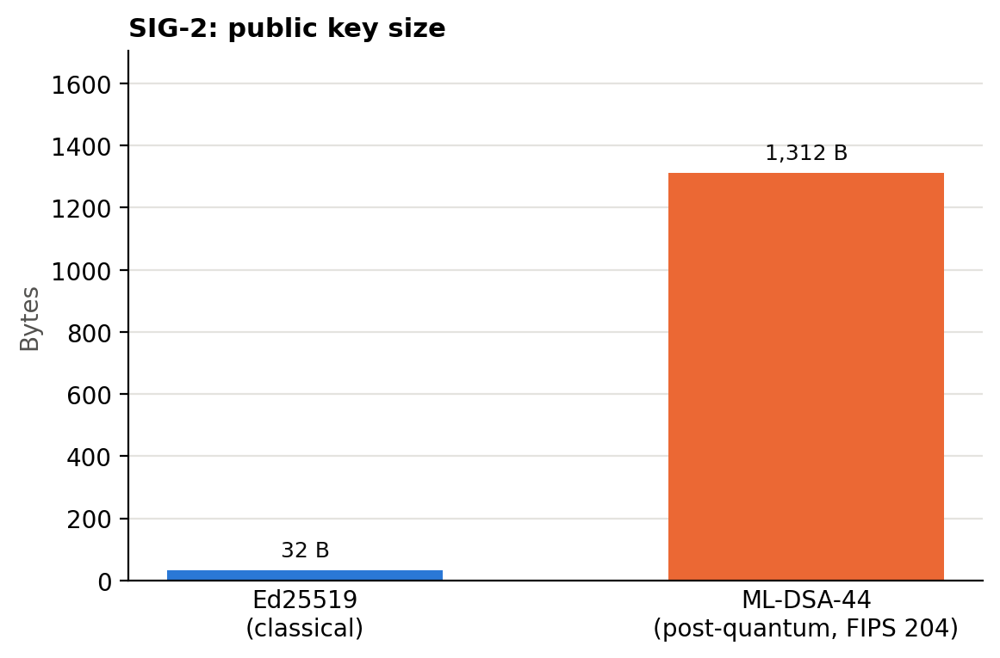
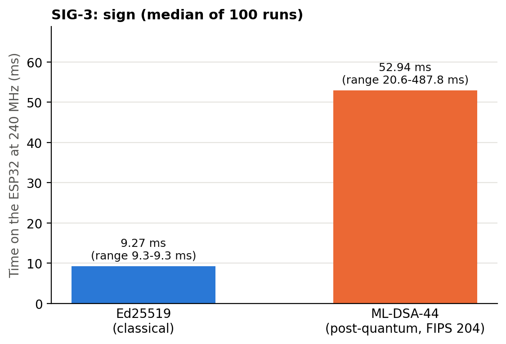
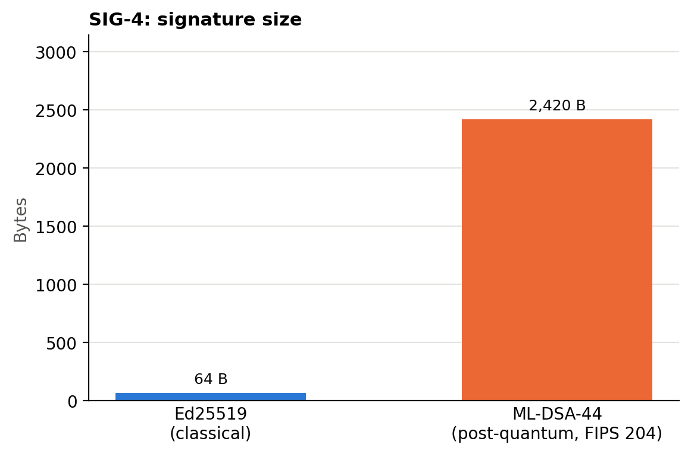
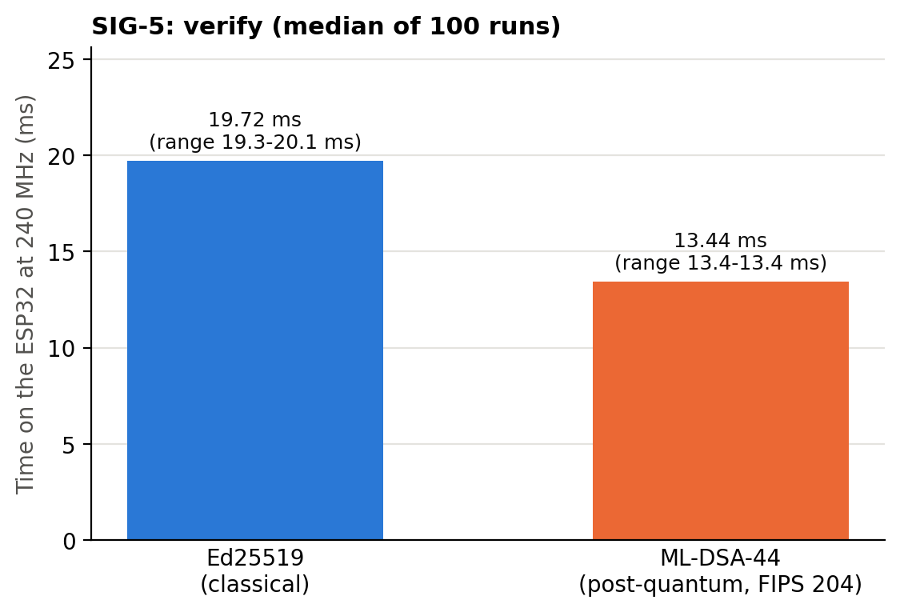
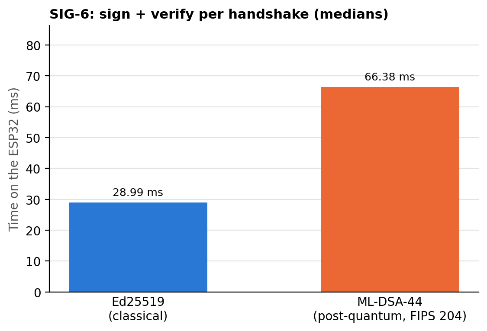
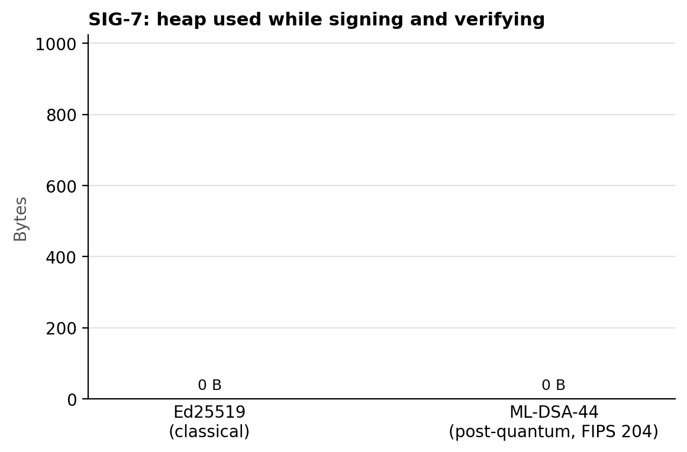
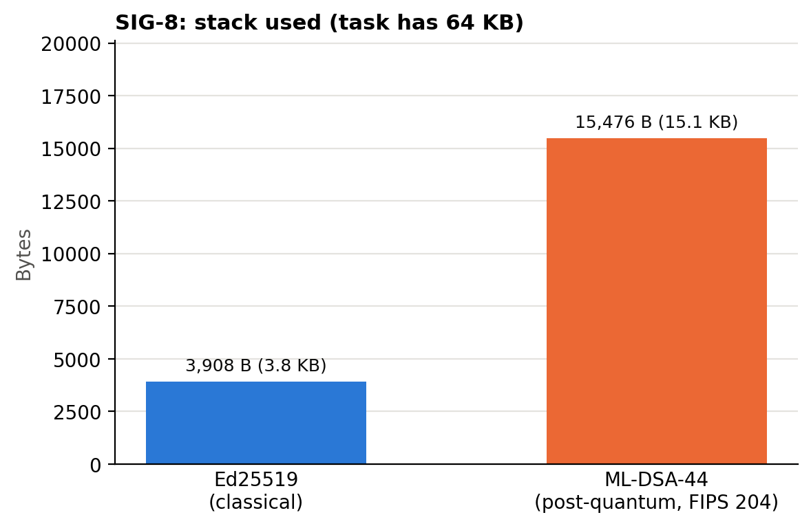

# Ed25519 vs. ML-DSA-44 on the ESP32

This test compares the signature algorithm of our classical VPN (**Ed25519**) with the post-quantum one (**ML-DSA-44**, NIST FIPS 204) on the ESP32 at 240 MHz. In the handshake, the ESP32 signs once (to prove who it is) and verifies once (to check the gateway), so these are the two most important numbers.

---

## Algorithms

| Algorithm | Based on | Safe against quantum computers? | Library |
| :--- | :--- | :--- | :--- |
| **Ed25519** | Curve25519 (RFC 8032) | No | libsodium |
| **ML-DSA-44** | Lattices (NIST FIPS 204) | Yes (NIST security category 2) | mldsa-native, with its low-memory setting (`MLD_CONFIG_REDUCE_RAM`) |

---

## Test setup

* **Board:** ESP32-D0WDQ6, two cores, 240 MHz
* **Stack:** each test runs in its own task with a 64 KB stack, on core 1
* **How time is measured:** the ESP32's cycle counter. Time in ms = cycles / 240,000.
* **Number of runs:** 100 per algorithm. The message changes every run, because ML-DSA-44 signing time depends on the message (see below).

---

## What we measured

| ID | What | How |
| :--- | :--- | :--- |
| SIG-1 | Time to make a key pair | Cycle counter, 100 runs (mean, median, spread, min-max) |
| SIG-2 | Key sizes | Public key size (32 B vs. 1,312 B) and secret key size (64 B vs. 2,560 B) |
| SIG-3 | Time to sign | Cycle counter, 100 different messages |
| SIG-4 | Signature size | Bytes sent over the network (64 B vs. 2,420 B) |
| SIG-5 | Time to verify | Cycle counter, 100 runs |
| SIG-6 | Cost per handshake | Sign + verify (SIG-3 mean + SIG-5 mean) |
| SIG-7a | Heap memory while signing and verifying | Highest heap use |
| SIG-7b | Heap memory while making keys | Highest heap use |
| SIG-8 | Stack memory | Highest stack use (the test's own buffers are kept off the stack so they do not count) |
| SIG-9 | Correct results | Ed25519: official RFC 8032 test vector. ML-DSA-44: a key made from a fixed seed must match the expected bytes, and a signature with one changed bit must be rejected |

The expected ML-DSA-44 bytes used in SIG-9 have been checked against dilithium-py, a separate implementation of FIPS 204. They match.

---

## Results (ESP32 at 240 MHz, 100 runs, measured 27 Nov 2026)

**Setup:** ESP32-D0WD, Arduino core 3.3.12, ESP-IDF 5.5.5, libsodium 1.0.21, ML-DSA-44 from `PQC_VPN/arduino_libraries/MLDSA44` (mldsa-native v1.0.0-beta2, `MLD_CONFIG_REDUCE_RAM`): exactly the code the VPN uses. Full output: `results/sig_bench_run1.log`.

| ID | What | Ed25519 | ML-DSA-44 | Comparison |
| :--- | :--- | :---: | :---: | :---: |
| SIG-1 | Make key pair (median) | **8.40 ms** | 13.06 ms | ML-DSA-44 is 1.6 times slower |
| | Make key pair (spread / min-max) | 0.00 ms (8.4-8.4 ms) | 0.11 ms (12.7-13.1 ms) | |
| SIG-2 | Public key size | **32 B** | 1,312 B | 41 times larger |
| | Secret key size | **64 B** | 2,560 B | 40 times larger (or keep only the 32 B seed) |
| SIG-3 | Sign (median) | **9.27 ms** | 52.94 ms | 5.7 times slower |
| | Sign (mean) | **9.27 ms** | 77.10 ms | |
| | Sign (spread / min-max) | 0.00 ms (9.3-9.3 ms) | 76.47 ms (20.6-487.8 ms) | ML-DSA-44 varies a lot (see below) |
| SIG-4 | Signature size | **64 B** | 2,420 B | 38 times larger (needs 2 TCP packets) |
| SIG-5 | Verify (median) | 19.72 ms | **13.44 ms** | **ML-DSA-44 is 1.47 times faster** |
| | Verify (spread / min-max) | 0.16 ms (19.3-20.1 ms) | **0.00 ms (13.4-13.4 ms)** | ML-DSA-44 always takes the same time |
| SIG-6 | Sign + verify per handshake (medians) | **28.99 ms** | 66.38 ms | **2.3 times more** |
| | Sign + verify per handshake (means) | **28.99 ms** | 90.54 ms | 3.1 times more |
| SIG-7a | Heap while signing and verifying | **0 B** | **0 B** | Neither uses heap |
| SIG-7b | Heap while making keys | **0 B** | **0 B** | Neither uses heap |
| SIG-8 | Stack used | **3,908 B** (about 3.8 KB) | 15,476 B (about 15.1 KB) | Fits easily in the 64 KB task stack |
| SIG-9 | Correct results | **PASS** | **PASS** | |

(1 KB = 1,024 bytes.) The same Ed25519 numbers were measured by the classical benchmark (`Non_PQC_VPN/benchmarking/mutual_auth_benchmark/`, re-run on 27 Nov 2026: sign 9.59 ms, verify 19.73 ms) and by the drone study (`Drone_Auth_Research`, 1,000 runs: sign 9.43 ms, verify 19.79 ms). The drone study also times ML-DSA-44 with 1,000 runs (sign median 54.74 ms, p99 289.5 ms, verify 13.44 ms, stack 14,960 B), which describes ML-DSA's slow cases more precisely than 100 runs can.

> **Correction (27 Nov 2026).** An earlier version of this table (1 Nov 2026) said Ed25519 signs in 15.91 ms, ML-DSA-44 needs 34,800 B of stack, and sign + verify costs "1.9 times more". That measurement was made with the ML-DSA-44 library used before 9 Nov 2026 and an older build; it could not be reproduced. With the current code, Ed25519 signs in 9.27 ms, ML-DSA-44 uses about 15 KB of stack, and sign + verify costs 2.3 times more (medians). The two other benchmarks above agree with the new numbers.

---

## What the results mean

1. **ML-DSA-44 verifies faster than Ed25519** (13.44 ms vs. 19.72 ms). The ESP32 has to verify the gateway's signature in every handshake, so this helps. ML-DSA-44 verification always takes exactly the same time.
2. **ML-DSA-44 signing is slower and its time jumps around.** Usually about 53 ms (5.7 times Ed25519), but between 20.6 ms and 487.8 ms. This is how ML-DSA works: it makes a candidate signature, and if that candidate could leak something about the secret key, it throws it away and tries again. Some messages need one try, others need several. Because of these rare slow cases the mean (77 ms) is much higher than the median (53 ms); the median is the typical time. Ed25519 always takes 9.27 ms.
3. **In total, one post-quantum handshake costs the ESP32 about 66 ms of signing and verifying (medians)**, about 2.3 times Ed25519 (29 ms). That is still much faster than the older classical options: ECDSA P-256 needs 469.85 ms and RSA-3072 needs 388.40 ms (see `Non_PQC_VPN/benchmarking/mutual_auth_benchmark/`).
4. **Making a key is also a little slower** (13.06 ms vs. 8.40 ms), but this happens only once, when a device starts for the first time.
5. **The real costs are size and a bigger stack.** The ML-DSA-44 public key and signature are about 40 times bigger than Ed25519's. Signing needs about 15 KB of stack (Ed25519: about 4 KB), so the post-quantum ESP32 code runs in its own task with a 64 KB stack, which leaves a large safety margin. Neither algorithm uses any heap memory.

---

## Output from the ESP32

The summary table the ESP32 printed at the end of the run (from `results/sig_bench_run1.log`):

```text
=================================================================================
             DIGITAL SIGNATURE BENCHMARK SUMMARY (ED25519 VS ML-DSA-44)          
=================================================================================
KPI ID  | Metric                                | Ed25519        | ML-DSA-44     
--------+---------------------------------------+----------------+---------------
SIG-1   | KeyGen Latency (Mean)                 |       8.40 ms  |      13.02 ms
        | KeyGen Latency (Median)               |       8.40 ms  |      13.06 ms
        | KeyGen Latency (StdDev σ)             |       0.00 ms  |       0.11 ms
        | KeyGen Range (Min - Max)              |   8.4-8.4   ms |  12.7-13.1  ms
SIG-2   | Public Key Wire Size                  |          32 B  |        1312 B
        | Secret Key Storage Size               |          64 B  |        2560 B
SIG-3   | Message Signing Time (Mean)           |       9.27 ms  |      77.10 ms
        | Message Signing Time (Median)         |       9.27 ms  |      52.94 ms
        | Message Signing Time (StdDev σ)       |       0.00 ms  |      76.47 ms
        | Signing Range (Min - Max)             |   9.3-9.3   ms |  20.6-487.8 ms
SIG-4   | Signature Wire Size (Fixed)           |          64 B  |        2420 B
SIG-5   | Verification Time (Mean)              |      19.72 ms  |      13.44 ms
        | Verification Time (Median)            |      19.72 ms  |      13.44 ms
        | Verification Time (StdDev σ)          |       0.16 ms  |       0.00 ms
        | Verify Range (Min - Max)              |  19.3-20.1  ms |  13.4-13.4  ms
SIG-6   | Crypto Auth Cost (Sign+Verify)        |      28.99 ms  |      90.54 ms
SIG-7a  | Steady-State Heap (Sign+Verify)       |           0 B  |           0 B
SIG-7b  | KeyGen Peak Heap (Provisioning)       |           0 B  |           0 B
SIG-8   | Peak Crypto Stack Usage (True)        |        3908 B  |       15476 B
SIG-9   | Cryptographic Correctness             | PASS (0 err)   | PASS (0 err)  
=================================================================================
SIG-6 with medians (sign median + verify median): Ed25519 28.99 ms | ML-DSA-44 66.38 ms
```

(The screenshot of the earlier, outdated run is kept in `screenshots/archive_2026-11-01_old_measurement/`.)

---

## Graphs

Made from the log above with `python3 make_graphs.py`. Times: median of 100 runs, with the min-max range.

### Time to make a key pair (SIG-1)


### Key sizes (SIG-2)


### Time to sign (SIG-3)


### Signature size (SIG-4)


### Time to verify (SIG-5)


### Sign + verify per handshake (SIG-6)


### Heap memory (SIG-7a and SIG-7b)


### Stack memory (SIG-8)


---

## How to run it

1. Open `mutual_auth_benchmark.ino` in the Arduino IDE.
2. Choose **Tools > Board > ESP32 Dev Module** and set the CPU frequency to **240 MHz**.
3. Upload, then open the **Serial Monitor** at **115200 baud**, or save the run to a file with `python3 PQC_VPN/benchmarking/capture_esp32_bench.py --port /dev/ttyUSB0 --out PQC_VPN/benchmarking/mutual_auth_benchmark/results --name sig_bench_run1` (from the `FYP` folder; close the Serial Monitor first).
