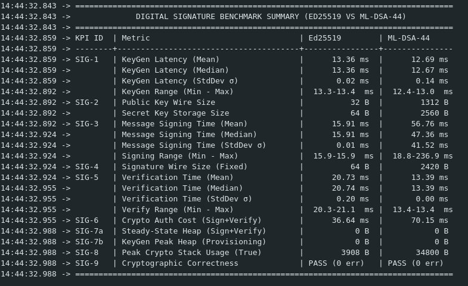
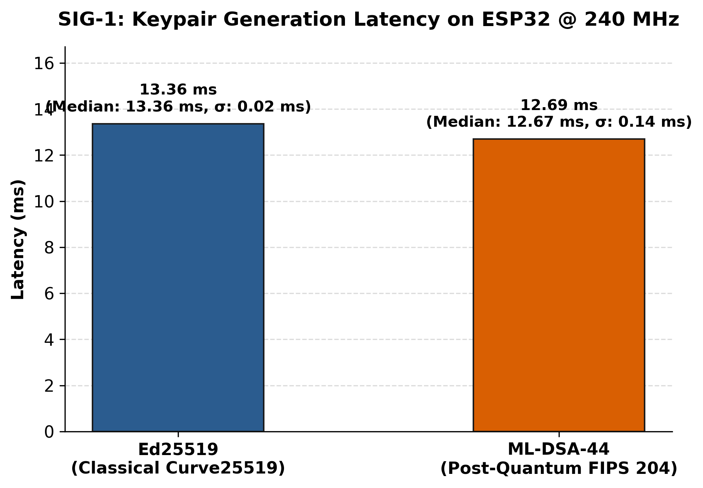
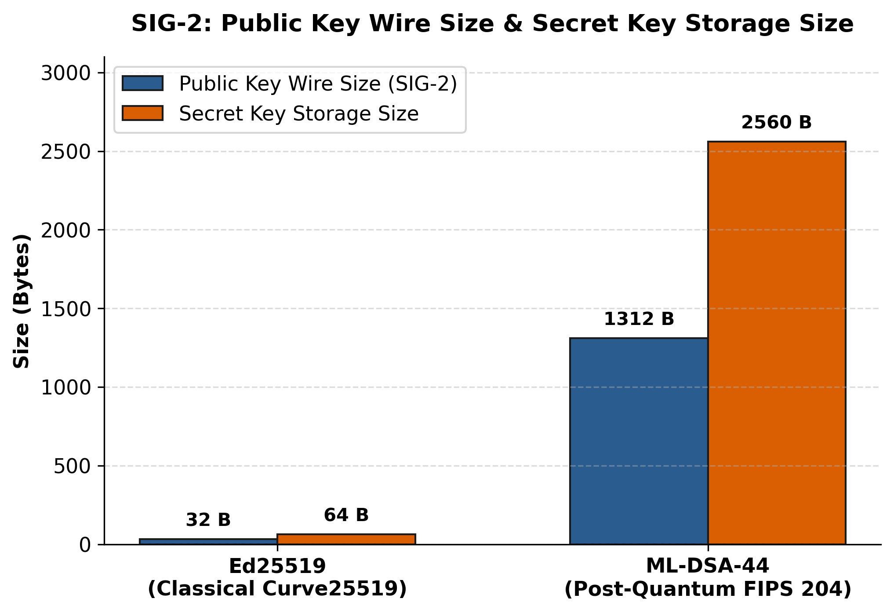
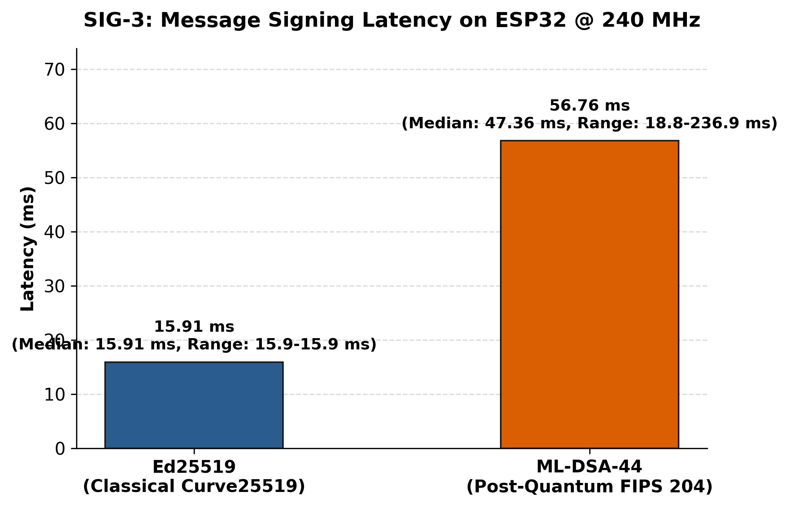
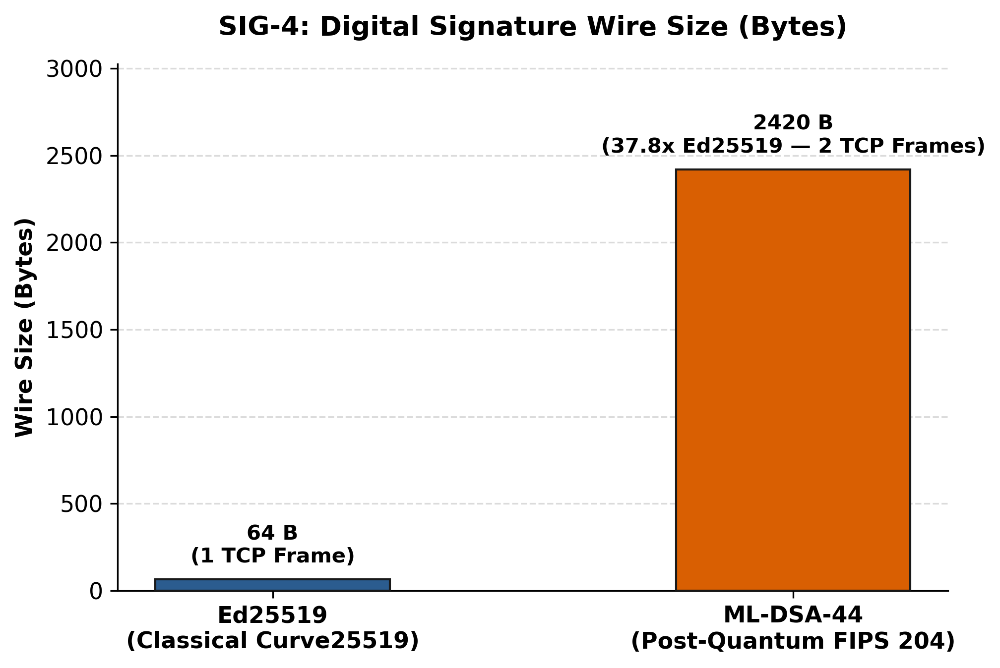
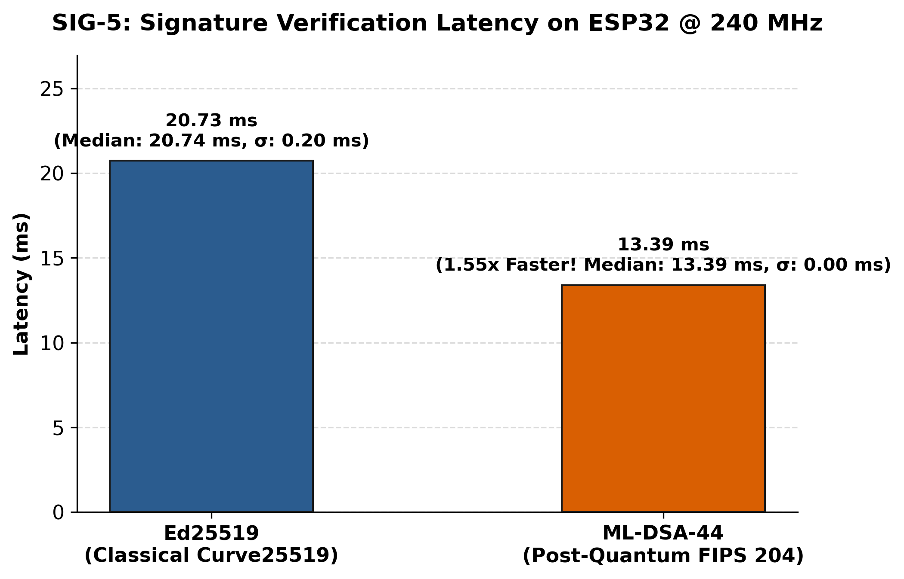
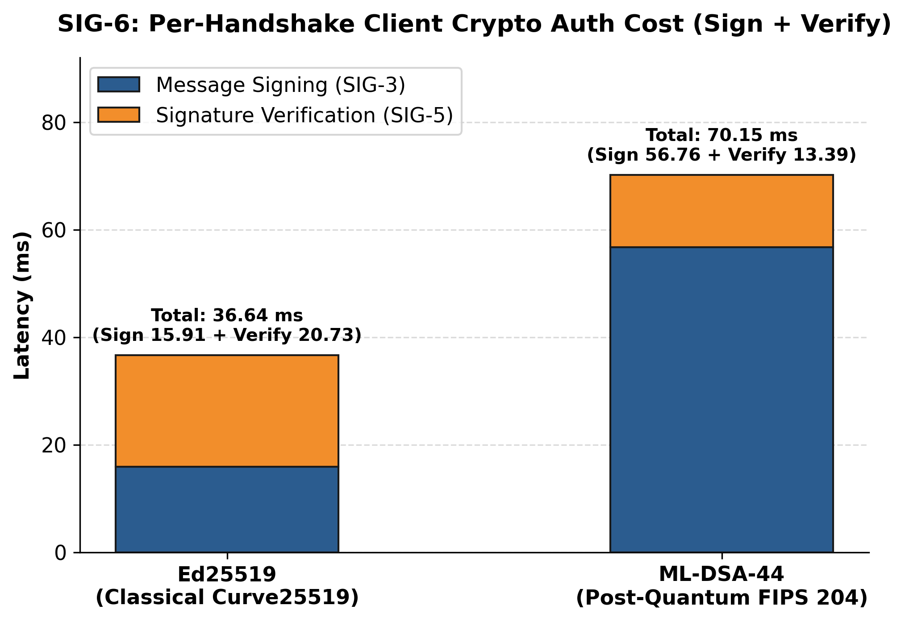
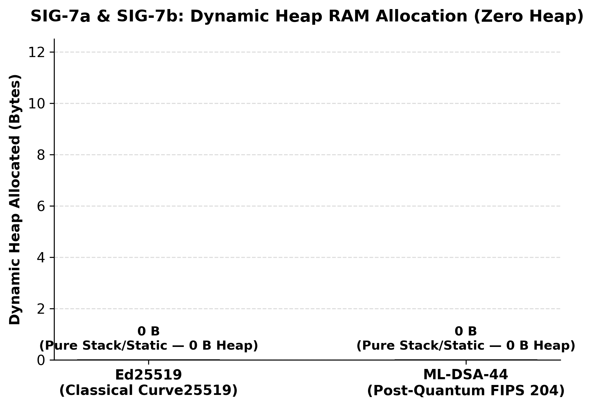
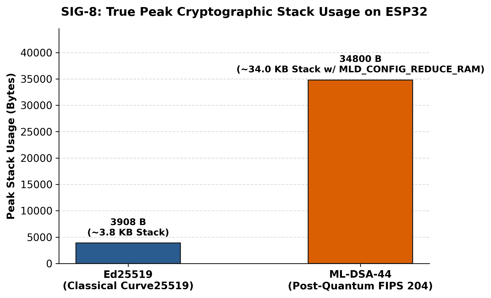

# Post-Quantum vs. Classical Digital Signature Benchmark on ESP32 (`Ed25519` vs. `ML-DSA-44`)

Head-to-head hardware micro-benchmark evaluating the classical digital signature winner (**`Ed25519`**, RFC 8032) against the NIST FIPS 204 standardized post-quantum module-lattice digital signature scheme (**`ML-DSA-44`**) on the ESP32 microcontroller at 240 MHz.

---

## Algorithms Evaluated

| Algorithm | Cryptographic Family / Standard | Security Level | Implementation Library |
| :--- | :--- | :--- | :--- |
| **`Ed25519`** | Twisted Edwards Curve25519 (RFC 8032) | 128-bit Classical *(Quantum-Vulnerable)* | `libsodium` (`crypto_sign_ed25519_*`) |
| **`ML-DSA-44`** | Module-LWE / Module-SIS Lattice (NIST FIPS 204) | NIST PQC Category 2 (~128-bit Quantum + Classical) | `mldsa-native` (`PQCP_MLDSA_NATIVE_MLDSA44_*` with `MLD_CONFIG_REDUCE_RAM`) |

---

## Test Environment

* **Microcontroller:** ESP32-D0WDQ6 (Dual-Core Xtensa LX6 @ 240 MHz)
* **Task Stack Allocation:** Dedicated 64 KB (`65,536 bytes`) FreeRTOS tasks pinned to Core 1
* **Measurement Mechanism:** Direct hardware CPU cycle counter register (`ccount`):
  $$\text{Time (ms)} = \frac{\text{CPU Cycles}}{240,000}$$
* **Iteration Count:** 100 runs per algorithm with message mutation per iteration to exercise `ML-DSA-44`'s Fiat-Shamir with Aborts rejection sampling distribution.

---

## Benchmark Methodology & KPIs

| KPI ID | Metric | Measurement Technique |
| :--- | :--- | :--- |
| **`SIG-1`** | **Keypair Generation Latency** | Hardware cycle counter (`ccount`) across 100 runs (`Mean`, `Median`, `StdDev` $\sigma$, `Min - Max`) |
| **`SIG-2`** | **Public Key Wire & Secret Key Size** | Serialized public key wire size (`32 B` vs. `1,312 B`) and secret key storage size (`64 B` vs. `2,560 B`) |
| **`SIG-3`** | **Message Signing Latency** | Hardware cycle counter across 100 mutated messages (`Mean`, `Median`, `StdDev` $\sigma$, `Min - Max`) |
| **`SIG-4`** | **Signature Wire Size** | Serialized signature byte length transmitted over the network (`64 B` vs. `2,420 B`) |
| **`SIG-5`** | **Signature Verification Latency** | Hardware cycle counter across 100 runs (`Mean`, `Median`, `StdDev` $\sigma$, `Min - Max`) |
| **`SIG-6`** | **Per-Handshake Client Crypto Cost** | Total client-side authentication compute time per VPN handshake ($\text{SIG-3 Mean} + \text{SIG-5 Mean}$) |
| **`SIG-7a`** | **Steady-State Dynamic Heap** | Peak dynamic heap allocation (`malloc`/`calloc`) during runtime `Sign + Verify` |
| **`SIG-7b`** | **KeyGen Peak Heap** | Peak dynamic heap allocation during device keypair provisioning (`KeyGen`) |
| **`SIG-8`** | **True Peak Crypto Stack Usage** | FreeRTOS task stack high-water mark (`uxTaskGetStackHighWaterMark`) with harness/key buffers in `.bss` |
| **`SIG-9`** | **Cryptographic Correctness** | RFC 8032 §7.1 KAT (`Ed25519`) + NIST FIPS 204 deterministic seed KAT & 1-bit tamper rejection (`ML-DSA-44`) |

---

## Hardware Summary Table (Measured on ESP32 @ 240 MHz, $N = 100$ Runs)

| KPI ID | Metric | Ed25519 (Classical) | ML-DSA-44 (NIST FIPS 204 PQC) | Comparison / Ratio |
| :--- | :--- | :---: | :---: | :---: |
| **`SIG-1`** | **KeyGen Latency (Mean)** | 13.36 ms | **12.69 ms** | **`ML-DSA-44` is $1.05\times$ faster** |
| | **KeyGen Latency (Median)** | 13.36 ms | **12.67 ms** | — |
| | **KeyGen Latency ($\sigma$ / Min–Max)** | 0.02 ms (`13.3–13.4 ms`) | 0.14 ms (`12.4–13.0 ms`) | Deterministic NTT matrix expansion |
| **`SIG-2`** | **Public Key Wire Size** | **32 B** | 1,312 B | $41.0\times$ larger |
| | **Secret Key Storage Size** | **64 B** | 2,560 B | $40.0\times$ larger *(or 32 B seed)* |
| **`SIG-3`** | **Message Signing Time (Mean)** | **15.91 ms** | 56.76 ms | $3.57\times$ slower (Mean) |
| | **Message Signing Time (Median)** | **15.91 ms** | 47.36 ms | $2.98\times$ slower (Median) |
| | **Message Signing ($\sigma$ / Min–Max)** | 0.01 ms (`15.9–15.9 ms`) | 41.52 ms (`18.8–236.9 ms`) | Fiat-Shamir rejection sampling |
| **`SIG-4`** | **Signature Wire Size (Fixed)** | **64 B** | 2,420 B | $37.8\times$ larger (2 TCP segments) |
| **`SIG-5`** | **Verification Time (Mean)** | 20.73 ms | **13.39 ms** | **`ML-DSA-44` is $1.55\times$ faster!** |
| | **Verification Time (Median)** | 20.74 ms | **13.39 ms** | — |
| | **Verification ($\sigma$ / Min–Max)** | 0.20 ms (`20.3–21.1 ms`) | **0.00 ms (`13.4–13.4 ms`)** | Single-pass NTT verification |
| **`SIG-6`** | **Crypto Auth Cost (`Sign + Verify`)** | **36.64 ms** | 70.15 ms | Only **$1.91\times$** total compute cost |
| **`SIG-7a`** | **Steady-State Heap (`Sign + Verify`)** | **0 B** | **0 B** | Zero heap fragmentation |
| **`SIG-7b`** | **KeyGen Peak Heap (`Provisioning`)** | **0 B** | **0 B** | Zero heap fragmentation |
| **`SIG-8`** | **Peak Crypto Stack Usage (True)** | **3,908 B** (~3.8 KB) | 34,800 B (~34.0 KB) | Fits in 64 KB FreeRTOS task stack |
| **`SIG-9`** | **Cryptographic Correctness** | **PASS (0 err)** | **PASS (0 err)** | 100% KAT & Tamper verified |

---

## Key Technical Findings for Post-Quantum VPN Migration

1. **`ML-DSA-44` Verification Is $1.55\times$ Faster Than Classical `Ed25519` (`13.39 ms` vs. `20.73 ms`):**
   - During `MSG 2` of the VPN handshake, the ESP32 must verify the Laptop Server's signature before trusting the server. Because `ML-DSA-44` verification uses fast 32-bit Number Theoretic Transform (NTT) polynomial multiplication modulo $q = 8,380,417$ with no rejection loop, it verifies in a rock-steady **`13.39 ms`** ($\sigma = 0.00\text{ ms}$), beating `Ed25519` (`20.73 ms`)!
2. **`ML-DSA-44` Key Generation Is Also Faster Than `Ed25519` (`12.69 ms` vs. `13.36 ms`):**
   - Device key provisioning on first boot takes only **`12.69 ms`** on the ESP32 (compared to ~20,000 ms for `RSA-3072` and ~146 ms for `ECDSA P-256`).
3. **Fiat-Shamir with Aborts Rejection Sampling in `ML-DSA-44` Signing (`18.8 ms` Min, `47.36 ms` Median, `56.76 ms` Mean):**
   - Unlike `Ed25519` (`15.91 ms` fixed), `ML-DSA-44` signing (NIST FIPS 204 Algorithm 7) samples a masking vector $\mathbf{y}$ and rejects candidate signatures whenever $\|\mathbf{z}\|_\infty \ge \gamma_1 - \beta$ or $\|\mathbf{r}_0\|_\infty \ge \gamma_2 - \beta$ to prevent secret-key leakage.
   - When the first attempt succeeds, `ML-DSA-44` signs in just **`18.8 ms`** (almost identical to `Ed25519`'s `15.9 ms`!), with a median of **`47.36 ms`** and mean of **`56.76 ms`**.
4. **Total Per-Handshake Client Compute Overhead Is Only `70.15 ms` ($1.91\times$ `Ed25519`):**
   - Combining client signing (`56.76 ms`) and server verification (`13.39 ms`), the ESP32 completes full post-quantum mutual authentication in **`70.15 ms`**—more than **$6.7\times$ faster than Classical `ECDSA P-256` (`470.09 ms`)** and **$5.5\times$ faster than `RSA-3072` (`388.27 ms`)**!
5. **Memory Engineering Requirement (`34,800 B` Stack, `0 B` Heap):**
   - With `MLD_CONFIG_REDUCE_RAM` and `MLD_CONFIG_SERIAL_FIPS202_ONLY` enabled in `mldsa-native`, `ML-DSA-44` allocates **`0 bytes` of dynamic heap** and peaks at **`34,800 bytes` (~34.0 KB) of stack**, which runs safely inside a dedicated **64 KB (`65,536 B`) FreeRTOS task** on the ESP32.

---

## Hardware Serial Monitor Output

---

## Benchmark Visualizations

### 1. Keypair Generation Latency (`SIG-1`)

### 2. Public Key Wire Size & Secret Key Storage Size (`SIG-2`)

### 3. Message Signing Latency (`SIG-3`)

### 4. Digital Signature Wire Size (`SIG-4`)

### 5. Signature Verification Latency (`SIG-5`)

### 6. Per-Handshake Client Crypto Auth Cost (`SIG-6: Sign + Verify`)

### 7. Dynamic Heap RAM Allocation (`SIG-7a & SIG-7b`)

### 8. True Peak Cryptographic Stack Usage (`SIG-8`)

---

## How to Run the Benchmark

1. Open `mutual_auth_benchmark.ino` in the Arduino IDE.
2. Select **Tools > Board > ESP32 Dev Module** and set **CPU Frequency** to **240 MHz**.
3. Upload the sketch to the ESP32 and open the **Serial Monitor** at **`115200` baud**.

