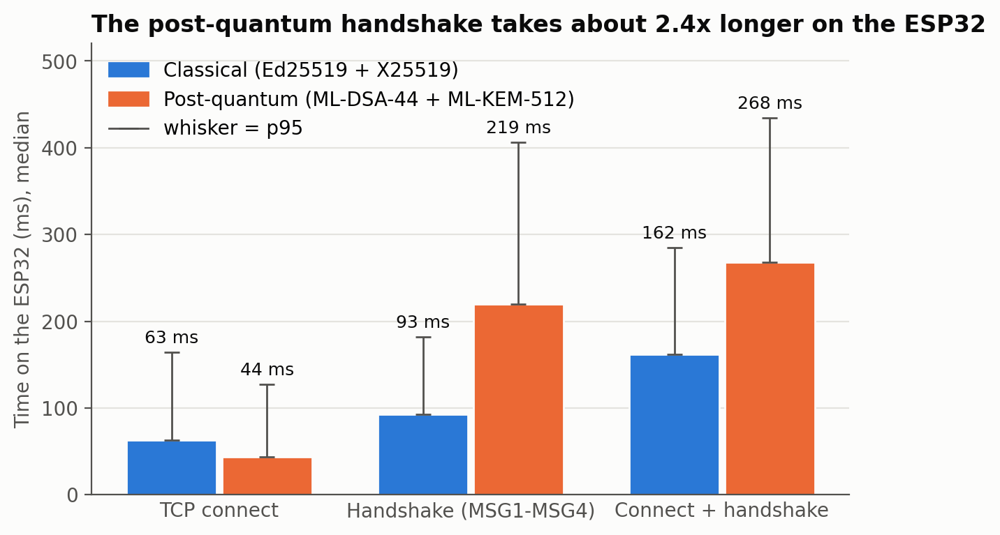
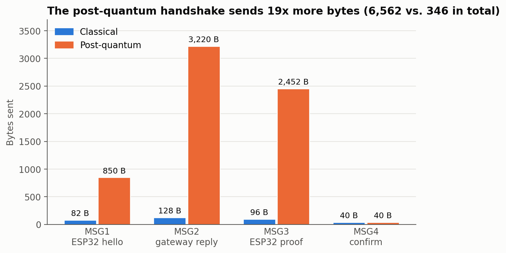
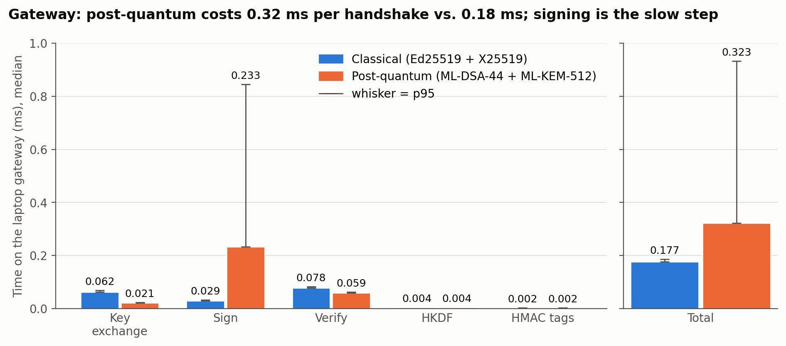
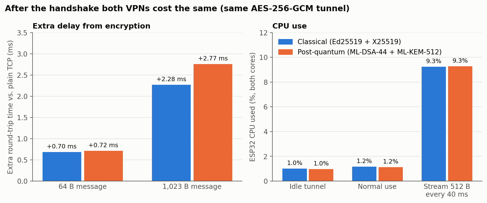
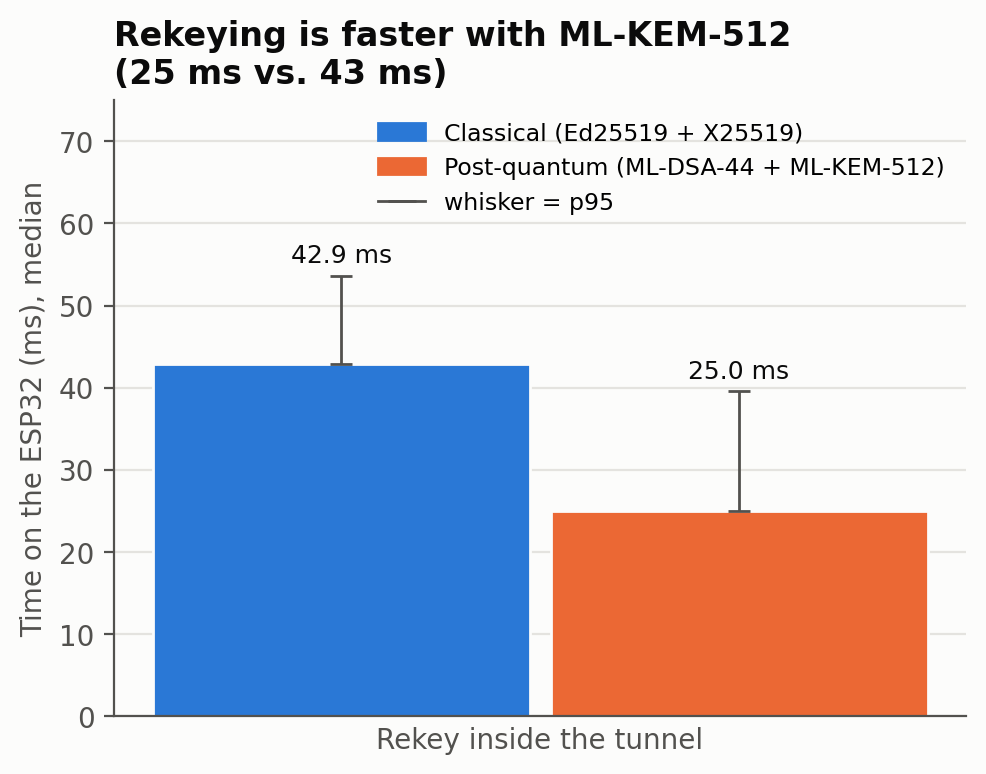
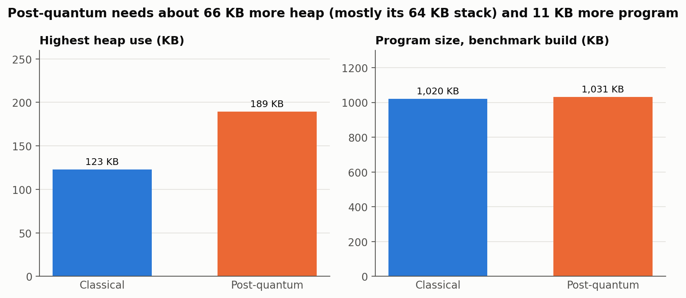
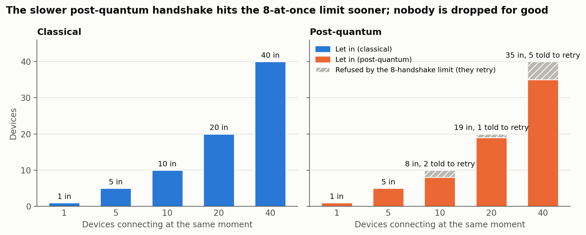
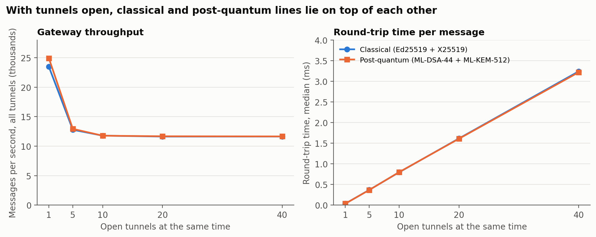

# Whole-VPN Benchmark: Classical vs. Post-Quantum

The other benchmarks in this repository time **one algorithm at a time** (sign, verify, key exchange). This one tests the **finished VPN**:
* does every algorithm give correct results,
* how long the handshake takes,
* how much the encryption slows messages down,
* how much data can be sent,
* how long rekeying takes,
* how much CPU and memory the ESP32 uses,
* how many devices the gateway can handle.

Both VPNs are tested with exactly the same code, so their results can be compared directly.

The same files are in [`Non_PQC_VPN/benchmarking/system_benchmark/`](../../../Non_PQC_VPN/benchmarking/system_benchmark/) and [`PQC_VPN/benchmarking/system_benchmark/`](../../../PQC_VPN/benchmarking/system_benchmark/). The scripts find out by themselves which VPN they belong to. `compare_gateway_crypto.py` and `reference_cross_check.py` are only in `PQC_VPN/`.

The benchmark has four parts:

| Part | What it does | Where it runs | Status |
|---|---|---|---|
| **A** | Tests the VPN on a real ESP32 over real Wi-Fi (tests B0-B7) | ESP32 + laptop | Done (classical: 2 runs, post-quantum: 1 run) |
| **B** | Tests the gateway with many simulated ESP32s (tests L0-L6) | Laptop | Done |
| **C** | Compares the gateway's crypto cost fairly, classical vs. post-quantum | Laptop | Done |
| **D** | Checks our post-quantum libraries against two independent implementations, with 1,000 random inputs | Laptop | Done: 9,000 / 9,000 identical |

---

## Part A: on the ESP32 (tests B0-B7)

| Test | What it measures | How |
|---|---|---|
| B0 | Does every algorithm give correct results? | Known-answer tests (see below) |
| B1 | How long AES-256-GCM takes per message (64, 256 and 1,023 bytes) | 200 runs each, no network. Also given in ms per KB |
| B2 | How long the handshake takes, and how many bytes it sends | 100 handshakes over Wi-Fi: first the TCP connection, then messages 1-4 |
| B3 | How much delay the VPN adds | 200 pairs per size: a plain message (no VPN) and a VPN message, **one after the other**, so changes in the Wi-Fi affect both the same way |
| B4a | The most data the VPN can send | 30 s of 1,023-byte messages, with up to 8 on the way at once. Only data the gateway confirmed is counted |
| B4b | Whether the VPN keeps up with a steady stream | 30 s of 512 bytes every 40 ms (102.4 kbps), sent on time no matter what. We check how much arrives and how long the replies take |
| B5 | How long a rekey takes | 20 rekeys, from the request until the new keys are in use |
| B6 | How busy the ESP32's CPU is | How much of the time **both cores** are idle (this counts our code *and* the Wi-Fi work). Three cases: connected but quiet (20 s), normal use with one ping every 1.5 s (20 s), and the steady stream from B4b |
| B7 | Memory and flash | Most heap memory used, free heap, unused stack, program size |

**For every time we give the number of samples, mean, median, 95th percentile (p95), spread, minimum and maximum.** The p95 is the time that 95% of the cases are faster than. On a network, the slow cases matter as much as the normal ones.

While measuring, the ESP32 does not print its normal handshake tables. Printing several KB at 115,200 baud takes hundreds of milliseconds and would make every handshake look slower. In the CPU test, the benchmark sleeps while waiting instead of looping, so waiting does not count as CPU work.

### How to run it (about 10 minutes per VPN)
1. On the laptop, start the gateway in benchmark mode. This also starts a plain (no VPN) echo server, used to compare against:
   ```bash
   cd PQC_VPN          # or Non_PQC_VPN
   python3 benchmarking/system_benchmark/gateway_benchmark.py --serve
   ```
   For `PQC_VPN`, build the libraries first with `laptop_server/build_native_libs.sh`.
2. In `esp32_client/config.h`, set `#define BENCHMARK_MODE 1`. Also check `WIFI_SSID`, `WIFI_PASSWORD` and `GATEWAY_IP`. The board must be in `authorized_devices.json`.
3. Upload, open the Serial Monitor at 115200 baud, and wait for **BENCHMARK COMPLETE**. Keep the board in the same place for both VPNs, because the Wi-Fi affects B2-B4.
4. Copy all lines that start with `BENCH,` into `results/esp32_results.csv`. The first `BENCH,` line is the header.
5. Set `BENCHMARK_MODE` back to `0` and upload again for normal use.

### Results (ESP32-D0WD at 240 MHz, Wi-Fi from a Redmi 13C phone hotspot; the ESP32 and the laptop both connect to it)

| Test | What | Classical | Post-quantum | Post-quantum vs. classical |
|---|---|---|---|---|
| B0 | Known-answer tests passed | **9 / 9** | **13 / 13** | both correct |
| B1 | AES-256-GCM encrypt + decrypt, 1,023 bytes | 1.21 ms per KB | 1.21 ms per KB | same (same code) |
| B2 | Handshake, messages 1-4: median / p95 | 92.7 / 181.6 ms | **219.3 / 406.4 ms** | **2.4 times longer** |
| B2 | Failed handshakes | 0 / 100 | 0 / 100 | same |
| B2 | Bytes sent for one handshake | 346 bytes | **6,562 bytes** | **19 times more** |
| B3 | Extra delay from the VPN (median): 64 B / 1,023 B | +0.7 / +2.3 ms | +0.7 / +2.8 ms | about the same |
| B4a | Most data the VPN can send | 1,119 kbps | 788 kbps | see note below |
| B4b | Delivered when 102.4 kbps is sent | 102.4 kbps, 750 / 750 | 102.4 kbps, 750 / 750 | same |
| B4b | Reply time during the stream: median / p95 | 14.7 / 84.8 ms | 13.9 / 131.4 ms | same median |
| B5 | Rekey time: median / p95 | 42.9 / 53.6 ms | **25.0 / 39.6 ms** | **post-quantum is faster** |
| B6 | CPU use: quiet / normal use / 102 kbps stream | 1.0% / 1.2% / 9.3% | 1.0% / 1.2% / 9.3% | same |
| B7 | Most heap used | 126 KB | **194 KB** | +68 KB (mostly the 64 KB task stack) |
| B7 | Stack never used | 3.3 KB of 8 KB | 49.3 KB of 64 KB | |
| B7 | Program size (normal build) | 1,029 KB | 1,039 KB | +10 KB |

The raw data is in `Non_PQC_VPN/benchmarking/system_benchmark/results/esp32_results.csv` (classical) and `PQC_VPN/benchmarking/system_benchmark/results/esp32_results.csv` (post-quantum). An earlier classical run is kept in `esp32_results_run1.csv`.

**What the results show:**
* **Post-quantum makes the handshake 2.4 times longer: 219 ms instead of 93 ms.** Two reasons: the ESP32 has to sign with ML-DSA-44, which is slower than Ed25519 and sometimes has to try again, and the handshake sends 6,562 bytes instead of 346, which takes longer over Wi-Fi. A connection is made once and then kept, so a quarter of a second is fine for an IoT device.
* **After the handshake, there is no difference.** Both VPNs encrypt with the same AES-256-GCM code, so the extra delay per message (about 1-3 ms), the CPU use (about 1% in normal use) and the steady 102 kbps stream are the same.
* **Rekeying is faster with post-quantum: 25 ms instead of 43 ms.** ML-KEM-512 is faster than X25519 on the ESP32. The laptop tests (Part C) found the same thing.
* **Post-quantum needs more memory:** about 68 KB more heap. Most of it is the 64 KB stack of the task that runs the post-quantum code (ML-DSA-44 needs a big stack). About 89 KB of heap is still free. The program is only 10 KB bigger.
* **The lower top speed in B4a (788 vs. 1,119 kbps) is most likely the Wi-Fi, not the VPN.** Once connected, both VPNs run exactly the same encryption code, and the CPU use was the same. The Wi-Fi was clearly worse during the post-quantum run: the plain messages (no VPN) were slow in the worst 5% of cases (p95 142 ms vs. 30 ms in the classical run). To be sure, run both again one after the other and compare.

**How to read these numbers:**
* **Use medians, not means, for anything that goes over Wi-Fi.** A few messages sometimes get stuck for 100 ms or more, and those pull the mean up. This even made some mean "extra delays" come out *negative*, because the plain messages happened to get more of these delays. The median is the right number: for small messages the VPN costs less than 1 ms, which is less than the normal ups and downs of the Wi-Fi.
* **Compare the handshakes using messages 1-4, not the TCP connection time.** The test has to wait 2.2 seconds between handshakes, because the gateway allows only 5 connections per device every 10 seconds. During that pause, the phone hotspot turns its radio down to save power, and the next connection has to wait for it to wake up. A normal Wi-Fi router gives steadier numbers.
* **Reply times during the stream include rekeys.** While a rekey runs, the messages due in that time wait and then go out together. The p95 shows these moments; the median is the normal case.

**The two classical runs agree,** which shows the results are repeatable:

| | Classical run 1 | Classical run 2 (above) |
|---|---|---|
| Handshake, messages 1-4 (median) | 88.7 ms | 92.7 ms |
| AES-256-GCM per KB | 1.22 ms | 1.21 ms |
| Extra delay, 1,023 B (median) | +2.6 ms | +2.3 ms |
| Most data the VPN can send | 1,208 kbps | 1,119 kbps |
| CPU: quiet / normal / stream | 1.0 / 1.2 / 9.1 % | 1.0 / 1.2 / 9.3 % |

(Run 1 used an earlier version of the benchmark, so its B4b reply times and B5 rekey time are not compared.)

---

## Known-answer tests (B0 on the ESP32, L0 on the laptop)

A known-answer test runs an algorithm on **fixed inputs** and compares the result with a value that someone else published or calculated. If even one byte is different, something is wrong. This catches mistakes that a test like "sign something, then verify my own signature" would miss, because a broken implementation always agrees with itself.

| Algorithm | Used for | Checked against | Classical | Post-quantum |
|---|---|---|:-:|:-:|
| SHA-256 | Hashing the handshake | FIPS 180-4 example ("abc") | ✓ | ✓ |
| HMAC-SHA256 | Confirming the keys, making keys | RFC 4231 test case 2 | ✓ | ✓ |
| AES-256-GCM | Encrypting messages | NIST GCM test case 16, plus one changed bit must be caught | ✓ | ✓ |
| Ed25519 | Proving who you are | RFC 8032 section 7.1, test 1 (make key, sign, verify, changed signature caught) | ✓ | |
| X25519 | Key exchange and rekeying | RFC 7748 section 5.2, vector 1 | ✓ | |
| ML-KEM-512 | Key exchange and rekeying | kyber-py 1.2.0 (FIPS 203): make key, encapsulate, decapsulate, broken ciphertext | | ✓ |
| ML-DSA-44 | Proving who you are | dilithium-py 1.5.1 (FIPS 204): make key, fixed signature, verify, changed signature caught | | ✓ |

ML-KEM-512 and ML-DSA-44 are the algorithms this project is about. Their expected values come from **kyber-py** and **dilithium-py**, which are separate implementations of the NIST standards, written in Python by other people. We ran them with fixed inputs (ML-KEM: d = 0x00-0x1F, z = 0x20-0x3F, m = 0x40-0x5F; ML-DSA: seed = 0x00-0x1F, message = 0x60-0x7F, no context, fixed signing).

On the ESP32, encapsulation and signing use random numbers, so they can't be compared byte for byte. The ESP32 therefore checks:
* making keys from a fixed seed,
* opening the reference ciphertext,
* verifying the reference signature,
* a round trip with its own random encapsulation and signing.

The laptop also compares the fixed (non-random) encapsulation and signing byte for byte.

### Part D: testing with many random inputs
One fixed input can miss a mistake that only shows up for some inputs. So `reference_cross_check.py` runs **1,000 tests with random inputs** (random seeds, messages from 0 to 256 bytes, contexts from 0 to 32 bytes). In each test, our libraries and the reference programs must give exactly the same:
* keys,
* ciphertext,
* shared secret,
* answer for a broken ciphertext,
* fixed signature.

Each side must also accept the other side's signatures (including the random signatures the VPN really uses), and both must reject a changed signature.

**Result: 9,000 / 9,000 checks identical** (1,000 tests, random seed 2030312455, saved in `results/reference_cross_check.txt`).
```bash
pip install kyber-py dilithium-py        # only the first time
python3 benchmarking/system_benchmark/reference_cross_check.py --trials 1000
```

---

## Part B: the gateway on the laptop (tests L0-L6)

```bash
python3 benchmarking/system_benchmark/gateway_benchmark.py     # about 2 minutes; saved in results/laptop_gateway_results.csv
```

| Test | What it measures |
|---|---|
| L0 | The known-answer tests above, on the laptop, plus one encrypted message and one changed message |
| L1 | The gateway's crypto work per handshake, step by step (500 timed runs, after 50 warm-up runs) |
| L2 | Gateway encrypt and decrypt time per message (2,000 timed runs, after warm-up) |
| L3 | A full handshake between the real gateway and a simulated ESP32 on the same laptop (100 runs) |
| L4 | A rekey on the same laptop (20 rekeys) |
| L5 | 1, 5, 10, 20 or 40 devices connecting at exactly the same moment: how many get in, and how long it takes |
| L6 | 1 to 40 connected devices, all sending 64-byte messages as fast as the replies come back (5 s each). The simulated devices run as **separate programs**, so their own work does not slow down the gateway |

Each simulated device uses its own address (`127.0.0.x`, Linux only), like separate ESP32s on Wi-Fi.

### Results (HP Victus 15, 12 CPU threads, Python 3.12, plugged in, Performance power mode)

| Test | What | Classical (`Non_PQC_VPN`) | Post-quantum (`PQC_VPN`) |
|---|---|---|---|
| L0 | Known-answer tests | 8 / 8 PASS | 12 / 12 PASS |
| L2 | AES-256-GCM encrypt + decrypt, 1,023-byte message (median) | 0.0147 ms | 0.0143 ms |
| L3 | Full handshake on the laptop: median / p95 | 1.17 / 1.30 ms | 2.19 / 3.31 ms |
| L3 | Bytes sent for one handshake | 346 bytes | 6,562 bytes |
| L4 | Rekey on the laptop: median / p95 | 0.44 / 0.48 ms | 0.15 / 0.34 ms |
| L5 | 10 devices connecting at the same moment: let in / refused (limit: 8 handshakes at a time) | 10 / 0 | 8 / 2 |
| L5 | 20 devices connecting at the same moment: let in / refused (limit: 8 handshakes at a time) | 20 / 0 | 19 / 1 |
| L5 | 40 devices connecting at the same moment: let in / refused (limit: 8 handshakes at a time) | 40 / 0 | 35 / 5 |
| L6 | 1 connected device(s): messages per second in total, reply time median / p95 | 23,475 msg/s, 0.04 / 0.06 ms | 24,915 msg/s, 0.04 / 0.05 ms |
| L6 | 10 connected device(s): messages per second in total, reply time median / p95 | 11,778 msg/s, 0.80 / 1.49 ms | 11,773 msg/s, 0.80 / 1.50 ms |
| L6 | 40 connected device(s): messages per second in total, reply time median / p95 | 11,633 msg/s, 3.24 / 6.24 ms | 11,651 msg/s, 3.22 / 6.26 ms |
| L6 | Devices dropped or unable to connect (40 devices) | 0 | 0 |

**What this shows:**
* The AES-GCM encryption (L2) is the same code in both VPNs, and it now measures the same in both runs (about 0.015 ms per 1 KB message). This means the laptop gave stable numbers this time.
* A handshake on the laptop takes about 2 times longer with post-quantum (L3), and sends 19 times more bytes.
* With 40 devices connecting at exactly the same moment, the classical gateway lets them all in, while the post-quantum gateway refuses a few, because its handshakes take longer and the limit of 8 handshakes at a time is reached sooner (L5). Refused devices simply try again.
* After the handshake both VPNs are the same: the same number of messages per second and the same reply times (L6). One device can send about 23,000-25,000 messages per second through the gateway on this laptop; with 40 devices the total is about 11,600 per second, and no device was ever dropped.

---

## Part C: a fair comparison of the gateway's crypto cost

```bash
python3 benchmarking/system_benchmark/compare_gateway_crypto.py --rounds 6     # PQC_VPN only; about 1 minute
```
This script measures the classical and the post-quantum gateway **taking turns** (classical, post-quantum, post-quantum, classical, and so on) for 6 rounds, then takes the median. Because they take turns, both see the same laptop conditions. In round 1, for example, the laptop was slow for both, and that does not affect the result.

| Operation | Classical (Ed25519 + X25519) | Post-quantum (ML-DSA-44 + ML-KEM-512) | PQC / classical |
|---|---|---|---|
| Key exchange | 0.062 ms (p95 0.069) | 0.021 ms (p95 0.023) | 0.34x |
| Sign gateway transcript | 0.029 ms (p95 0.032) | 0.233 ms (p95 0.845) | 7.96x |
| Verify device signature | 0.078 ms (p95 0.083) | 0.059 ms (p95 0.062) | 0.76x |
| HKDF session keys | 0.004 ms (p95 0.004) | 0.004 ms (p95 0.004) | 1.00x |
| Two HMAC confirmation tags | 0.002 ms (p95 0.003) | 0.002 ms (p95 0.003) | 0.99x |
| TOTAL gateway crypto | 0.177 ms (p95 0.186) | 0.323 ms (p95 0.932) | 1.82x |

Between rounds, the total changed by only 1% (classical) and 15% (post-quantum, because ML-DSA signing time varies). An earlier run on battery gave almost the same ratios (1.98 times in total, 8.5 times for signing), so the result does not depend on the laptop's power mode.

### What these numbers mean
* **Post-quantum costs the gateway about 1.8 times the crypto work per handshake**, about 0.15 ms more. Almost all of it is **ML-DSA-44 signing**: 8 times Ed25519 normally, and about 26 times in the slowest 5% of cases. ML-DSA sometimes has to throw a signature away and try again, which makes some signatures much slower than others.
* **ML-KEM-512 is faster than X25519** (0.34 times the time), and **ML-DSA-44 checks signatures faster than Ed25519** (0.76 times). The post-quantum key exchange itself is not the expensive part.
* **The real cost of post-quantum is size, not computing time:** one handshake is 6,562 bytes instead of 346 (19 times more). On Wi-Fi this matters much more than a fraction of a millisecond on the gateway: on the ESP32 (B2) the handshake took 219 ms instead of 93 ms.
* **After the handshake, both VPNs are the same.** Both encrypt with AES-256-GCM, so the cost per message, the number of messages per second and the delay do not depend on classical vs. post-quantum.
* **Many devices at the same moment:** with 10-40 devices connecting at exactly the same time, some are refused, because the gateway only allows 8 handshakes at the same time (to protect itself from floods). This happens more with post-quantum, because its handshakes take longer. A refused device tries again after 3 s, 6 s, 12 s, and so on. In L6, every device got connected this way.
* **One device on its own is also limited by the rekey rules:** at most 2,000 messages with one key and one rekey every 5 seconds, which is about 400 messages per second per device. This is on purpose, and far more than an ESP32 sends. L6 switches this limit off, because it is testing the gateway.

**For reliable laptop numbers:** plug the laptop in and set the power mode to **Performance**, as was done for the results above.

---

## Graphs

All graphs are made by `make_graphs.py` (in `PQC_VPN/benchmarking/system_benchmark/`) from the result files above. Blue is always classical and orange is always post-quantum.

### Handshake time on the ESP32 (B2)


Bars are the median, the line on top is the p95. The post-quantum handshake takes 219 ms instead of 93 ms.

### Bytes sent in the handshake


Messages 2 and 3 carry the ML-DSA-44 public key and signature and the ML-KEM-512 key, which is why they are so much bigger.

### Gateway crypto per handshake, step by step (Part C)


ML-KEM-512 and ML-DSA-44 verify are faster than X25519 and Ed25519. Only ML-DSA-44 signing is slower, and it also changes the most from run to run.

### After the handshake: extra delay and CPU use (B3, B6)


Both VPNs use the same AES-256-GCM tunnel, so these bars are almost the same.

### Rekey time on the ESP32 (B5)


A rekey only swaps a new key exchange (no signatures), and ML-KEM-512 is faster than X25519 on the ESP32.

### Memory on the ESP32 (B7)


Most of the extra heap is the 64 KB stack of the task that runs the post-quantum handshake.

### Many devices connecting at the same moment (L5)


Grey devices were told "busy, try again" by the limit of 8 handshakes at once. They are not blocked; they connect on their next try.

### Many tunnels open at the same time (L6)


Once connected, the two VPNs behave the same. No session was dropped in any test.

---

## Files
* [`benchmark_report.pdf`](benchmark_report.pdf) (PQC_VPN only): the full report, with every result, all graphs, what each measurement means and where the code is.
* `gateway_benchmark.py`: the laptop tests (Part B), `--serve` mode for the ESP32 tests (Part A), and `--l1-json` for Part C.
* `compare_gateway_crypto.py` (PQC_VPN only): the fair classical vs. post-quantum comparison (Part C).
* `reference_cross_check.py` (PQC_VPN only): the 1,000 random tests against kyber-py and dilithium-py (Part D).
* `results/laptop_gateway_results.csv`: Part B results (id, metric, n, mean, median, p95, std, min, max, unit).
* `results/esp32_results.csv`: Part A results (`esp32_results_run1.csv`: an earlier classical run).
* `make_graphs.py` (PQC_VPN only): makes the graphs in `results/graphs/` from the result files. Run `python3 make_graphs.py`.
* `results/gateway_crypto_comparison.md` and `results/reference_cross_check.txt` (PQC_VPN only): Parts C and D.
* `../../esp32_client/SystemBenchmark.*`, `KnownAnswerTests.*`, `VpnLog.*`: the ESP32 side of the benchmark (Part A).
